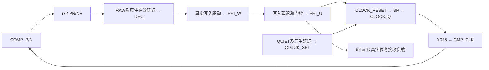

# 下一步：恢复原生完成反馈的比较器测试台

**仅为方案，尚未建包、仿真或批准为基线。** 先验证小输入能否通过真实接收、写入和复位路径完成连续判决，再讨论尺寸。保持N4/rx2、供电、器件和原生RC延时不变，不借用大输入时的固定时钟高宽。

## 一个测试台与明确边界

源网表为 `output/managed_execution/runs/sar8fix-loaded-both-rx2-tt/inputs/dut.scs`，SHA256：
`c10982b40a9cf4a8aa861852f454b2a26e45ca0988fecd9a26f83c617887cd36`。
沿用该源的模型节、TT、0.9V、27°C和已披露数值设置。

| 部分 | 保留内容与理由 |
| --- | --- |
| 比较器 | 原生 `XCOMP/sar_strongarm_t28`，11MOS；不改模型或尺寸。 |
| 完成和时钟反馈 | **完整** `sar8i_ctrl`，772MOS：包括154MOS的 `sar8p_timing`、194MOS的8位token链、368MOS的8组寄存器和56MOS的ACTIVE树。恢复 `X025` 真实时钟驱动及其两个输出漏端。 |
| 比较器输出/时钟负载 | 原生 `CL_COMP_P`、`CL_COMP_N`、`CL_CMP_CLK` 三个MOM，以及两路rx2的实际输入、PR/NR后级扇出。保留8位DATA/PHI_W寄存器负载，不能缩成单个观测反相器。 |
| 输入源 | 原版18个flat-CDAC MOM（每侧256单位），底板仍固定理想参考；初始临时导通电导关闭后TOPP/N浮置。先用保持的+0.25LSB输入，不在两次判决间重新钳位。 |
| 数字输出负载 | 原整机每个D0–D7的5fF `COUT`，以及下述参考接收岛的实际D/CODE输入负载。只接5fF不能代表全部后级负载。 |
| 外部激励 | 只在声明的外部SAMPLE/初始化端口给启动激励；CMP_CLK、DEC、PHI_W、PHI_U、token、ACTIVE均由原生电路产生。原整机采样窗口和关闭沿不改。 |

单臂核心共 **783MOS**，不是783MOS就已闭合了全部真实负载。原D2每臂467MOS切掉了时钟反馈、token与ACTIVE路径，不能只把理想时钟源删掉就称为自定时测试台。

控制器SAMPLE端在整机连接的是 `SAMPLE_INT`。本模块台的启动激励必须声明在这个边界给定，不能将理想启动当作已经验证了整机外部SAMPLE、参考预置和RST_DONE之间的启动握手；后者仍属于控制/参考模块的接口验证。

### PHI_U接口：必须补齐的真实负载

同一原生网表中，PHI_U除控制器内部负载外，还连接参考字接收端的 **36个MOS栅端**：

- `XREF.X000` 缓冲器输入：2个栅端。
- `XREF.XREQUEST.X001` SR置位输入：2个栅端。
- `XREF.XMUX0…7`：每组4个栅端，共32个。

保留这些接收功能所需的首组完整单元是 `X000`（4MOS）、`XREQUEST`（14MOS）和8个mux（112MOS），合计130MOS；**它们不是完整负载岛**。`FIRST0`后续缓冲、请求/ACK/捕获时钟链、`TARGET`的8个真实捕获寄存器和Q端后级负载不能消失。方案采用同源原生接收/捕获岛，封装前先列出逐节点输出扇出和切口；需要保留的下一级真实器件必须连回，不能以任意电容或理想电压代替。

目前只核对到783MOS核心和130MOS首组接收单元这个**下界**，没有宣称913MOS是完整测试台。完整 `sar8i_refword` 本身为942MOS；不为图省事直接接入整套参考功率驱动来掩盖接口问题。最终接收岛尺寸和输出负载清单是提包前置条件，尚未冻结。

## 恢复的反馈是什么

保留原门控：WRITE_REQ受DEC、CMP_CLK和非SAMPLE共同控制；PHI_U由PHI_W及真实写入延迟产生；CLOCK_RESET由SAMPLE或PHI_U产生；QUIET路径经原生延迟再置位下一次比较。**不新增** `abs(COMP_P−COMP_N)>0.45V` 的DONE检测器，也不以timer强制关断。

PHI_U是更新事件，不是模拟参考建立完成的回报；QUIET的RC延时也不测量CDAC是否建立。因此该测试台验证的是比较器/接收/复位反馈，在固定底板下不能证明真实SAR位切换已经有足够建立时间。

## 最小验证与判读

第一项只做单臂TT、保持+0.25LSB、一个原生8位token序列，至少完整观察前两次自然判决和复位；不做尺寸、时钟或PVT扫描。不能由理想源安排第二次CMP_CLK来预先决定恢复间隔。

1. 同时保存COMP_P/N、内部X/Y、PR/NR、RAW/RAW_D/DEC、DATA、PHI_W、PHI_U、CLOCK_RESET/CLOCK_Q、QUIET/QUIET_D、CMP_CLK及token。按**真实接收/写入事件**判定完成，0.45V线仅辅助读图。
2. 逐轮检查一次有效写入对应一次更新和复位，写入极性正确、无缺失/重复/窗口外写入。由token定位正在写入哪一位；不能沿用旧台“只看D0”的方法。
3. 在下一次真实比较前测量COMP_P/N、X/Y预充、PR/NR与RAW/DEC返回状态，以及TOP差模/共模残留。输出高于0.9VDD仅是复位观测条件，不是已经分配的电路裕量。
4. 保留输入栅电流、MOM电流及TOP节点KCL；报告反冲发生在写入前、复位沿还是恢复期。新增反馈/负载器件需要重新覆盖端间电压检查，旧228项筛查不能外推。
5. 原生日志、接受步数和明确save列表必须一致；不使用allpub。下一包仍走主聊天的managed流程，先确定实际器件数与保存量，再定资源预算。

验收首先是链路事实成立：小输入完成接收/正确写入，然后实际反馈复位，下一次比较前恢复可测、无虚假完成。比较器噪声/失配、kickback预算、真实CDAC更新、完整输入共模范围及PVT仍未覆盖；不从此台宣布8bit整机合格。
