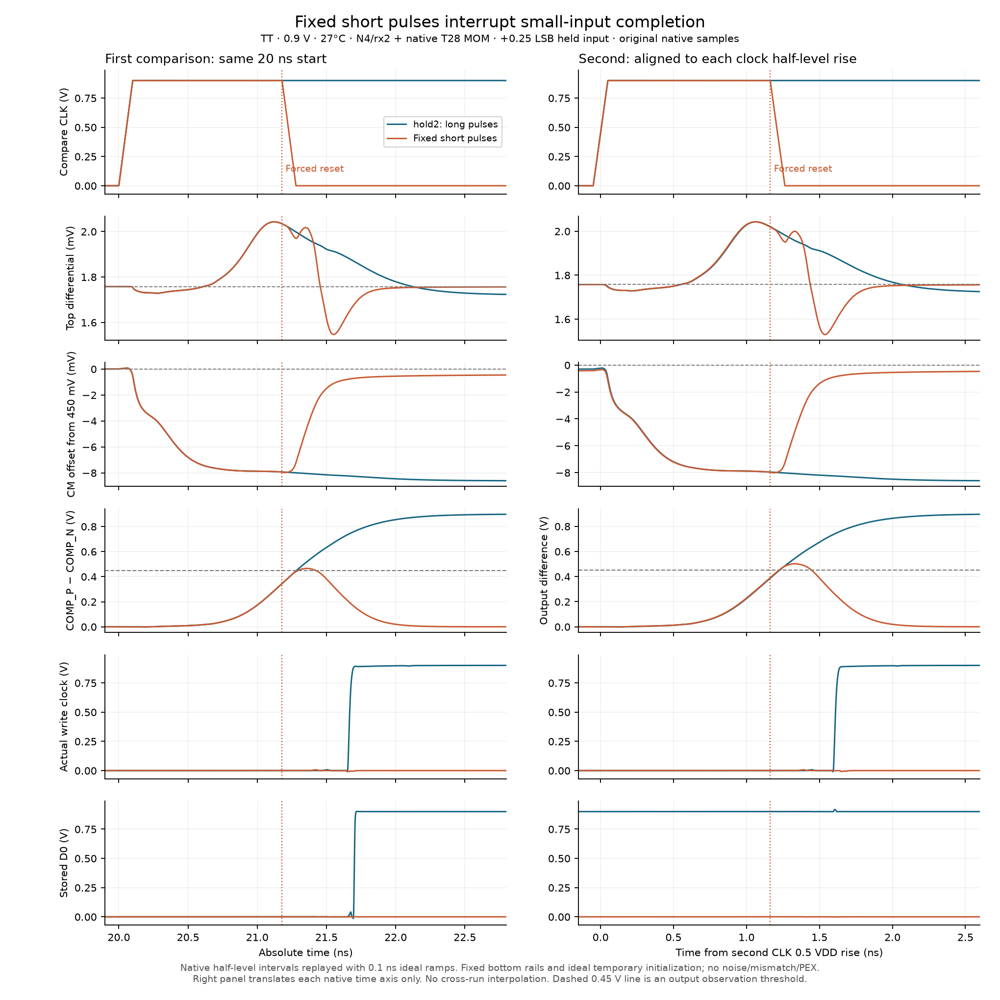

# 固定短脉冲：不是两次有效SAR转换

actual TT原生仿真与分析完成，但首两轮小输入均 **没有复位前写入**；后四轮长窗对照正确。
这说明借来的固定短脉冲不适合当前小输入完成路径，不能归因于真实异步逻辑失效。

| 观测 | hold2长脉冲 | actual固定短脉冲 |
| --- | ---: | ---: |
| 两次比较起点间隔 | 40ns | 3.955843ns |
| CLK半电平高宽 | 12ns / 12ns | 1.179357ns / 1.212701ns |
| 从CLK半电平上升到复位沿开始 | 11.95ns / 11.95ns | 1.129357ns / 1.162701ns |
| 复位前输出差观测条件 | 两轮均达到 | 两轮均未达到 |
| 复位前最大输出差 | 达到0.45V | 0.343V / 0.391V |
| 前两轮写入数 | 1 / 1 | 0 / 0 |
| 第二轮前差模 | 1.757607mV | 1.756938mV |
| 第二轮前目标差模残差 | -0.206µV | -0.874µV |
| 第二轮前共模 | 449.700415mV | 449.582184mV |

在hold2中，从CLK半电平上升到小输入接收写入约需1.61ns。actual在同一时间基准下，
约1.13/1.16ns就开始复位；此时本次0.45V输出差观测条件尚未满足，实际PHI_W也没有上升。
0.45V是分析用观测线，不是接收器的真实门限或电路中的完成反馈条件。
D0保留旧0，不应记为“成功写入了错误0”。没有窗口外写入，后四轮长窗写入均正确。

时钟间隔来自冻结N4/rx2整机TT第2帧bit6→bit5，当时约−362/−138mV的输入可更快完成。
完整异步电路原本由真实完成事件决定何时复位；本实验切断该反馈，固定重放脉冲。
因此实验暴露的是 **固定脉冲和小输入完成时间不匹配**，不是观察到整机异步控制主动提前复位。

首轮没有完成有效写入，所以第二轮前−0.874µV差模残差、449.582mV共模只描述
**中断求值后的恢复轨迹**。高宽和恢复间隔都变了，不能把与hold2的差异单独归为reset间隔效应，
也不能称为一次成功SAR决策后的保持误差。

## 数据和范围

10文件、10,970,767B的回收SHA及原生压缩/解压波形均复核；93,208点对应93,207个接受步，
完整覆盖260ns。保存36条电压、45条电流。原生0 errors、7 warnings保留；
228个N4/rx2选定端间检查无超限，不等于全部934个MOS或整机签核。
原生0.5VDD时序间隔仍由0.1ns理想边沿重放，底板/参考固定理想，初始化后输入浮置。
没有真实CDAC位更新、噪声、失配或版图寄生。

下一项只提出恢复原生完成反馈和接收负载的最小fixture方案，见feedback_fixture_plan.md。
本次未改尺寸、未扫时钟、未准备新包或提交远端。
