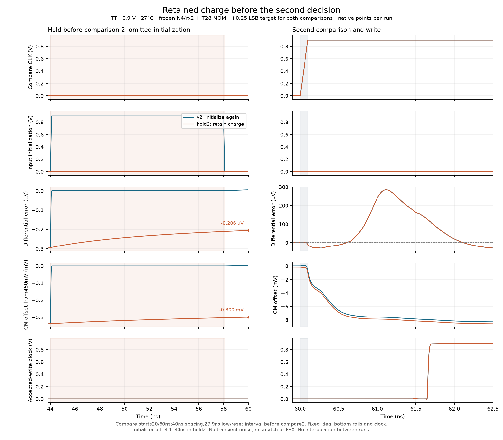

# 第二次比较继续使用保持电荷

取消44–58.1ns的第二次输入初始化后，第二次比较仍正确写入D0。
60ns比较前保留的差模残差为 **-0.206µV**，共模为
**449.700mV**。此前0.348mV复位差模峰值已大幅恢复；仍留下约0.300mV共模偏移。

| 第二次比较 | v2：重新初始化 | hold2：继续保持 |
| --- | ---: | ---: |
| 比较前差模 | 1.757818 mV | 1.757607 mV |
| 相对+0.25LSB目标的差模残差 | +0.005 µV | -0.206 µV |
| 比较前共模 | 450.003183 mV | 449.700415 mV |
| 写入延迟（交点插值记录） | 1.608375 ns | 1.608463 ns |
| DATA / 晚期D0 | 1 / 1 | 1 / 1 |

相对v2，不再初始化使差模改变 **-0.211µV**、共模改变
**-0.303mV**。实际输入仍为正，第二次DATA和晚期D0均为1；
两组各六次比较均只有一次正确写入。写入延迟都约1.608ns，插值差仅
0.087ps；未做数值收敛/统计验证，不据此判断速度变化。

## 时间与物理含义

- 比较器的时钟下降复位保留；取消的是输入重新初始化，不能理解为取消比较器复位。
- hold2在18.1ns断开初始化后持续保持到84ns。32.1–60ns是第一次复位/保持，
  60–72.1ns包含第二次比较，72.1–84ns是第二次复位/保持。
- 两次比较开始相隔 **40ns**；第一次时钟落稳到下一次比较有 **27.9ns**。
  本次证明的是这一较长恢复时间下的两次同极性比较，不能证明真实SAR较短bit间隔可接受，
  也不覆盖一帧连续8次比较或更接近零的输入。
- 第一次比较的输入和写入记录在两组中完全一致；差异出现在取消再初始化之后。
  这是电荷历史的单变量对照，不是完整ADC采样链验证。

## 数据与边界

两组完整receipt、原生日志及压缩/解压原生波形SHA均复核。hold2回收10文件、11,907,280B，
100,644个原生点对应100,643个接受步，完整覆盖260ns。保存36条电压和45条电流。
两组原生日志均为0 errors、7 warnings；保留SPECTRE-16881、SFE-3031和PDK/环境提示。
228个N4/rx2选定端压检查均无超限，范围不等于全部934个MOS。

底板/参考、电源、时钟仍理想，输入初始化为临时理想导通支路。未加入真实采样开关关断寄生、
参考动态切换、噪声、失配或版图寄生。上述结果不代表整机合格；acceptance_pass仍为空。

## 唯一后续建议

按已冻结合龙版本的 **实际bit时序与复位间隔**，复现一次不再初始化的连续两次比较，仍保持
固定底板和同一输入条件。先确认真实短间隔下第二次输入残留与判决，再讨论更大范围验证。
目前只提出建议，未新增包或仿真。

完整数值与散列见summary.json；原有v2和hold2输入包均未修改。
