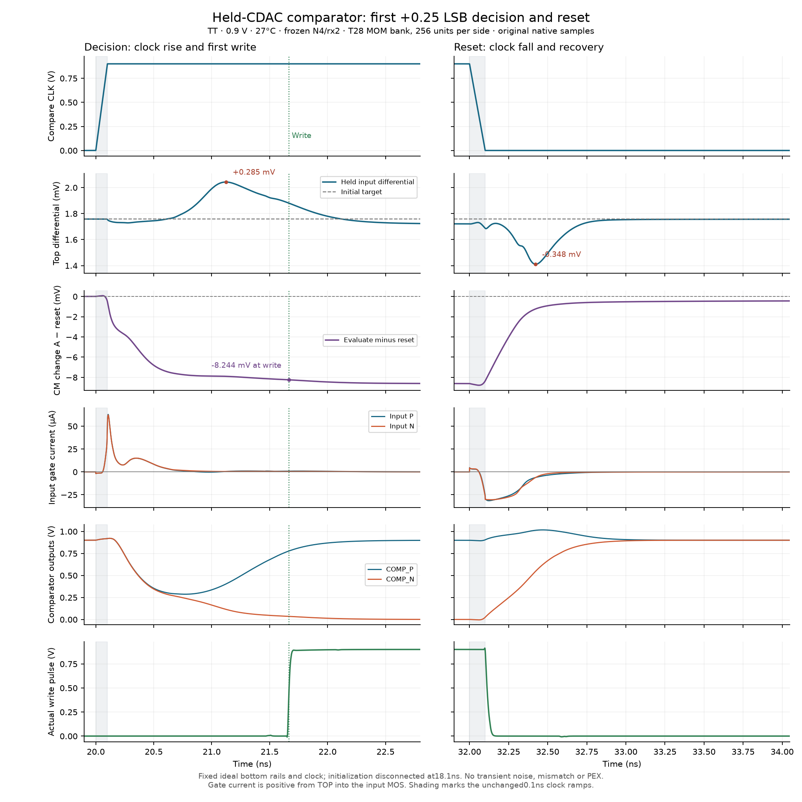

# 比较器接实际 CDAC 电容：TT 结果

六次 ±0.25 LSB 比较均以正确极性写入D0，写入延迟 **1.608–1.616 ns**。
本次确认的是固定底板、理想时钟下的比较器诊断；尚不能据此判定整机合格。

## 结果怎么看

1. **判决期已有反冲。** 写入前差模 A−reset 最大约 **0.285 mV**，
   相当于0.0405 LSB，约为本次1.758mV初始差模的16.2%。首次写入时输入差模约
   1.880mV，仍保持正确极性。
2. **共模下降不是复位后才发生。** 首次写入前共模已下降约
   **-8.244 mV**；复位沿附近最深约−8.781mV，之后逐步恢复。
   两侧输入管从顶板抽取相近电荷，与共模下降一致；总端口电流尚未拆成Cgs/Cgd等内部成分。
3. **复位另有一次差模扰动。** 时钟下降后、下一次初始化前，最大差模 A−reset 约
   **0.348 mV**，大于判决期峰值。它在当前写入之后出现，
   不能直接称为当前码字错误；也不能忽略它对同一采样电荷后续比较的影响。

所有扰动均以各周期比较前的实际电压为基准，减去同一原生时间网格上的始终复位对照臂。
它们是顶板电压扰动，不是自动等效成ADC码字误差、offset或随机噪声。

| 次序 | 比较前差模 (mV) | 写码 | 写入延迟 (ns) |
| --- | ---: | ---: | ---: |
| 1 | +1.758 | 1 | 1.616 |
| 2 | +1.758 | 1 | 1.608 |
| 3 | -1.758 | 0 | 1.616 |
| 4 | +1.758 | 1 | 1.608 |
| 5 | -1.758 | 0 | 1.616 |
| 6 | -1.758 | 0 | 1.615 |

延迟从比较时钟0.5VDD上升交点到实际写入脉冲0.5VDD上升交点。DATA在该估计交点的值
与目标一致，晚期D0也一致；这不构成寄存器setup/hold签核。比较前差模偏离目标最多
小于0.01µV，两臂输入初始化接近一致；这是本次确定性数值检查，不是输入精度规格。

## 可信度与边界

- 10文件、11,855,029B的回收SHA全部复核；100,668个原生点对应100,667个接受步，覆盖0–260ns。
  保存项确认为36条电压、45条电流；v1的忽略保存项/allpub问题消失。
- 四个顶板节点最大KCL残差约51.73pA；
  已核对全时段波形峰值、峰值处11项端电流求和及逐周期输入栅电荷积分。
- 228个N4/rx2选定端压检查无超限，范围不包含全部934个MOS。原生日志仍有7条warning，
  包括SPECTRE-16881初值求解、SFE-3031以及PDK/环境提示；随后完成原生PASS且0 errors。
  图中保留了COMP_P约1.017V的复位过冲；无CMI提示不等于全器件可靠性签核。
- 输入端负载为原始T28 MOM几何和倍率；底板、参考、电源与时钟理想。输入仅在初始化期通过
  理想10Ω支路建立，评估时完全断开。未包含真实参考开关/驱动、采样开关关断寄生、动态底板切换、
  瞬态噪声、失配或版图寄生。

## 下一项单变量验证

建议仅取消两臂 **44–58.1ns那一次重新初始化脉冲**，保持器件、参考、电源、比较时钟、端点
和输入源目标不变。前两次输入本来同为+0.25LSB；第二次比较将直接使用经历过一次比较/复位的
同一份保持电荷。检查第二次比较前残差、共模、码字和延迟，判断本次复位扰动是否带入下一次决策。
这比再次独立初始化更接近SAR一帧内重复比较的电荷历史，仍隔离参考驱动问题。
目前仅提出建议，未准备或提交新仿真。

数值与完整散列见同目录summary.json；原始v2输入包保持冻结。
