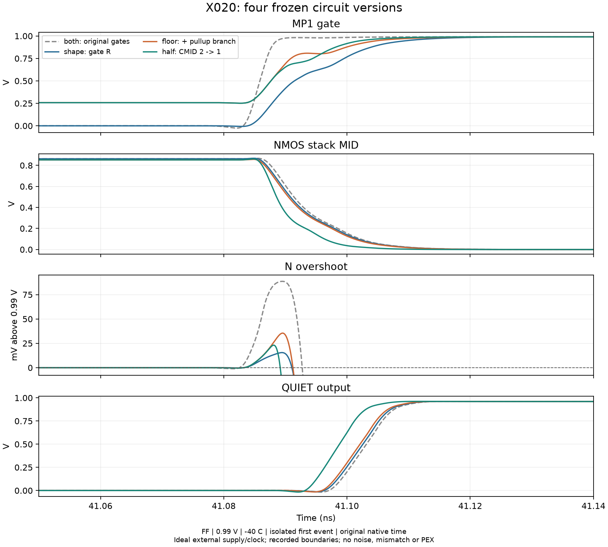
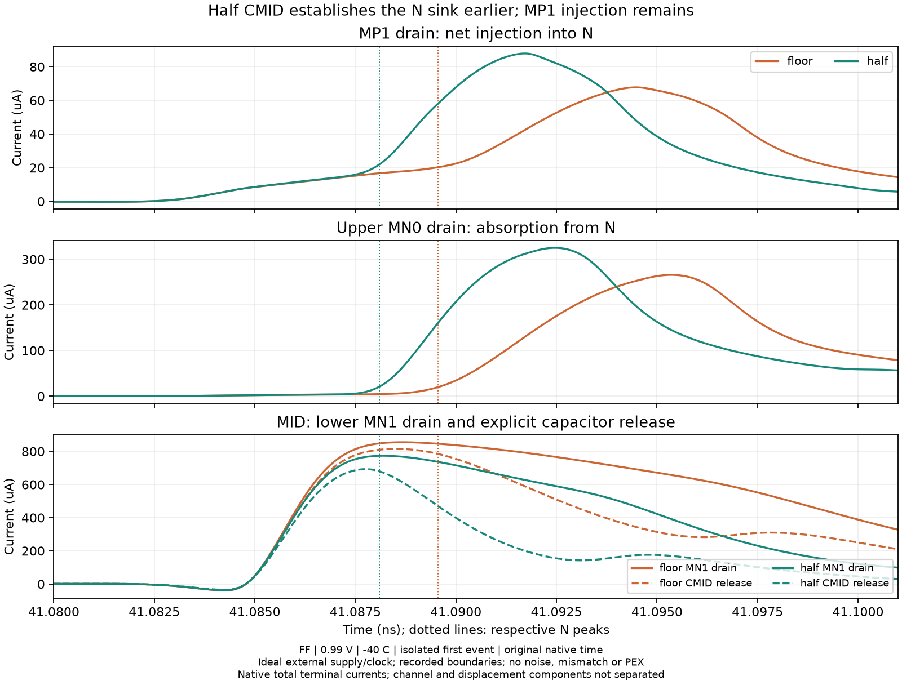
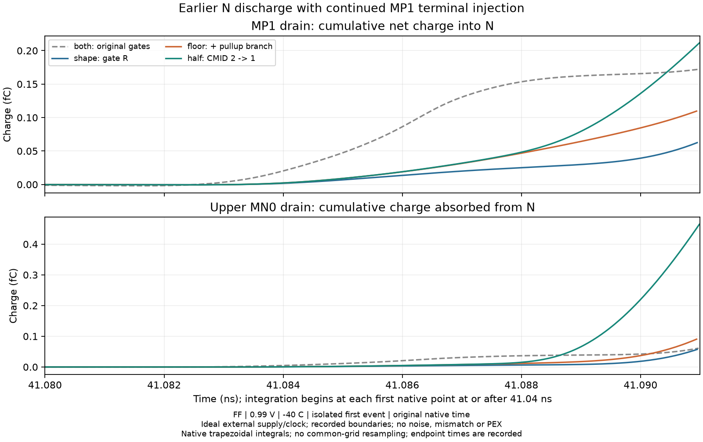

# CMID减半：下拉提前建立，仍有23.1mV过冲

FF、0.99V、−40°C；原整机关闭沿附近的隔离条件负载测试。外部电源/时钟理想，
原生边界记录重放，未含噪声、失配或PEX。四组均为PDK器件网表；未宣称OA同步。
所有图保留原时间轴，没有拟合或时间平移。

| 版本 | 电路差异 | N过冲 | 最大VSG(MP1) | 最大绝对VGD(MP1) | QUIET上升沿 | VDD能量 |
| --- | --- | ---: | ---: | ---: | ---: | ---: |
| both | 恢复真实SN门负载的原栅控 | 88.642mV | 1.015612V | 1.014803V | 41.103091ns | 0.070730pJ |
| shape | 仅MP1栅串一个原PDK电阻 | 15.488mV | 0.997022V | 0.996792V | 41.102522ns | 0.070772pJ |
| floor | shape再加三电阻上拉 | 35.472mV | 0.738497V | 0.989994V | 41.102059ns | 1.084930pJ |
| half | 仅将floor的X020.CMID multi2→1 | 23.105mV | 0.738498V | 0.989995V | 41.098727ns | 1.085184pJ |

端压与能量覆盖同一0–41.590786ns原生历史；只显式联立观察了三项端压。
QUIET在本观察窗内均为一次上升、没有下降。所有N最高值仍超过0.99V，
不能因floor/half的两项MP1栅极端压通过而宣布电路安全。

**减CMID后下拉改善多少？** 相比floor，N过冲降低12.367mV（34.86%）。
MID越过0.495V提前1.953ps；MN0漏端吸收电流达到20µA提前1.483ps、
达到50µA提前1.820ps，QUIET提前3.332ps。
在half的N峰时刻41.088098ns附近，两组各自不晚于该时刻的原生点仅相差
约2fs，MN0从N吸收电流由4.404µA增至20.781µA，约4.72倍。
这比比较各自峰值电流更能说明“提前建立”的收益。

**剩余电荷来自哪里？** half的N达峰时，MP1漏端向N净流入22.010µA；
MN0从N吸收20.781µA，MP0漏端与两只恢复反相器栅极共同吸收剩余约1.228µA。
其峰前41.040745–41.088098ns的端电流积分为：

| 接在N的端口 | 净流入N的端电荷 |
| --- | ---: |
| MP1漏端 | +0.050314fC |
| MP0漏端 | −0.014481fC |
| MN0漏端 | −0.017049fC |
| 恢复反相器PMOS栅端 | −0.009417fC |
| 恢复反相器NMOS栅端 | −0.009367fC |

在这个区间，MP1是唯一净注入支路，其他四个端口净吸收。但这是包含器件储能的
**总端电流**，没有将沟道与Cgd等位移分量分离。五项积分和按KCL接近零，
不能再把它当成“多余的净电荷”，也不能用它反推一个等效误差电容。

half峰前MP1净注入比floor各自峰前的0.075005fC小，主要因为N更早达峰。
请求同一41.04–41.0894ns区间，MP1净注入反而为0.070982→0.098364fC，
MN0净吸收则为0.021677→0.111999fC。因各自原生网格不同，实际结束点为
41.089350ns和41.089385ns；数据中保留了实际端点。结论是下拉更早、更强，
MP1的电荷交换并未被消除。

在half的N达峰时，MID仍为0.5623V，上管MN0的VGS约0.4203V。
下管MN1漏端772.9µA中，CMID向MID释放679.4µA（约87.9%）；MID储能仍在
占用关键早期的放电支路。MID没有先处于低电位，是比继续微调电容更值得处理的
结构问题。该因果推断由单变量响应支持，不等同于已证明换拓扑后所有阶段安全。

**静态代价没有改善。** floor/half初始VDD输出电流均为24.9778µA，
低态输入约13.41mV、B_PM约257.56mV。直流路径为：
`VDD → RPU0/1/2 → B_PM → RSLEW → LIVE下拉驱动 → VSS`。
其中四电阻消耗约24.352µW，初始VDD总输出约24.728µW；shape约0.041µW。
CMID减半不会切断这条路径。表中能量是局部首事件，不能当作完整ADC平均功耗。

下一项建议见 [next_step.md](next_step.md)：优先验证X020的NMOS输入栈次序，
让稳定为高的Q1先将MID拉低，再由LIVE接通靠N的上管。floor保留为诊断条件，
其静态代价仍是未解决项；不给现版本定版，也不再机械扫电容。

本次half回收9文件/2,081,537B，6041个全史原生点、1960个局部点；全部SHA/
尺寸与注册输入核对通过。重点节点KCL最大2.475pA，全部受测节点最大3.956pA。
CMI2751–2755、SFE1131、SPECTRE16780、VACOMP2435均保留；恢复反相器NMOS
VGS最高1.013105V仍超限。原始四组、分析器和输入包均未修改。

重现入口：[review_cmid_half_result.py](../../review_cmid_half_result.py)。
逐组原始数值、积分端点和证据散列见 `comparison.json`。
