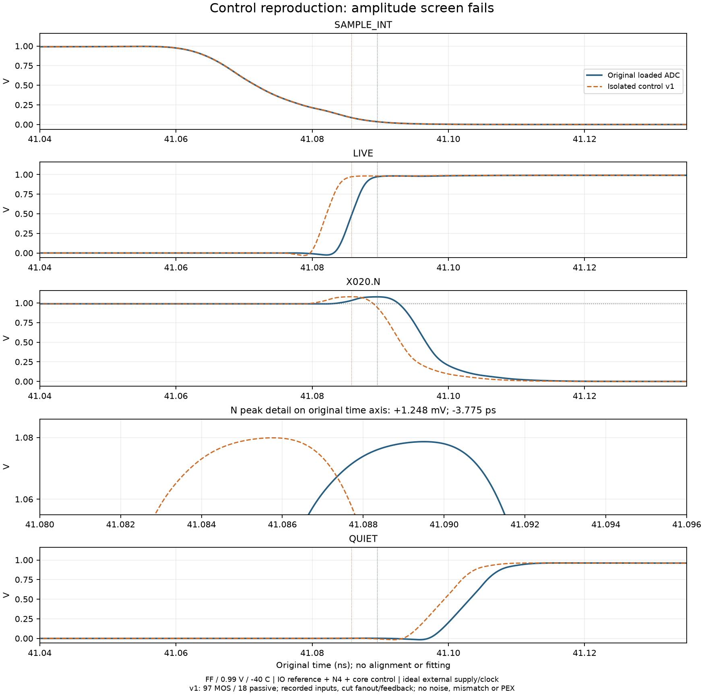
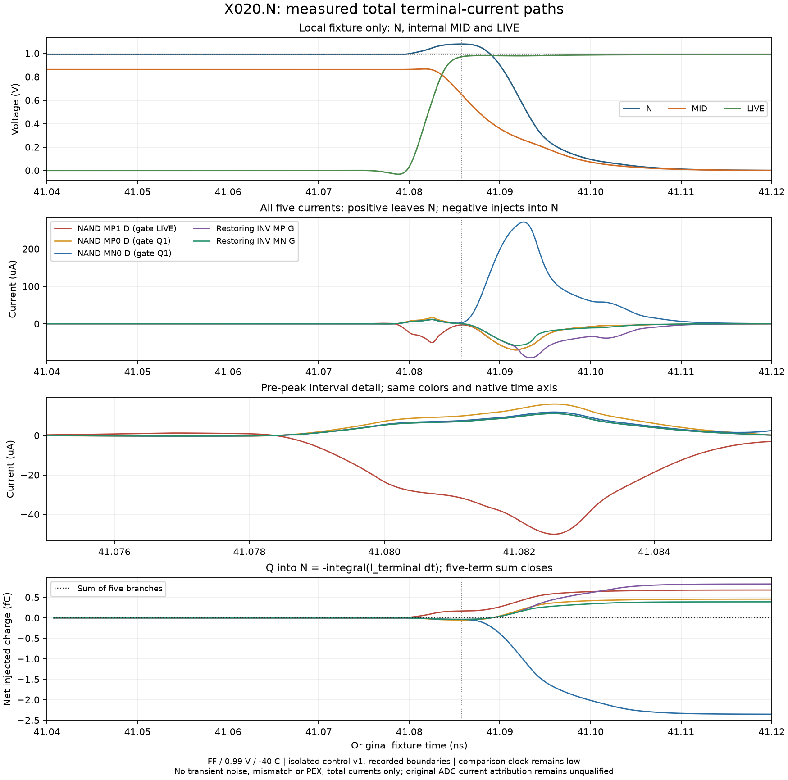
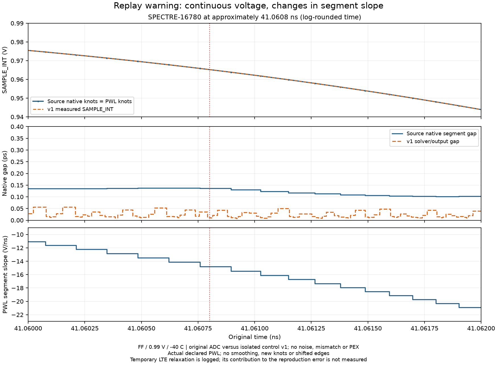

# 控制独立台 v1：复现审阅

**幅值复现未通过，不能据此批准原整机的电流归因或电路修复。**
固定的 1 mV 门槛保持不变；冻结分析器的 `acceptance_pass=null` 保持不变。

测试为 FF MOS、0.99 V、−40 °C，IO 参考候选 + N4 比较器 + 核心控制。
v1 保留 97 MOS、18 个无源器件，输入按源运行原生结点重放；外部电源、
时钟理想，未含瞬态噪声、失配或 PEX。截止时间早于第一次比较。

## 1. 结果与门槛

9 个回收文件共 **1,236,711 B**，无 skip，SHA/字节数全部通过。
注册 recipe SHA 与全部 12 个冻结输入一致。原生分析记录 5,917 点、完整
END、416 路电流齐全；本地回收的诊断表是其中 **1,836 点**，不是完整原始
PSF。原始 150.78 MB 波形未在本轮重新下载或修改。

| 指标 | 实测 | 固定门槛 | 判定 |
| --- | --- | --- | --- |
| X020.N 峰值 | 源 1.078642015 V；v1 1.079890184 V | 差 ≤1 mV | **差 +1.248169 mV，失败** |
| 峰值时间 | 源 41.089515434 ns；v1 41.085740590 ns | 差 ≤5 ps | −3.774844 ps，通过 |
| 四个选定边沿 | 每种边沿各 1 次，顺序一致 | 数量/顺序正确且差 ≤5 ps | 通过 |
| 初态最大差 | 9.367925 nV | ≤1 mV | 通过 |
| 七个关键节点最大 KCL 残差 | 3.648512 pA | ≤1 nA | 通过 |

源与 v1 的实际日志均为 `gear2only`、`maxstep=10 ps`、`reltol=1e-7`、
电压绝对容差 10 nV、电流绝对容差 100 fA。注意：网表请求的 `reltol=1e-6`
并不是实际生效值。相同设置不保证不同规模电路采用相同积分时刻。

| 0.5 VDD 边沿 | 源时间/ns | v1 时间/ns | v1−源/ps |
| --- | ---: | ---: | ---: |
| SAMPLE_INT ↓ | 41.071796039 | 41.071796062 | +0.000023 |
| CLOCK_RESET ↓ | 41.079404795 | 41.079404909 | +0.000114 |
| LIVE ↑ | 41.085839158 | 41.082104424 | −3.734733 |
| QUIET ↑ | 41.103090631 | 41.099353546 | −3.737085 |

SAMPLE_INT 与 CLOCK_RESET 几乎不变，偏移主要出现在 LIVE 路径，随后传给
N 峰值和 QUIET。LIVE→QUIET 延迟为源 17.251474 ps、v1 17.249122 ps；
LIVE→N 峰值为源 3.676276 ps、v1 3.636165 ps。
LIVE 的 10–90% 上升时间也由 3.836896 ps 变为 3.712391 ps，因此差异并非
单纯的整体时移。图中没有对齐、拟合或删除相位差。

## 2. 五条支路的局部电流证据

电流正号表示从 N 流入器件；净注入电荷定义为 `Q_into_N = −∫I_terminal dt`。
积分使用实际非均匀原生时间间隔的梯形法，不添加端点。下表窗口为
**41.040745359–41.085740590 ns**，终点正是 v1 的 N 峰值，共 1,070 点。

| N 的直接支路 | N 峰值时电流/µA | 峰值前净注入/fC |
| --- | ---: | ---: |
| NAND MP1 漏极，栅极接 LIVE | −3.027227 | **+0.166363** |
| NAND MP0 漏极，栅极接 Q1 | +0.208722 | −0.052552 |
| NAND MN0 漏极，栅极接 Q1 | +2.517797 | −0.040279 |
| 恢复反相器 MP 栅极 | +0.138752 | −0.036805 |
| 恢复反相器 MN 栅极 | +0.161957 | −0.036727 |

在这个独立台的峰值前窗口，MP1 是唯一净注入支路，其他四项净吸收。
N 下落阶段 MN0 漏极电流最高约 271.843 µA，转为主要向外输送电流的支路。
完整事件积分见 `review.json`，积分终点为原生行 41.119871102 ns。

这是**总端电流**，包含器件内部电荷变化；不能称为已单独测得 Cgd、沟道
电流或结电流。五项电流和/积分和接近零是 KCL 闭合，不表示 N 没有充电。
也不能把 +0.166 fC 除以一个猜测电容，宣称得到原整机的过冲来源。
由于幅值复现尚未通过，上述归因仅适用于 v1。

## 3. 数值重放与负载缺口需要分开

`SPECTRE-16780` 在日志约 **41.0608 ns** 处明确指向 SAMPLE_INT：为了跨越
信号不连续，LTE 容差被临时放宽。日志时间经过舍入，不应当作准确的内部断点。

对应 PWL 的相邻原生结点为：

| 时间/ns | 电压/V | 到下一点间隔/ps | 本段斜率/(V/ns) |
| --- | ---: | ---: | ---: |
| 41.060758961 | 0.965867524 | 0.137061 | −14.796964 |
| 41.060896022 | 0.963839438 | 0.129985 | −15.461901 |

文件结点严格递增，定义的折线电压连续，但斜率逐段变化。日志中的
“不连续”不能据此解释成 PWL 有有限幅度的电压跳变。全部七路文件逐点与
原生数据相同；在回收的 v1 诊断点上，SAMPLE_INT 对声明 PWL 的最大偏差仅
3.884e−13 V。没有发现输入时间或幅度被改写的证据；这不排除折线表示及
内部积分历史造成数值误差，也不能把 LTE 警告本身当作全部偏差的原因。

拓扑审查还发现此前边界清单漏列的 **SN 四个栅负载**：

- `X010.X000.MP1:2`、`X010.X000.MN1:2`，原 WRITE_REQ 支路；
- `X014.X000.MP1:2`、`X014.X000.MN1:2`，原 PHI_U 支路。

SN 由 `X000` 产生，再经 `X001` 生成 LIVE。去掉这些负载有一条明确的
路径可以影响 LIVE 时间及斜率；这与当前现象一致，**仍不是排他的因果证明**。
LIVE、Q1、QUIET 和 N 本身没有额外未保留的直接负载，完整差异清单保存在
`review.json`。原 PR/NR/WD 切口仍然存在。冻结 v1 未作任何补载改动。

## 4. 最小后续对照建议

以下仅为本地建议，未注册、未执行；详细端口和限制见 `next_experiments.json`。

1. **先补读已有原生数据。** 从源运行导出 SN、UD、WRITE_REQ、X010/X014 的
   NAND N/MID，以及 X001 的 N/MID；从 v1 导出已保存的 SN 与 X001 N/MID。
   已核对源网表确实请求这些电压，v1 没有的 X010/X014 不能凭空补数据。
   这可以通过新的受管 analysis-only 处理已有原始结果，无需再跑原整机。
2. **单独检验数值敏感度。** 新版本只把请求 reltol 收紧一档，其余 v1 器件、
   PWL 字节、maxstep、源设置与保存项保持。必须检查实际日志确实收紧，而非
   被 preset 留在同一个值。比较绝对峰值、原时轴边沿、KCL 与 LTE 警告；
   单次结果或警告消失都不能单独证明收敛。资源限额不变，超限保留失败。
3. **在相同收敛设置下逐支路补真实负载。** 先 X010，再单独 X014；每个原 AND
   最少包含 6 MOS 和 1 个原 CMID，还必须审查真实输出接收级。不能只补四个
   浮空管栅或猜固定电容。X014 成为 PHI_U 的真实驱动后，必须移走该处理想
   重放、将切口向外移；不能形成双驱。UD 取同一个源运行的原生历史。
   完整新边界、器件数和仍缺负载先交主任务审核，再冻结新实验。

先量化数值影响，再判断补载的增量效果。全部复现门槛通过之前，不开始尺寸
优化，不将本地电流结论升级为原整机结论。

## 5. 保留的告警与验证

- `CMI-2751/2752/2753/2754/2755`：端压筛查超限；日志后续重复告警被抑制，
  不能按打印条数判断全部超限节点，更不能因仿真完成而宣布已修复。
- `SFE-1131`：重复指定 scalefactor，后一次取值生效。
- `SPECTRE-16780`：上述 SAMPLE_INT 附近 LTE 临时放宽。
- `VACOMP-2435`：旧 AHDLCMI 环境变量不再支持，改用默认编译流。

相应原生告警行保存在 `warnings.txt`。本轮校验了回收与冻结输入 SHA、
峰值、边沿数量/顺序、初态、七项 KCL 与五项电流积分；三个解析积分的
闭式解/非均匀网格测试通过。三张最终图已用图像查看工具检查。没有新远端
操作，没有修改冻结包、分析器、PDK、OA、其他模块或共享日志，也没有提交/push。
