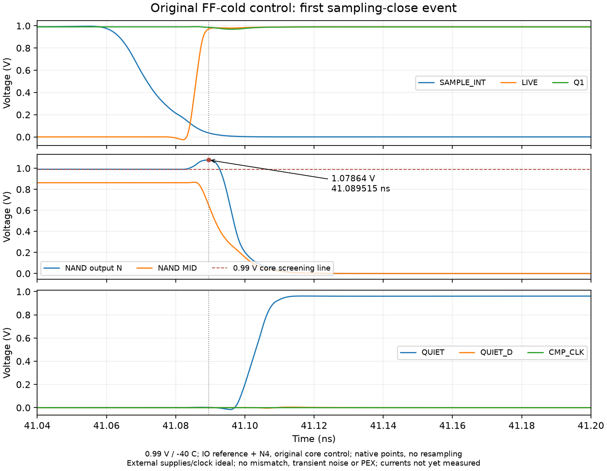

# Control: first sampling-close event

Status: native source reviewed; isolated fixture prepared locally. No new
simulation, electrical reproduction or circuit repair has run in this session.

## Measured source evidence

Source: immutable `sar8fix-loaded-both-ffcold`; FF MOS, 0.99 V, −40 °C,
IO reference + N4 comparator, original core control. Ideal external supplies
and clock; no transient noise, mismatch or PEX. The historical 027b951 ADC
performance does not qualify this candidate.

All 13 collected files passed receipt and nested-result SHA/size checks:
2,863,230 bytes. The history contains 8,746 native rows from 0 through
41.590785651 ns, including 4,665 rows in the diagnostic window. Initial-state
witnesses match its first row exactly. No resampling or peak clipping occurred.

| Event | Native evidence |
| --- | --- |
| SAMPLE_INT falls through 0.5 VDD | 41.071796039 ns |
| CLOCK_RESET falls through 0.5 VDD | 41.079404795 ns |
| LIVE rises through 0.5 VDD | 41.085839158 ns |
| X020.N reaches its maximum | **1.078642015 V at 41.089515434 ns** |
| QUIET rises through 0.5 VDD | 41.103090631 ns |
| First comparator-clock rising edge | 43.468865998 ns; beyond this fixture |

Threshold-crossing times use linear interpolation between adjacent original
native samples solely to locate events. The plotted and replayed waveforms
keep the original native rows.

The spike coincides with LIVE rising while Q1 stays high and NAND MID falls.
CMP_CLK remains low. This locates the fault before comparison; voltage timing
alone cannot assign the current to channel conduction or individual capacitances.
The dashed 0.99 V line is a core screening reference, not a lifetime verdict.

The managed export took 10.18 s, with peak analysis RSS 121,257,984 bytes;
the stream parser itself reported 6,052 KiB. Those are export measurements,
not the resource use of the proposed transistor simulation.

## Prepared isolation fixture

`first_event_v1/` retains **97 MOS and 18 passive devices**. Every retained
instance's model, dimensions, multiplicity, node connectivity and parameters
match the frozen source. Native N4, both receiving buffers, SR feedback,
clock buffer/direct loads, forward timing logic and original MOM/RC loads stay.

Seven upstream/input nodes replay all 8,746 native knots: SAMPLE_INT, PHI_W,
PHI_U, ACTIVE, DEC, TOPP and TOPN. PWL text totals 2,708,173 bytes. Paths resolve
as `pwl/name.pwl` from the managed Spectre `RUN/inputs` working directory.
COMP_P/N, WD and all retained active outputs have **no ideal voltage clamp**.
Internal initial-state witnesses are comparisons, not forced ICs or nodesets.

The fixture saves 57 voltages and 416 native terminal currents. It forms
56 node KCL equations and exports 37 diagnostic currents plus seven critical
KCL residuals at native points. Primary X020.N KCL sums five terms:
the two NAND PMOS drain currents, NAND MN0 drain current, and the two restoring
inverter gate currents. Positive terminal current leaves the node into a device;
injection into the node has the opposite sign. Multiplicity is not applied twice.
Missing current TRACE or first values fail rather than becoming zero.

Limitations: TOPP/N voltage replay removes CDAC source impedance and reciprocal
kickback; DEC replay cuts qualification feedback; PR/NR downstream qualification
loads and WD-to-X010 fanout are omitted. Omitted token/register and upstream
networks are replaced by recorded input histories. This is a first-event
reproduction diagnostic, not a full asynchronous-control correctness test.

## Proposed review gates

These numerical reproduction tolerances await parent review. They are not
ADC design specifications, PVT approval or foundry reliability limits.

| Quantity versus the original native run | Proposed absolute tolerance |
| --- | --- |
| X020.N peak voltage | 1 mV |
| Peak time and selected 0.5 VDD edge times | 5 ps |
| Initial-state witness voltages | 1 mV |
| Critical node KCL residual | 1 nA |

First compare fixture DC/history and spike reproduction. If it differs beyond
the approved contract, investigate cut loads/feedback before attributing source
currents or changing devices. Successful reproduction should retain the original
spike; the analyzer therefore leaves `acceptance_pass` null and never claims repair.

`first_event_analyze.py` is a bounded streaming reducer for Python 2.7/3. It
requires managed/native completion, full fixture PSF END and every requested
signal. It preserves CMI warning codes and sparse native held values. Binary
output is capped at 30 MiB; total collection at 32 MiB; Linux analysis RSS at
256 MiB. `result.json` is written last. No current component decomposition is
inferred from total terminal currents.

`first_event_v1/recipe.suggested.yaml` is a local suggestion, not registration:
Spectre X CX, one thread, simulation RSS 1 GiB, analysis RSS 256 MiB, original
FF/−40 °C/0.99 V model includes and requested tolerances. Effective settings
and actual current TRACE support still need inspection after the first run.

Validation: 15 focused local tests cover immutable source/device identity,
all native PWL points, package-relative paths/hashes, output single drivers,
KCL signs, sparse/GROUP values, missing/duplicate/nonfinite data, END/native
completion gates, warning retention and output caps. These tests do not compile
or simulate the Spectre deck. The plot was inspected with the image viewer.
