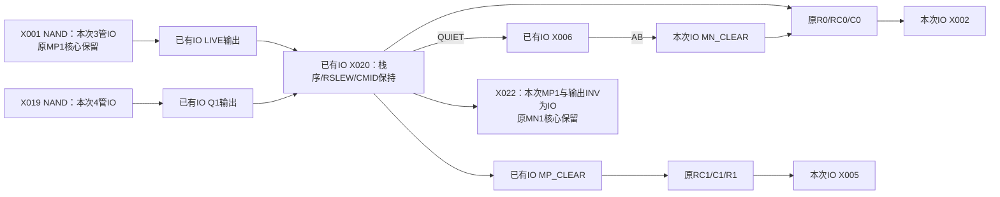

# 最小边界修正V2

状态：已准备、未提交的检查点。主会话正在核对tcb标准单元库；当前不继续扩展
手工IO边界，也未启动本候选。以下保留原准备范围和证据，供后续路线判断使用。

依据完成的IO-local数据，只将**15只实际超限的保留核心器件**换为已核实普通
1.8V primitive。上一版15只IO及其尺寸、全部节点连接、19个无源实例、退出的
分压支路、采样时序和11份FF原生PWL均保持。没有增加或移除叶实例。

| 位置 | 本次换管 | 数量 |
| --- | --- | ---: |
| LIVE前级NAND | X001.X000.MN0/MN1/MP0 | 3 |
| Q1前级NAND | X019.X000四管 | 4 |
| QUIET门剩余接口 | X022.X000.MP1、X022.X001两管 | 3 |
| AB→RC0清零 | XD_QUIET_D.MN_CLEAR | 1 |
| RC0输入INV | XD_QUIET_D.X002两管 | 2 |
| RC1输入INV | XD_QUIET_D.X005两管 | 2 |

X001.X000.MP1与X022.X000.MN1在此前102对筛查中未超限，继续保留核心器件并
观测。本次累计从stack-order替换30只器件，原fixture仍有60只核心管；不是整个
控制器IO化。原条件负载复制管、比较器、其余逻辑保持。

每只器件的选择依据就是本FF冷角的原生六对端压结果，完整数值/时刻、前后模型/
参数见 `change_manifest.json`。原失效15管共46对，不将原有故障都归为新引入。
几何用已核实CDF单位L=150nm、W=320nm、nf=1；原1µm/0.5µm映射multi4/2，
MN_CLEAR原2µm映射multi7。沿用相应单位寄生参数，没有将核心30nm参数套给IO。
未假设新尺寸速度、清零强度或首帧状态已经合格。

观测扩大到原fixture全部101个MOS，每管VGS/VGD/VDS/VGB/VDB/VSB同时刻相减，
606对加原3个比较标签及N的独立核心轨诊断，共610项。原生保存仍为62V/438I；
局部导出全部62V/438I和61个节点KCL，使残留核心/条件复制负载等问题可以直接
定位。**观测扩大不等于器件替换扩大，也不等于比较器等其他模块通过。**

核心0.99V筛查保持。既有普通18mac/na18仍采用原记录的暂定1.98V绝对值筛查，
不代表认证了全部SOA/结正偏限值。LIVE等节点的负向结极性、体端总电流和原生
CMI必须继续报告；这一版没有宣称消除IO-local的44mV N上冲或−175mV LIVE下冲。
五源能量和真实边沿保留；短窗口内缺失的后续时钟不补造。

本包仍是FF、0.99V、−40°C、截止41.590786ns的原条件历史。SS/0.81V速度、
复位和完整周期尚需独立合法激励。此前IO FO4在SS冷角约202.6ps的风险记录不变，
不能把本次FF的PWL换标签当SS实测。

交付入口：[recipe.suggested.yaml](recipe.suggested.yaml)，建议ID
`sar8audit-ctrl-ioboundary-v2`。15声明输入、4,636,412B；recipe文件SHA256：
`d444e366e3a5ce1079d7c933ab5396a125747b4420109d2abfe9cab456d7db0d`。
原冻结分析器不改；原1线程、仿真1GiB/900s、分析256MiB/600s及回收32MiB保持。
按2千个局部点估计二进制约9MiB，原30MiB导出硬限仍有效。

最小本地验证已通过：精确15叶实例变化/116个保持、全部端口/无源/先前IO参数
保持、101×6观察覆盖、MN_CLEAR合法单位multi7。合成测试证明未替换核心的
1.04V仍被0.99V筛查标出，耐压管按原暂定值筛查；告警和空验收结论保留。
这不是实际Spectre结果。本会话未登记或远端提交。
