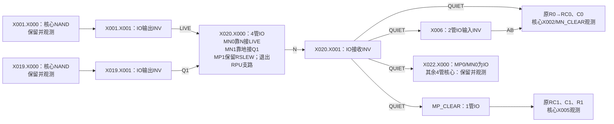

# 局部耐压互补逻辑候选

父会话已完成本候选回收：[结果与三张图](results/README.md)。后续V2仅保留为
未提交检查点；当前主会话正在核对tcb标准单元库，等待路线判断。

以完成的 `sar8audit-ctrl-stackorder-v1` 为基点，**15管换普通1.8V primitive，
删除RPU0/1/2直流分压**。这是器件类别、合法单位几何和偏置退出的方案级变化，
不归因于单一W/L变化，也不代表端压/速度已通过。

原数字逻辑与全部MOS端口连接保留：X020上管接LIVE、下管接Q1；CMID仍为multi=1，
保留RSLEW。未新增偏置源、时钟或强制初值。外部采样窗口、关闭沿、0.99V、
FF、−40°C、Spectre设置及41.590786ns停止点保持；11份原生PWL字节保持。
现有输入历史属于FF冷角，不能改corner标签后宣称是SS实际边界。

图中X006/X002/X005/MP_CLEAR/MN_CLEAR均在 `XDUT.XCTRL.XTIM.XD_QUIET_D`。
R0/R1、C0/C1及其真实逻辑负载保留，没有用理想电容或理想源替代。
仅沿修改路径生成私有master，实例路径保持；共享primitive其他实例没有整体替换。

| 边界 | 改成IO的MOS | 数量 |
| --- | --- | ---: |
| X020 NAND和N接收INV | X020.X000四管、X020.X001两管 | 6 |
| LIVE/Q1输出驱动 | X001.X001、X019.X001各两管 | 4 |
| QUIET直接首级负载 | XD_QUIET_D.X006两管、MP_CLEAR、X022.X000.MP0/MN0 | 5 |

全部使用已核实CDF单位L=150nm、W=320nm、nf=1及对应寄生参数，模型为
`nch_18_mac/pch_18_mac`；不沿用核心30nm参数。原有效W映射成整数并联单位：
1µm→multi4、0.5µm→multi2、3µm→multi10。这是初始量化尺寸，未声称等Ron或最优。
原先IO FO4采用的反相器也是P4/N2，没有重复基础器件审计。
完整逐管前后模型/节点/参数在 `change_manifest.json`。

原101个MOS实例保持数量，其中仅15个修改；删除3只电阻后无源实例为19个。
与修改节点相邻的17个核心MOS继续观测：X001/X019前级NAND、X022剩余四管、
RC0/RC1接收INV及MN_CLEAR。候选可能仍留下这些核心管的超限，必须原样报告。

测量保存62V、438端电流，27个重点节点KCL；局部输出为全部62V和169个端电流。
32个修改/暴露MOS各测VGS/VGD/VDS/VGB/VDB/VSB，同时刻相减，覆盖0到END。
另保留3个旧比较标签及N对旧核心轨的独立诊断，共196项。
核心使用0.99V筛查；普通IO沿用已有记录的**暂定1.98V筛查**，不宣称全端压
可靠性限值已认证。原生CMI、结电压符号、极值时刻和所有告警保留。
`N_versus_old_core_rail_DIAGNOSTIC`用于比较N电压，不能混作IO模型的SOA判据。

五个源的全史能量、低态电流、LIVE/Q1/N/QUIET及RC/时钟后续波形均保留。
实际响应可能比可用历史更慢；若窗口内未出现相应沿，记录“窗口内未观测”，
不延长未知PWL、外推角点或改变采样关闭沿来判过。内部DC初态允许自然变化。

既有FO4量化风险：

| 条件 | 核心下降/上升 | 普通IO下降/上升 |
| --- | ---: | ---: |
| FF、0.99V、−40°C | 16.73 / 12.11ps | 52.41 / 66.63ps |
| SS、0.81V、−40°C | 33.66 / 29.40ps | 202.62 / 187.28ps |

IO的SS下降FO4约为其FF的3.87倍，且比同角核心增加约169ps；这些不是当前
实际负载的延迟，也不能直接串加成合龙时序。第二角点须获得合法SS源边界后另建。

交付：[recipe.suggested.yaml](recipe.suggested.yaml)，建议ID
`sar8audit-ctrl-iolocal-v1`。15个声明输入、4,481,087B；recipe文件SHA256：
`185777388be0fe0d906940d437fdff9ddd457b2f831dd4dde466721d661e1987`。
原冻结分析器字节保持；1线程、仿真1GiB/900s、分析256MiB/600s，回收上限32MiB。
以先前约2千个局部点估算，当前二进制导出约4MiB；实际仍由原30MiB硬上限保护。

本地最小验证已通过：精确15叶实例变化/3电阻删除、其他116叶实例保持、端口和
输入PWL一致、合法单位参数与32管六对端压覆盖。一次合成解析测试证明同样1.04V
在未替换核心管仍报0.99V筛查超限，IO管按暂定1.98V筛查；CMI和空验收状态保留。
合成测试不构成真实Spectre结果。本会话未登记/提交，也未修改远端或其他模块。
