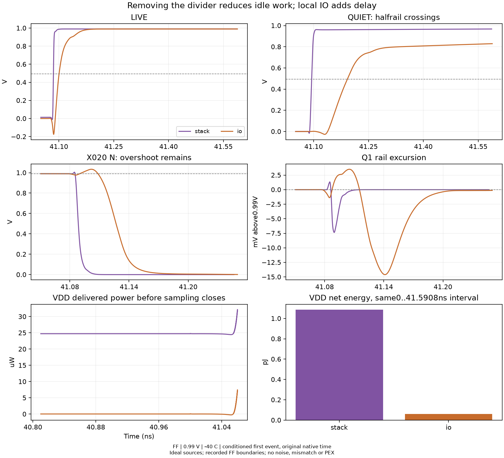
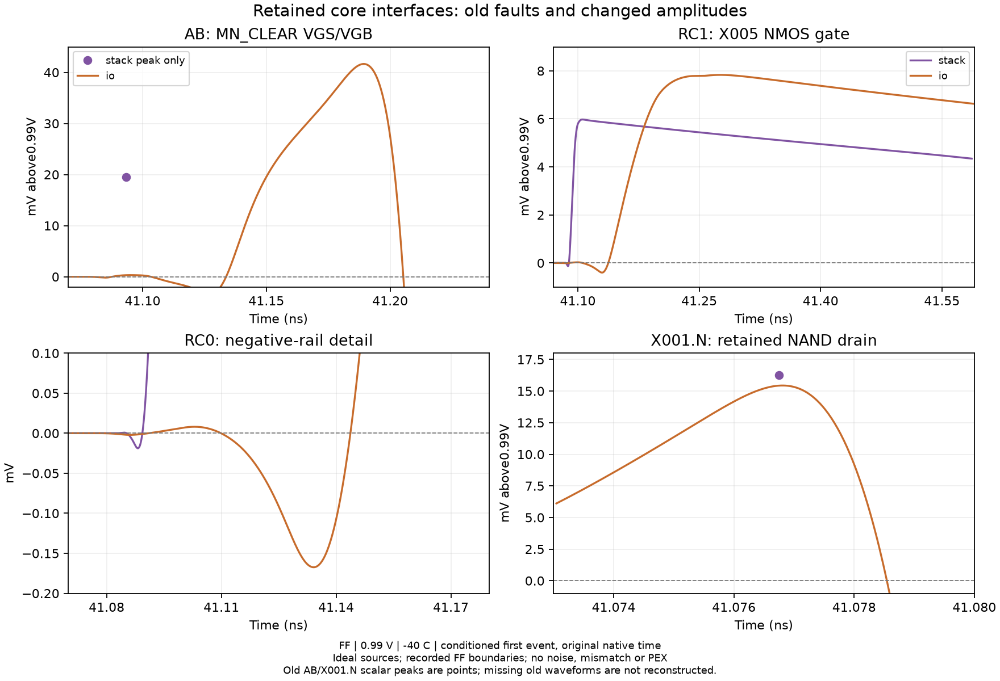
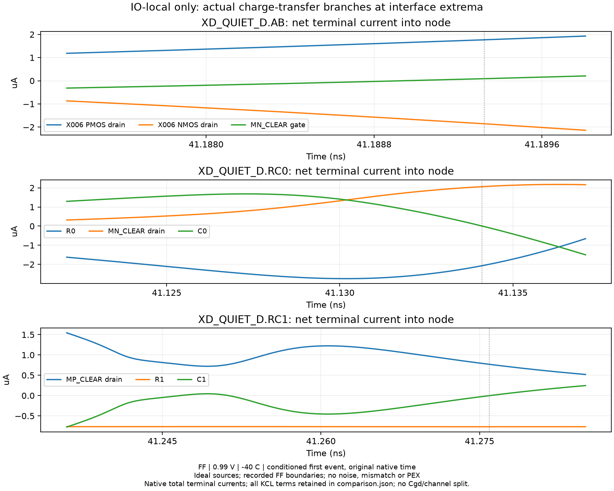

# 局部IO结果：直流分压代价下降，核心接口仍未闭合

FF、0.99V、−40°C，0–41.590786ns首事件条件负载；外部供电/重放源理想，
重放波形继承原FF内部边沿与过冲。未含噪声、失配、PEX，不能外推为SS或整周期。

| 观察量 | stack-order | IO-local |
| --- | ---: | ---: |
| N最高电压 | 1.005230V | 1.034017V |
| N超出0.99V | 15.230mV | **44.017mV** |
| LIVE最低电压 | −11.629mV | −175.076mV |
| Q1最高电压 | 0.991334V | 0.993509V |
| LIVE半轨沿距采样关闭 | 13.260ps | 28.758ps |
| QUIET半轨沿距采样关闭 | 22.803ps | 120.517ps |
| QUIET半轨沿绝对时刻 | 41.094599ns | 41.192313ns |
| 停止时QUIET电压 | 0.967987V | 0.829476V |
| 初始VDD净输出功率 | 24.7287µW | 0.03575µW |
| 同区间VDD净输出能量 | 1.085590pJ | 0.061017pJ |

QUIET增加97.714ps延迟，窗口内仍各有一次上升、没有下降。QUIET_D、CLOCK_SET、
CLOCK_Q、CMP_CLK在两组该短窗口内都未越过半轨，不能据此宣布完整比较时钟、
复位或SAR周期已经验证。停止时IO输出仍受真实RC负载影响：约66.98µA由QUIET
输出PMOS漏端供给，其中66.47µA流入原R0支路；这解释了当时QUIET仅0.829V，
不能把半轨沿当成全摆幅建立完成。

**过冲并未消失。** 15只新IO的90对端压在已有暂定1.98V绝对值筛查下零超限；
其中最大为LIVE输出PMOS的VDS约1.16508V。N、LIVE、Q1摆幅反而增大，可靠性
结论不能由器件类别或绝对值筛查代替原生CMI。
LIVE=−175.08mV时，IO NMOS漏/体结呈正偏极性；NMOS/PMOS体端总电流分别约
4.409/4.739µA。它们包含位移等分量，未分离成直流二极管电流，也未证明正偏结
已合格。此项符号和体流必须随候选继续保留。

保留17只核心管的102对中，15只、46对超过0.99V筛查。关键接口如下：

| 核心接口 | stack已知极值 | IO-local极值 | 解读 |
| --- | ---: | ---: | --- |
| MN_CLEAR VGS/VGB=AB | 1.009554V | 1.031652V | 原有超限加重 |
| X005 NMOS VGS/VGB=RC1 | 0.995974V | 0.997832V | 原有超限加重 |
| X002 PMOS VSG=0.99−RC0 | 0.9900188V | 0.9901674V | 原有负向偏移加重 |
| X001.MN0 VDB=X001.N | 1.006276V | 1.005442V | 原有过冲略减，仍超限 |
| X019 PMOS绝对VDS=0.99−min(N) | 0.990523V | 0.990499V | 原有负向偏移略减 |

旧AB、X001.N没有局部波形列，但有全史标量极值。上述源/体参考为理想常数，
因此可以精确换算这几项端压；没有把两个独立变化节点的极值相减。图中旧版
只画真实保存的标量峰值点，未重建曲线。其他缺失的旧联立端压明确标作未知。

**原生电流定位：**

- AB在41.189325ns达峰1.031652V，QUIET当时为0.471519V；X006 PMOS漏端
  向AB净注入1.769µA，MN_CLEAR栅端净注入0.089µA，X006 NMOS漏端净吸收
  1.858µA。输出仍为高时的端电荷交换使AB上冲，并直接作用于核心MN_CLEAR栅端。
- RC0在41.134109ns最低−0.167443mV：R0从RC0抽走2.068µA，MN_CLEAR漏端
  从地侧净补入2.062µA。QUIET低侧扰动经原R0进入RC0，钳位有限阻抗留下小负值。
- RC1在41.275920ns最高0.997832V：MP_CLEAR漏端净注入约0.7695µA，R1净
  吸收约0.7673µA。MP_CLEAR的端电荷仍到达RC1，核心X005输入端继续暴露。
- X001.N在41.076824ns最高1.005442V：核心MP0漏端净注入6.853µA，MN0漏端
  净吸收6.467µA，IO接收INV两栅端吸收其余。前级NAND原有问题没有因接收端
  耐压改变而消失。ACTIVE重放本身最高0.990241V，也会直接暴露核心输入栅端。

以上为总端电流，不拆成纯Cgd/沟道分量。全部KCL项见JSON，最大残差7.901pA。

五个源在同一完整观测区间的净输出能量如下，负值表示净吸收：

| 源 | stack，pJ | IO-local，pJ |
| --- | ---: | ---: |
| VDD | 1.0855904757 | 0.0610167932 |
| BIAS10_N | −0.0002529142 | −0.0002529788 |
| BIAS10_MID | +0.0000373738 | +0.0000378201 |
| BIAS14_N | −0.0002529207 | −0.0002529854 |
| BIAS14_MID | +0.0000373738 | +0.0000378201 |
| 五源合计 | 1.0851593883 | 0.0605864691 |

VDD净能量下降94.379%，主要收益来自退出持续直流分压；不是一个完整转换周期的
耗散或整机平均功耗。原CMI2751–2755等告警均保留。

回收9文件/4,436,865B，6065个原生点、1984个局部点；回执/输入SHA与原生END
均已核对。旧输入和分析器冻结。逐项端压可比范围、缺失旧波形、KCL、电流快照、
五源能量见 `comparison.json`；重现脚本
[review_io_local_result.py](../../review_io_local_result.py)。

下一项只修补这15只已测失败的保留核心管，维持原15只IO/逻辑/无源/输入不动；
另将观测扩大到原fixture全部101管，避免再次漏测边界。已准备
[最小边界修正包](../../io_boundary_v2/README.md)，尚未远端提交。

当前状态：按主会话最新方向，V2保存为未提交检查点；暂停继续扩大手工IO边界，
等待tcb标准单元库路线的统一判断。本轮失败与原始证据不丢弃。
