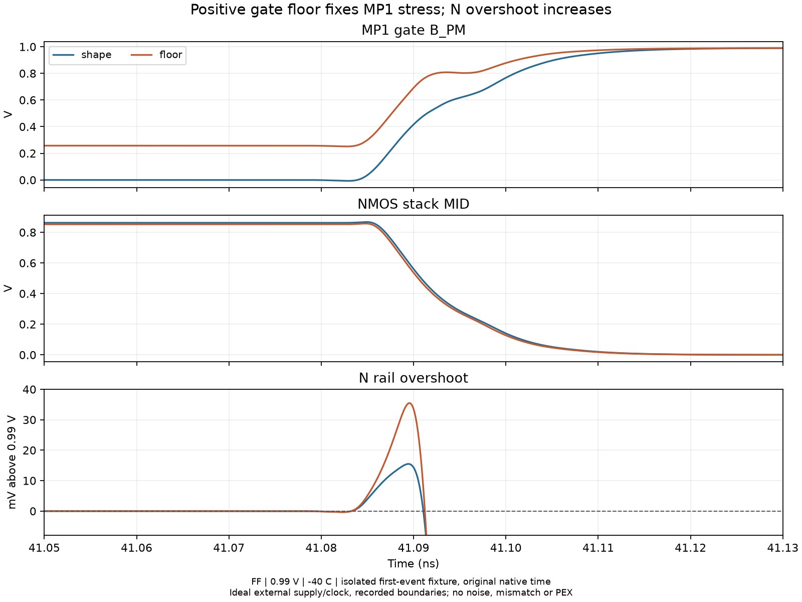
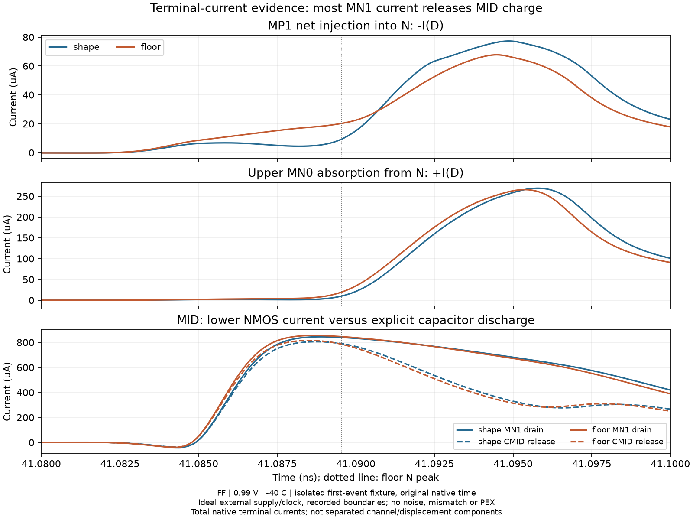

# 正栅偏置结果：栅极问题缓解，N过冲仍失败

条件：FF、0.99 V、−40°C，采样关闭后的首个事件；隔离的条件负载网表，
保留原始时间轴与求解器原生采样点。外部供电/时钟理想，边界来自原整机记录；
未含噪声、失配、PEX。shape/floor及shape全史重分析回执和输入SHA均已核对。

| 观察量 | shape：单个栅串联电阻 | floor：再加三电阻上拉 |
| --- | ---: | ---: |
| N最高电压 | 1.005488 V | 1.025472 V |
| 超出0.99 V | 15.488 mV | 35.472 mV |
| MP1全史最大VSG | 0.997022 V | 0.738497 V |
| MP1全史最大绝对VGD | 0.996792 V | 0.989994 V |
| N达峰时，MP1净流入N | 8.15 µA | 20.27 µA |
| N达峰时，MN0从N吸收 | 7.74 µA | 19.68 µA |
| MP1峰前净流入电荷，41.04ns至各自峰值 | 0.03264 fC | 0.07500 fC |
| QUIET上升沿 | 41.102522 ns | 41.102059 ns |
| VDD净输出能量，0–41.590786ns | 0.07077 pJ | 1.08493 pJ |
| 初始VDD输出电流 | 0.04142 µA | 24.97781 µA |

**为何栅极修好而N更差？** floor避免了B_PM负向下冲，但改变了MP1在
N上升期间的关断/电荷交换过程。峰前MP1漏端净注入增多；固定请求终点
41.0894ns的原生点积分也为0.03224→0.07098fC，结论不依赖各自峰值终点。
这是端电流证据，尚未将沟道与位移电流分离，不能将其全部称为Cgd注入。

同时，MN0吸收电流确实增大，不能说floor把下拉变弱了。但在floor的N达峰
时，MID仍为0.5711V、Q1为0.9857V，上管MN0的VGS约0.4145V。
下管MN1漏端约845.7µA，其中约784.7µA对应CMID向MID释放电荷；
N端经MN0漏端流出的总电流仅19.7µA。说明大MID储能在关键早期仍占据
主要放电支路；减小它是否能提前建立N吸收，需要下一次单变量实验验证。

floor的重点节点KCL最大3.501pA，全部受测节点最大3.954pA；QUIET在观察窗
内均只有一次上升、没有下降。所测MP1 VSG/VGD已无超过0.99V的原生点，
但恢复反相器NMOS VGS仍随N超限，CMI2751–2755等原生日志保留。
只观察了三个联立端压，不代表全电路所有端压通过。

新增低态静态电流约24.936µA，0.99V下约24.687µW；同一区间VDD能量
增加至15.33倍。五个源的有符号能量均在 `comparison.json` 中，未将理想
边界源功率或该首事件能量当作整机功耗验收。

唯一下一项为 `../../cmid_half_v1/recipe.suggested.yaml`：仅X020私有CMID
的multi2→1，保留floor及全部其他器件/时序。假设待验证；此处仍为失败
机理分析，没有整周期、PVT或整机合格结论。
