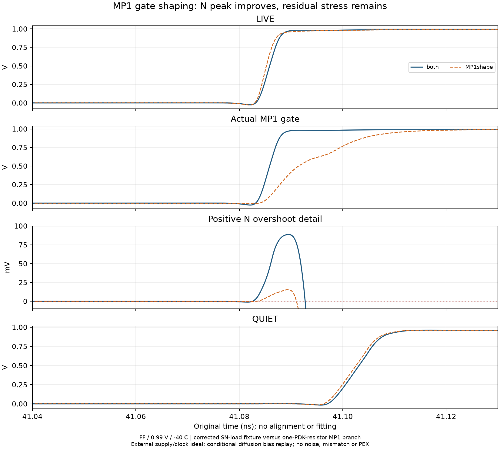
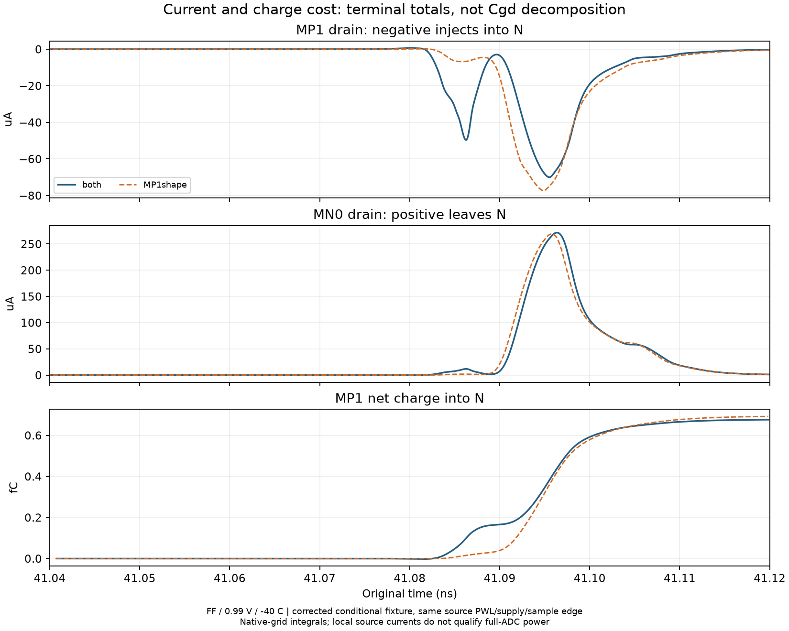

# MP1 串联栅电阻：有效，但残余未消除

FF、0.99 V、−40 °C；同一修正后的条件负载台，原生时轴比较。
9个文件1,927,723B、438路电流、6,054原生点、完整END及输入SHA已核对。

| 指标 | both | MP1shape |
| --- | ---: | ---: |
| N峰值/V | 1.078641566 | **1.005487759** |
| 超过0.99V/mV | 88.642 | **15.488** |
| MP1最大VSG/V，全时程 | 1.015612 | **0.997022** |
| 回收窗内VGD绝对值最大值/V | 1.014803 | **0.996792** |
| VDD电流峰值/mA | 1.008205 | **1.060869** |
| 关键KCL最大残差/pA | 3.654 | **3.452** |

超轨幅度下降82.53%，但 **N和MP1端压均仍超限**。VSG可由全时程B_PM最小值
和恒定VDD精确推出；表中VGD是40.81–41.5908ns窗口的同时值，已足以确认
越界。它的精确全时程极值已准备只读重处理，不能用两个不同时刻的极值相减
冒充。全部CMI、SFE-1131、SPECTRE-16780和VACOMP-2435保留。

LIVE提前0.629ps、QUIET提前0.569ps。QUIET仍只有一次上升，回收窗口中没有
下降边沿；没有为了压过冲改变外部采样窗口或关闭沿。

峰值前MP1净注入由0.164111降至0.032637fC，下降约80.1%；完整41.04–41.12ns
事件的MP1净注入由0.676401略升至0.692251fC。后半段较大的端电流和VDD峰值
增加5.22%是代价，与延迟关断引起的重叠导通相符，但没有单独分解沟道/Cgd。

四个条件偏置源在相同窗口中的净能量几乎不变。原both的VDD波形未被旧紧凑表
保留，不能据此伪造两版完整VDD能量对比，也不能把瞬时电流峰值当作平均功耗。

下一项已冻结为 `../../mp1_floor_v1/recipe.suggested.yaml`：用现有合法电阻构成
随VDD变化的正低态基准，同时处理B_PM下冲和上拉保持效应；不是只继续增大
串联电阻。新增静态电流和延迟必须实测，尚无该候选的仿真通过结论。
