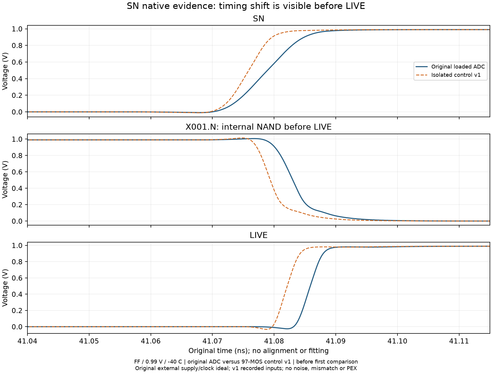
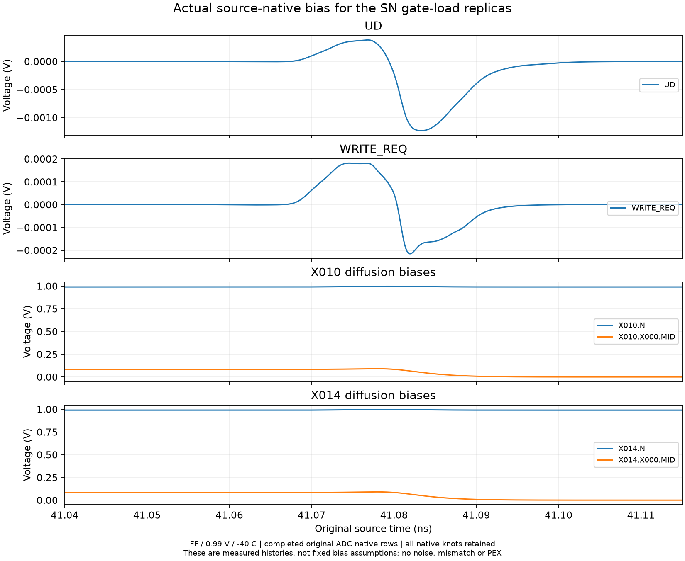

# SN 原器件负载对照

优先版本为 [both/recipe.suggested.yaml](both/recipe.suggested.yaml)。主聊天已登记并
提交 `sar8audit-ctrl-snload-both-v1`，实际 recipe hash：
`66cda5e5a9c65de39abee30125b33fe39f8926729145adbe5d25999b0bcc802c`。
**both 全部输入保持冻结。** 单支路 `x010_only`、`x014_only` 已备好，暂不运行。

原生补充数据已逐文件及嵌套 SHA 校验：源 8,746 点/9 路，原 v1 5,917 点/3 路。
两份 analysis-only recipe 与各自 source recipe 独立绑定，原生结点、初态和实际
覆盖终点均核对。以下比较没有时移或拟合：

| 信号事件 | 原机/ns | 原 v1/ns | 原 v1 提前/ps |
| --- | ---: | ---: | ---: |
| SN ↑ 0.5 VDD | 41.078857953 | 41.075845371 | 3.012583 |
| X001.N ↓ 0.5 VDD | 41.083060862 | 41.079408369 | 3.652493 |
| LIVE ↑ 0.5 VDD | 41.085839158 | 41.082104424 | 3.734733 |

SN 下冲为原机 −8.977648 mV、原 v1 −10.780405 mV；X001.N 峰值为
1.006291268 V、1.013985215 V。偏移在 SN 已可见，再传到 LIVE。

both 在原 97 MOS/18 无源独立台上增加 **4 个原尺寸 PDK MOS**：两条缺失
SN 扇出各自的 NAND MP1、MN1，成为 101 MOS/18 无源。栅极接自然驱动的 SN，
源/体保持原连接；其漏端 N/MID 使用同一原机的完整原生偏置历史。
每路保留全部 8,746 个结点，不用固定电压或拟合电容代替。原 7 路 PWL 字节、
外部采样窗口/关闭沿、既有器件参数与输出驱动均保持。

这是**条件 MOS 输入负载恢复**，用于区分独立台遗漏扇出的影响，不是 ADC
电路优化或完整 X010/X014 逻辑重建。新增理想源仅接新负载副本的漏端偏置节点；
原 SN、LIVE、COMP_P/N、WD 等既有输出没有被电压钳位。漏端反馈由记录历史
约束，不能据此声称完整互易反馈或整机功耗合格。

both 包声明 15 个输入、4,408,071 B；加管理器摘要共 4,411,043 B。
61 路电压、436 路电流、12 个关键 KCL 节点；使用冻结分析器，保留警告和
`acceptance_pass=null`。5 项针对性 builder 测试通过，主聊天亦已复跑。
原 1.248 mV 对 1 mV 的复现超差仍保留，不机械阻断此项机制对照。
本 session 没有远端操作、改 PDK/OA、提交或 push。
