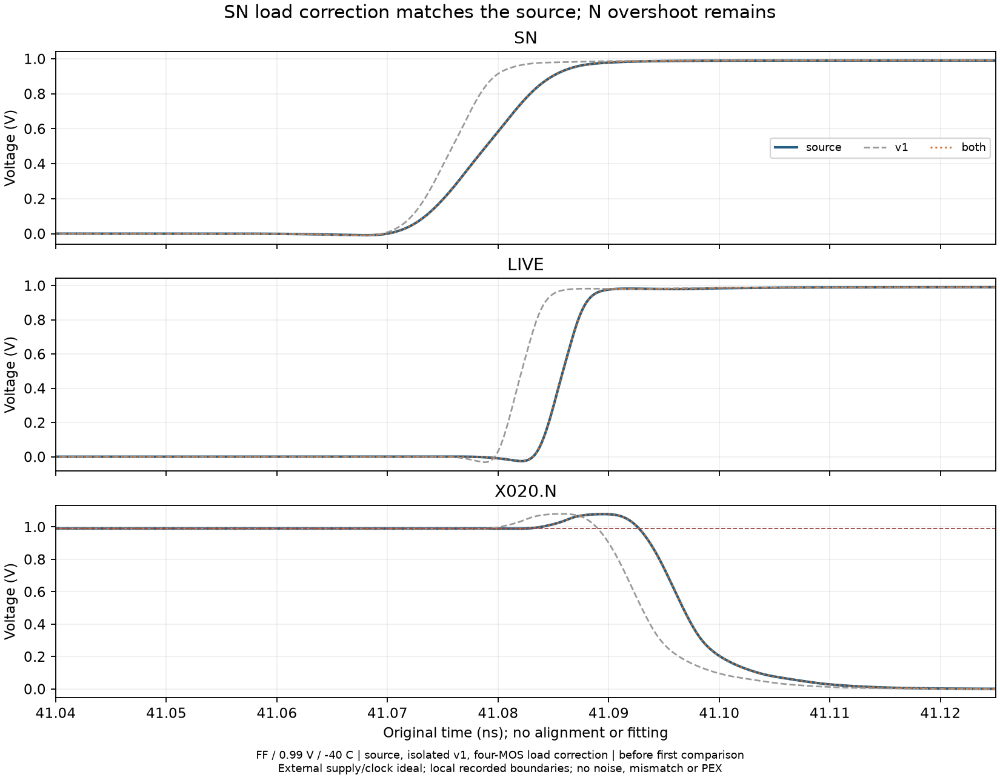
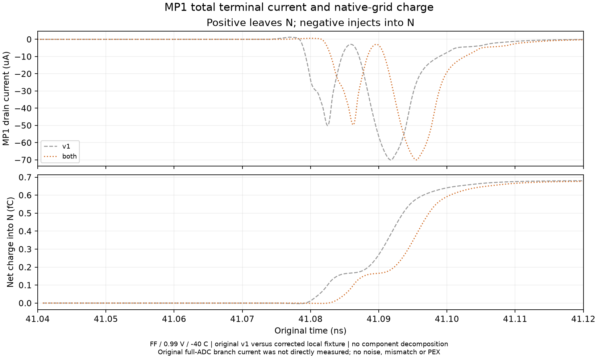

# 三者对比：复现偏差已消除，真实过冲仍在

FF、0.99 V、−40 °C；第一次采样关闭，比较尚未开始。

| 指标 | 原整机 | 原独立台 v1 | 补齐 SN 负载 both |
| --- | ---: | ---: | ---: |
| X020.N 峰值/V | 1.078642015 | 1.079890184 | **1.078641566** |
| 峰值时间/ns | 41.089515434 | 41.085740590 | **41.089498025** |
| SN ↑ 0.5 VDD/ns | 41.078857953 | 41.075845371 | **41.078858003** |
| LIVE ↑ 0.5 VDD/ns | 41.085839158 | 41.082104424 | **41.085839169** |
| SN 最低电压/mV | −8.977648 | −10.780405 | **−8.981845** |

both 与原机的 N 峰值仅差 **−0.449 µV、−0.0174 ps**。这项单变量对照支持：
原 v1 的时间/幅度复现偏差主要来自遗漏的 SN 栅负载。不运行两项单支路区分。
both 的关键 KCL 最大残差 **3.654 pA**，初态最大差 **9.37 nV**。
9 个回收文件共1,725,886B、436 路电流、原生 END 和全部冻结输入 SHA 已核对。

MP1 峰值前净注入为 v1 **0.166363 fC**、both **0.164111 fC**，各积分至各自
N 峰值；起点均为实际原生行41.040745359ns。总端电流的主要负脉冲及其
电荷轨迹随时序恢复，不是对某项 Cgd 或沟道电流的单独测量；原整机没有直接
保存该支路电流，不能把图中 both 曲线称为原整机直接测量。

**这修正了隔离台，没有修好 ADC。** both 的 N 仍比0.99V高约88.64mV，CMI
2751–2755、SFE-1131、SPECTRE-16780、VACOMP-2435仍在。
冻结分析器的 `acceptance_pass=null` 保持。

下一项直接检验 MP1 栅极单独整形，见 `../../mp1_shape_v1/README.md`；不再
为复现精度增加实验。本轮没有新远端操作或原始电路/OA修改。
