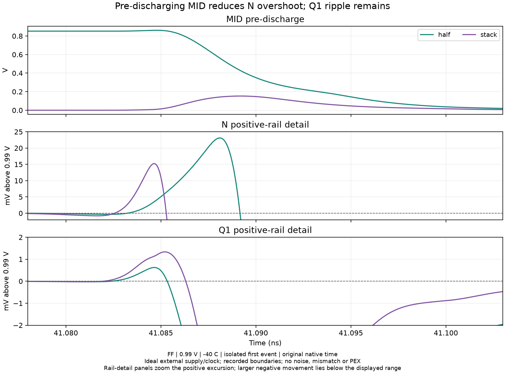
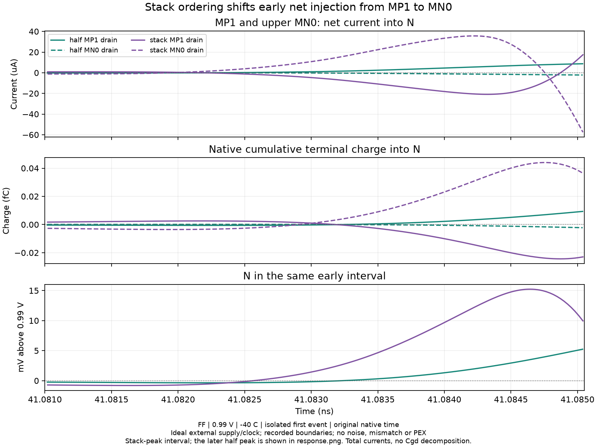
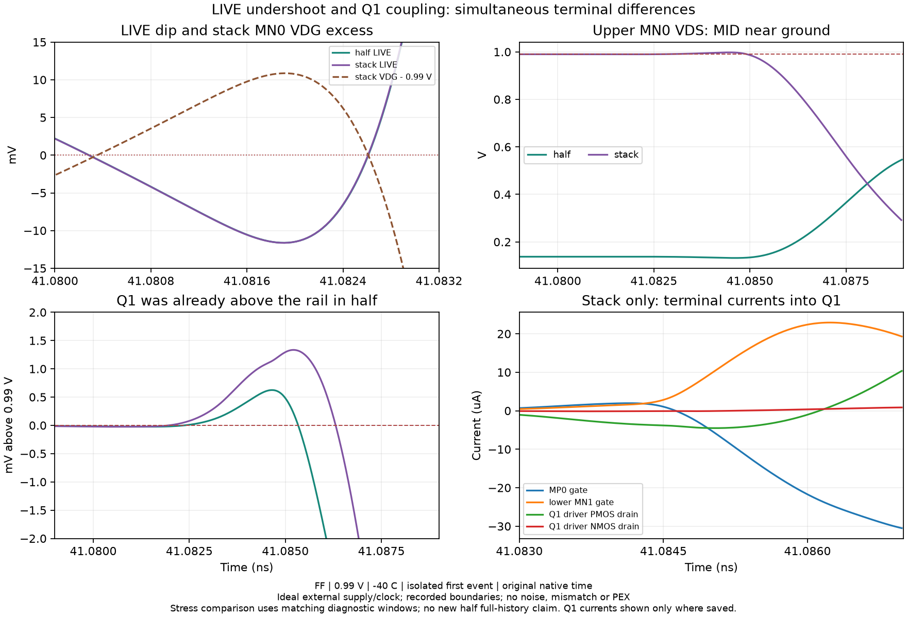

# 换栈结果：MID预放电生效，主导注入转移到MN0

FF、0.99V、−40°C，首事件隔离网表；理想外部电源/时钟、原生边界重放。
没有噪声、失配或PEX。只交换X020两只NMOS栅极，其余器件/时序保持。

| 观察量 | half | stack-order |
| --- | ---: | ---: |
| MID的DC初态 | 0.852467V | 0.325µV |
| N最大电压 | 1.013105V | 1.005230V |
| 超出0.99V | 23.105mV | 15.230mV |
| N峰时刻 | 41.088098ns | 41.084645ns |
| Q1最大电压 | 0.990624V | 0.991334V |
| QUIET上升沿 | 41.098727ns | 41.094599ns |
| VDD能量，0–41.590786ns | 1.085184pJ | 1.085590pJ |
| 初始VDD输出功率 | 24.7280µW | 24.7287µW |

MID预放电已实现；N过冲再降34.08%，QUIET提前4.128ps，本观察窗仍为一次上升、
没有下降。但N及其他受测端压仍超限，三电阻直流偏置代价也保留。

**谁在向N注入？** 下表为41.040745ns至各自N峰值的总端电流积分。
正数净流入N，负数净流出；两列结束时间不同，不能据此单独推断总注入减少比例。

| N端口 | half | stack-order |
| --- | ---: | ---: |
| MP1漏端 | +0.050314fC | −0.022544fC |
| MN0漏端 | −0.017049fC | +0.043200fC |
| MP0漏端 | −0.014481fC | −0.008352fC |
| 恢复反相器PMOS栅端 | −0.009417fC | −0.006173fC |
| 恢复反相器NMOS栅端 | −0.009367fC | −0.006131fC |

在stack的N达峰时，LIVE=0.3760V、MID=8.318mV，MN0仍在向N净流入14.362µA；
MP1从N净吸收14.478µA。因LIVE改为直接驱动上管，主导净注入支路已由MP1
转为MN0，符合LIVE边沿经上管栅/漏电荷交换影响N的机理。这里尚未将端电流
拆成纯Cgd和沟道分量；KCL积分和接近零，也不代表额外净储电荷为零。

**端压问题如何变化？** 以下12项均用两组实际接法、同一重叠诊断窗
40.810–41.590786ns内的同一时刻电压相减，再取最大绝对值。
half没有这12项的全史重分析，不能把它的同窗结果写成全史通过。
stack这12项同窗极值与已回收全史极值逐项核对一致。

| 同一器件/端压 | half最大绝对值 | stack最大绝对值 |
| --- | ---: | ---: |
| MN0 VGS | 0.989999V | 0.989998V |
| MN0 VGD | 0.989998V | **1.000869V** |
| MN0 VDS | 0.576897V | **0.997816V** |
| MN0 VGB | **0.990624V** | 0.990000V |
| MN0 VDB | **1.013105V** | **1.005230V** |
| MN0 VSB | 0.861448V | 0.152992V |
| MN1 VGS | 0.990000V | **0.991334V** |
| MN1 VGD | 0.989998V | **0.990284V** |
| MN1 VDS | 0.861448V | 0.152992V |
| MN1 VGB | 0.990000V | **0.991334V** |
| MN1 VDB | 0.861448V | 0.152992V |
| MN1 VSB | 0 | 0 |

粗体表示超过现有0.99V绝对值诊断屏。接近0.99V的四舍五入值不等于有裕量。
原生CMI仍是PDK证据；结电压需保留符号。stack的MID最低−0.301mV，已记录，
没有另设一个正向结电压合格阈值。

三个关键时刻串起了路径：

1. **41.081913ns，LIVE下冲。** half为−11.623mV，stack为−11.629mV，
   下冲原本就存在。stack此时N=0.989240V，所以MN0的
   `VGD=LIVE−N=−1.000869V`。换栈将既有下冲施加到了靠近高电位N的栅漏两端。
2. **41.084645ns，N达峰。** MID已靠近地，N下拉更早建立；同时上管MN0
   成为主要净注入支路。N靠地结电压和恢复反相器栅压仍随其超出0.99V。
3. **41.085227ns，Q1达峰。** Q1超出0.99V的现象在half已有，这次
   从0.624mV增到1.334mV。Q1现在接靠地MN1，所以其VGS/VGB直接达到0.991334V。

在Q1峰值时，MN1栅端向Q1净流入13.569µA，MP0栅端净吸收9.188µA，上游Q1
驱动PMOS漏端净吸收4.381µA；其余很小。峰前MN1栅端净流入0.007538fC，
与MID上升时通过MN1端电荷反馈到Q1的解释一致。旧half未导出这些Q1支路电流，
这里只能做Q1电压对照及stack的支路归因，不能声称旧版完全没有该电流。

原MP1两项全史最大VSG/绝对VGD为0.738204/0.989995V，仍在原诊断限内；
其余所测故障没有消失。stack回收9文件/2,109,393B，5939个全史原生点、
1858个局部点；全部回执和输入SHA核对通过。重点KCL最大2.739pA，全部受测
节点最大3.954pA。CMI2751–2755等全部原告警保留。

下一项建议：[局部耐压互补逻辑与退出直流偏置](next_step.md)。这是方案，
没有生成新实验包或修改远端。重现脚本为
[review_stack_order_result.py](../../review_stack_order_result.py)，逐点范围、积分
端点、实际栅极归属、缺失的旧电流列和证据散列见 `comparison.json`。
