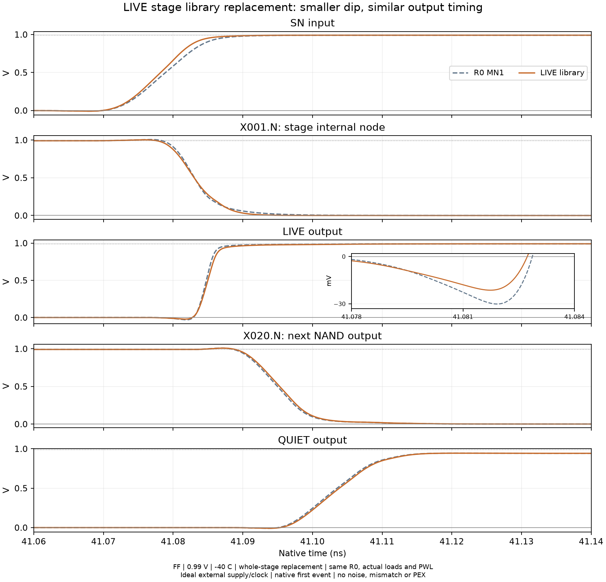

# LIVE整级标准库替换：有改善，过压未闭合

主对照为**R0 MN1**；候选只替换X001的NAND＋INV，旧6MOS及MID电容一起退出，
不是单管因果实验。两组均为FF/0.99V/−40°C，实际X020/R0/RC负载、11份PWL和采样关闭沿保持。

| 指标 | R0 MN1 | LIVE标准级 |
| --- | ---: | ---: |
| LIVE最低值 | −30.133mV | **−21.370mV，幅度改善29.08%** |
| LIVE低于−1mV累计时长¹ | 5.194ps | **5.555ps，变宽** |
| SN最低值 | −8.982mV | −9.411mV，略变差 |
| X001.N最大超幅，参考0.99V | 16.273mV | 12.512mV |
| X020.N最大超幅，参考0.99V | 18.683mV | 17.966mV |
| 关闭→QUIET半轨沿 | 31.665ps | **31.986ps，增加0.322ps** |
| VDD净供能，0..41.590786ns | 0.0678523pJ | **0.0665266pJ，减少1.95%** |
| 物理端压超限对/606对 | 237 | **237** |

¹−1mV只描述低谷宽度，器件筛查门限仍为0.99V。时长按原生样点交叉线性估计。
VDD净供能不是整周期ADC功耗；额外七路理想边界功与R0吸收量已独立记录，不补造旧版缺少的完整历史值。

**原生端流解释。** 新LIVE最低点为41.081743ns，级内N=0.675444V。
INV的PM `X001.X001.MM0`总漏端从LIVE抽出3.645µA，NM `MM1`补回2.090µA，
R0端1补回1.555µA，支路KCL闭合。仍存在PM相关的动态净抽取；总端流尚未拆成沟道/Cgd分量。
全部节点最大KCL残差约3.937pA，十二库MOS的48个端流均已原生绑定。

替换后本级SN栅端电流峰值131.44→59.98µA，事件净交换1.615→0.756fC；
级内INV栅端净交换−1.232→−0.756fC。负载、寄生、时序及旧MID电容同时改变，
这些证据支持整级实现收益，不能只归给某个W/L或电容移除。

**下一项建议。** 优先只将产生RB的复位反相级 `XCLOCK.X000` 换成已验证`INVD1`，
保留上游CLOCK_RESET真实驱动、SR扇出与复位极性/优先级。
RB仍下冲约25.523mV，现已大于LIVE低谷，且本次几乎未变。
同步独立报告入射CLOCK_RESET约+24mV上冲，不能把接收端替换当作上游应力已消除。
本轮未扩电路或提交新任务。

数据：[comparison.json](comparison.json)。候选run为`sar8audit-ctrl-stdcell-live-ff-v1`，
managed hash `a99eeaad32f6fb75ac2c548ebf617690091e2175fb022aa43437e522684a9226`。
9文件/9,416,094B与输入身份、PASS/END已核对，6053原生点，无必需信号缺项；
CMI-2751至2755保留。源R0证据同样核对，原生有效设置一致。
仍是理想外部电源/时钟、无噪声/失配/PEX的首事件台，不作完整复位、PVT或ADC合格结论。
