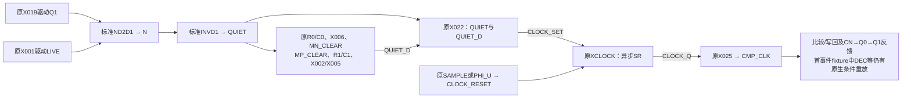

# 最小标准单元替换面：X020两级AND

只替换 `XDUT.XCTRL.XTIM.X020` 的自搭NAND＋INV，外部仍为
`QUIET = Q1 & LIVE`。采用主库 `tcbn28hpcplusbwp12t30p140` 的两个D1单元。
Q1/LIVE生成、RC延迟/清零、SR锁存、时钟缓冲和比较器均保留。
这是门单元实现对照，不采用新基线；IO V2继续保留为未提交检查点。

对照A直接复用已重现原整机首事件的 `sar8audit-ctrl-snload-both-v1`
（recipe `66cda5e5a9c65de39abee30125b33fe39f8926729145adbe5d25999b0bcc802c`）。
对照B仅改变X020，两组共用原FF/0.99V/−40°C、11份边界PWL、采样窗口/关闭沿、
真实扇出及同一截止点。该源不含后来RSLEW、直流分压和IO换管，A/B归因清楚。

| 原实例 | 实际存在的候选 | 已核实subckt端口顺序 | 接线/已核实布尔功能 |
| --- | --- | --- | --- |
| X020.X000，自搭NAND | ND2D1BWP12T30P140 | A1 A2 ZN VDD VSS | LIVE Q1 N VDD! 0；N=¬(LIVE·Q1) |
| X020.X001，自搭INV | INVD1BWP12T30P140 | I ZN VDD VSS | N QUIET VDD! 0；QUIET=¬N |

保留外层X020的旧端口顺序 `A B VDD VSS Y`，A=Q1、B=LIVE、Y=QUIET。
候选wrapper接线如下，已生成本地网表，尚未执行：

```text
subckt sar8audit_and2_tcb A B VDD VSS Y
    X000 (B A N VDD VSS) ND2D1BWP12T30P140
    X001 (N Y VDD VSS) INVD1BWP12T30P140
ends sar8audit_and2_tcb
```

端口不能沿用自搭NAND/INV的内部顺序。上表存在性、端口与核心模型名来自
[package_metadata.json](../standard_cells/package_metadata.json)，OA视图来自
[live_inventory.json](../standard_cells/live_inventory.json)。
主会话新增的[two_cell_logic_check.json](../standard_cells/two_cell_logic_check.json)
已从实际170a SPICE验证上述真值；NAND输出相邻NMOS接A1，因此确定LIVE→A1、
Q1→A2。后补元数据已确认显式纳米单位、实际内部MOS名及inline subckt端序；
SPICE-M读入/原生探针支持和slew/load范围仍待原生验证。
D1是初始候选，驱动是否足够待真实负载验证。

X020没有状态或内部反馈。源中的显式 `X020.X000.CMID` 属于自搭门内部实现，
随整个门替换退出；不移接到标准单元的隐藏节点，也不复制/改写foundry内部电路。
N仍作为可观测的NAND输出/INV输入。RC0/RC1的MOM与全部外部负载保持。



QUIET真实扇出逐项为：R0→RC0/C0/X002；X006→AB→MN_CLEAR；MP_CLEAR栅端
及其RC1/C1/R1/X005；X022的QUIET输入。Q1/LIVE保持由实际门驱动，保留四只SN
条件负载复制管及原生偏置重放；不改为理想Q1/LIVE电压源或统一拟合电容。

必须保留的异步契约：

- Q1或LIVE为低时QUIET为低；两者高时QUIET为高。两级均为组合响应，
  没有新增CP/使能/复位，也不加新的全局时钟。
- 现有 `CLOCK_RESET = SAMPLE | PHI_U`，高有效。XCLOCK由现网表推导为
  R=1清Q（S同时为1也清Q）；R=0且S=1置Q；R=S=0保持。外部SR反馈和优先级不动。
- `CLOCK_SET = QUIET & QUIET_D` 的原资格延迟、清零路径、反馈竞争与脉冲传播继续
  由真实电路决定。标准单元会改变内部延迟，不能强行拟合回旧边沿或仅凭最终逻辑值判过。

不使用已列出的DFQD1/DFCNQD1/LHQD1替换XCLOCK：其CP/CDN/E极性与异步优先级
在当前元数据中待核，DFF/透明锁存器也不能直接替代该SR。DEL025D1仅有名称和
I/Z端口证据，不用其名称替代实际RC资格时间。

接入时读取元数据所指的170a原始晶体管SPICE，以只读include使用两单元，先使用
非LPE版本与原器件级源比较。确认其nch_mac/pch_mac模型与本项目PDK及FF角匹配；
190a/170a/180a交付差异见[主会话评估](../standard_cells/assessment.md)。
不需要为本两单元对照解包13.66GB CCS；时序/LPE/全库迁移均不在本替换面内。

最小对照测量：

| 项目 | 两组同样记录 |
| --- | --- |
| 功能/极性 | 四组输入的AND契约；原关闭沿的Q1/LIVE→N→QUIET顺序 |
| 真实边沿 | 原生半轨沿、脉冲数/宽度、毛刺、QUIET/QUIET_D/CLOCK_SET/CLOCK_Q/CMP_CLK；缺失沿记未观测 |
| 实际负载 | QUIET终值和R0电流，AB/RC0/RC1、上游Q1/LIVE反冲与输入slew |
| 电压/电流 | 两库单元内部MOS及保留接口的同时刻六对端压、结极性、端电流/KCL与原生CMI；内部实例名从实际SPICE取得 |
| 功耗 | 相同0..END的VVDD及四偏置源有符号能量；标准NAND/INV电源端电流索引分别为4/3，接入后核对原生符号 |

已知首事件窗口不足以验证完整比较/复位；本实验不据此宣布闭环、PVT或ADC通过。
库内仍用核心模型，不能套用IO的暂定1.98V筛查；入射Q1/LIVE与保留周边本身的
超限需分组报告。后续SS必须有合法SS边界，不能把FF条件PWL改标签使用。

后续[FF最小本地包](standard_cell_v1/README.md)已准备，未运行仿真、未修改共享计划或旧冻结输入。
