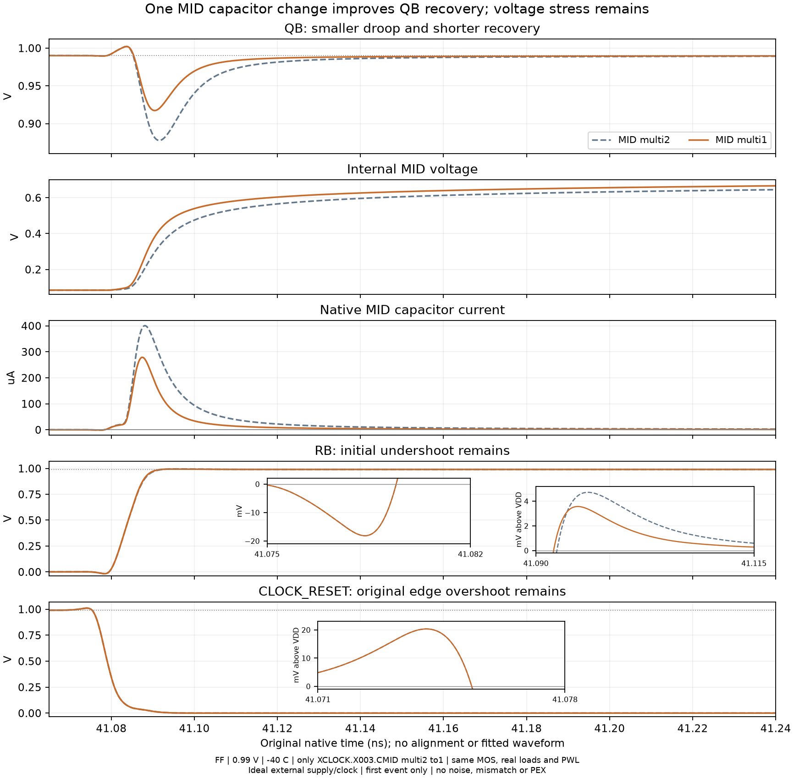

# MID电容减半：QB储荷恢复改善，瞬态端压尚未闭合

源为原RESET NAND版；唯一变化是`XCLOCK.X003.CMID multi2→1`，其余MOS、真实驱动/负载与11份PWL保持。
两组FF/0.99V/−40°C、相同原生求解设置。multi2数据同时对齐冻结的`source_storage_reference.json`。

| 指标 | multi2基线 | multi1 q2 |
| --- | ---: | ---: |
| QB最低值 | 0.877733V | **0.917302V** |
| QB高电平下陷，参考0.99V | 112.267mV | **72.698mV，减小35.25%** |
| QB低谷→持续恢复到±1mV¹ | 131.898ps | **70.734ps** |
| 各自RB90%→QB恢复的MID净充电¹ | 4.364577fC | **1.906870fC** |
| RB下冲 / 上冲，参考0/VDD | -18.144 / +4.724mV | -18.149 / +3.573mV |
| CLOCK_RESET上冲，参考VDD | +20.340mV | +20.339mV |
| QB / SN上冲，参考VDD | +11.974 / +11.802mV | +12.099 / +11.910mV |
| R下降→RB上升半轨延迟 | 5.008ps | 5.002ps |
| VDD净供能，0..41.590786ns | 0.0651130pJ | **0.0622725pJ** |
| 物理超限对/606 | 245 | **245** |

¹恢复是在本次窗口内不再离开0.99V±1mV；两组积分采用各自RB90%和恢复端点，不能把充电下降百分比当作固定偏置电容标定。
实际电流直接使用原生返回值，没有再乘除2。

**储荷路径得到验证。** 减半MID后，QB下陷减小35.25%、恢复缩短46.37%，MID后段充电由4.365降至1.907fC。
QB低谷时，上管MN0的VGS/VDS由0.654/0.546变为0.597/0.535V；下管MN1栅源仍接近0（−0.683mV）。
新低谷上管总漏端从QB抽出223.538µA、源端向MID注入201.042µA，电容吸收183.568µA；PM1补回221.481µA。
低谷后30ps，电容电流由原20.415µA降至7.790µA；上管仍从QB抽出9.345µA，PM1补回10.442µA。
源/漏总端流、MID充电及恢复同时变化，支持真实储荷负担的因果贡献，不能仅解释为瞬间边沿耦合。

**尚未解决的部分。** RB下冲仍约−18.15mV，CLOCK_RESET上冲仍约+20.34mV；该电容不控制这些前沿的全部来源。
RB回弹从+4.724降至+3.573mV，超过VDD+1mV的宽度从17.400降至11.680ps；
但QB/SN的正向峰分别增加约0.125/0.108mV，表明更快内部响应仍可能加重短尖峰。
245对超限的成员也未改变，原有微伏级尾部超限保留。当前仍较大的轨外幅度为LIVE−21.365、RESET+20.339、RB−18.149及X020.N+17.966mV。

五路源、七路理想边界源和R0功分别记录；VDD同窗口净供能减少4.36%，不是整周期ADC功耗。
各阶段四端偏置/电流、独立端口功率及局部端口功在JSON中。没有region、Vth或沟道分量，不推断三极区或纯Cgd。
QB仍高于半轨，未见错误CLOCK_Q翻转；这不代替完整复位/闭环验证。

**优先后续建议，仅提案。** 在当前multi1候选上，只交换`XCLOCK.X003`两串联NM的栅控位置：
**Q控制靠QB的上管、RB控制靠地的下管**，保留PM网络、电容、尺寸和所有外部时序。
本段Q保持低，目前却是RB驱动上管持续从QB向MID供电。把保持低的控制放到输出相邻管，
可直接检验是否隔开这条已定位的储荷路径；比继续减电容或机械换库更有针对性。
输入负担、RB返注、全部端压及完整SR复位/置位仍须验证，不预判通过。本轮不准备候选。

**两次运行的区别。** 原v1在许可证签出阶段SPECTRE-209退出，3文件/6,023B保留，未产生电气结果。
实际结果来自q2；25项电气输入及solver不变，提交recipe的run_id和retry_provenance不同。q2为9文件/9,473,260B、6059点，
SHA/大小、PASS/END和72个库端流已核对；CMI-2751..2755保留。

源9文件/9,448,118B。两组外部电源/时钟理想，无噪声/失配/PEX，均为41.590786ns首事件台，不判定整机/PVT合格。
[完整对照、阶段电流/偏置/源功与失败记录](comparison.json)。q2 run `sar8audit-ctrl-stdcell-qbcap-ff-q2`，managed hash `ae800c95066a921a5df6e9101c29adecdf7a6e761cac71b1490ed0f1b30920b0`。
本轮无远端操作、新实验、OA修改、采纳、commit或push。
