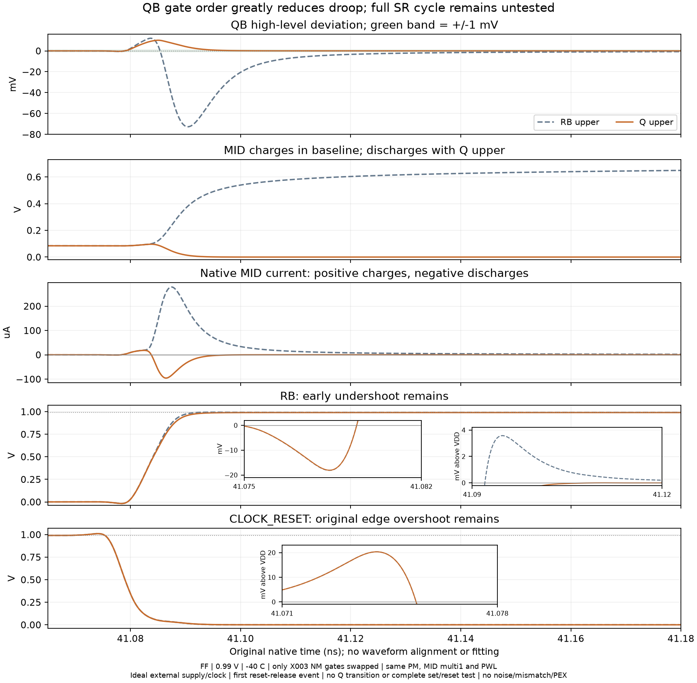

# Q上／RB下：大幅减小QB下陷，完整SR功能仍未验证

对照为qbcap-q2的RB上／Q下；唯一变化是`XCLOCK.X003`两个NM栅控互换。PM、MID multi1、尺寸、真实负载及11份PWL保持。
两组FF/0.99V/−40°C、同一首个采样关闭/复位释放窗口和原生求解设置。

| 指标 | RB上基线 | Q上候选 |
| --- | ---: | ---: |
| QB最低值 | 0.917302V | **0.989612V** |
| QB负向下陷，参考0.99V | 72.698mV | **0.388mV** |
| QB正向尖峰，参考VDD | +12.099mV | **+10.185mV** |
| 最低值→此后始终±1mV¹ | 70.734ps | **16.442ps** |
| 各自RB90%→稳定的MID净电荷² | +1.906870fC | **-0.153834fC** |
| RB下冲 / 上冲，参考0/VDD | -18.149 / +3.573mV | -18.074 mV / **+2.006µV** |
| RESET上冲，参考VDD | +20.339mV | +20.340mV |
| R下降→RB上升半轨延迟 | 5.002ps | 5.080ps |
| VDD净供能，0..41.590786ns | 0.0622725pJ | 0.0593486pJ |
| 物理端压超限对/606 | 245 | **237** |

¹新QB最低点0.989612V已经在±1mV内；随后仍有+10.185mV正峰，41.094366ns才持续回到带内。
**16.442ps主要包含这个正峰的衰减，不能全称为负向下陷恢复时间。**旧70.734ps则包含实际的负向恢复。
²两组各取自己的RB90%与稳定端点，积分窗不同；新值为放电，绝对端流交换同为0.153834fC，不是正负抵消制造的小值。

**路径改变。** 原RB驱动上管在RB90%时VGS约0.637V，持续由QB向MID供电。
改为Q驱动上管后，同相位上管VGS/VDS约−0.034/0.963V，漏端总流−0.540µA；
RB控制的下管VGS约0.892V、漏端抽走74.478µA，MID电容电流−67.150µA，主要转为向地放电。
MID不再从约0.085V充到高电平，而是短暂到0.096V后降到接近0；这与目标储荷路径被隔开的解释一致。
记录的是四端偏置与总端流，仍不作region、沟道/Cgd分解或长沟道公式推断。

**门负担不是消失。** RB的四栅门净交换2.224668→2.594256fC（增加16.61%），峰值323.230→328.206µA；
Q完整四栅负担净交换−0.098514→+0.014329fC，最大绝对瞬态门流4.768→2.749µA。
已核对实际RB接`X003.MN1`、Q接`MN0`及其余PM/buffer门，KCL按新节点连接求和；没有拿旧门电流套新拓扑。

**237对的变化组成。** 同一器件/端对比较是消失12、新增4，净减8；两管的栅端点本次已变，JSON保留两组实际端点。
消失的12对为：原MN0 VGB的3.573mV超幅；8对2.278–49.726µV尾部超幅；另3对原超幅仅0.0647µV。
新增4对均在X003：下管MN1的VGS/VGB各2.006µV、VGD为0.324µV；上管MN0的VDS为33.901µV。
所有微小值及CMI均保留，筛查上限仍0.99V。当前大幅超限仍有LIVE−21.368、RESET+20.340、RB−18.074、X020.N+17.966mV，
QB/SN正峰仍约+10.185/+11.345mV，**没有全部修好**。

**自然初态与功能边界。** 两组QB初始都约0.989999956V、Q约2.13µV；MID自然初值84.519/84.419mV，未强行对齐。
初态只作观测，不能证明经过完整置位/复位。当前没有CLOCK_SET上升、Q翻转或从Q高开始的reset断言。
五路源、七路理想边界源和R0功分别保存，VDD净供能不是完整ADC功耗。

**下一项最有价值的验证。** 做一次独立、带真实驱动和扇出的SR完整时序：reset/保持→释放→set/保持→从Q高复位/保持，
同时观察Q/QB/MID/RB、双向延迟、输入负担与全部端压，并验证复位优先级。
先确认栅位交换没有把储荷问题转移到另一方向，再继续修剩余尖峰。本轮只建议，不准备新包或启动远端。

候选9文件/9,440,613B、6051点，基线9文件/9,473,260B；SHA/大小、输入身份、PASS/END和72库端流均核对。
全部节点最大KCL残差约3.94pA。外部电源/时钟理想，无噪声/失配/PEX；未判定完整SR、PVT或整机合格。
[完整端对变化、偏置/电流/源功与门负担](comparison.json)。run `sar8audit-ctrl-stdcell-qborder-ff-v1`，managed hash `c933758028b599adad5e3ab700a3e610424c2ab10133ccbaa33ead845fd87ce4`。
本轮无远端操作、OA修改、新实验、共享计划/日志修改、采纳、commit或push。
