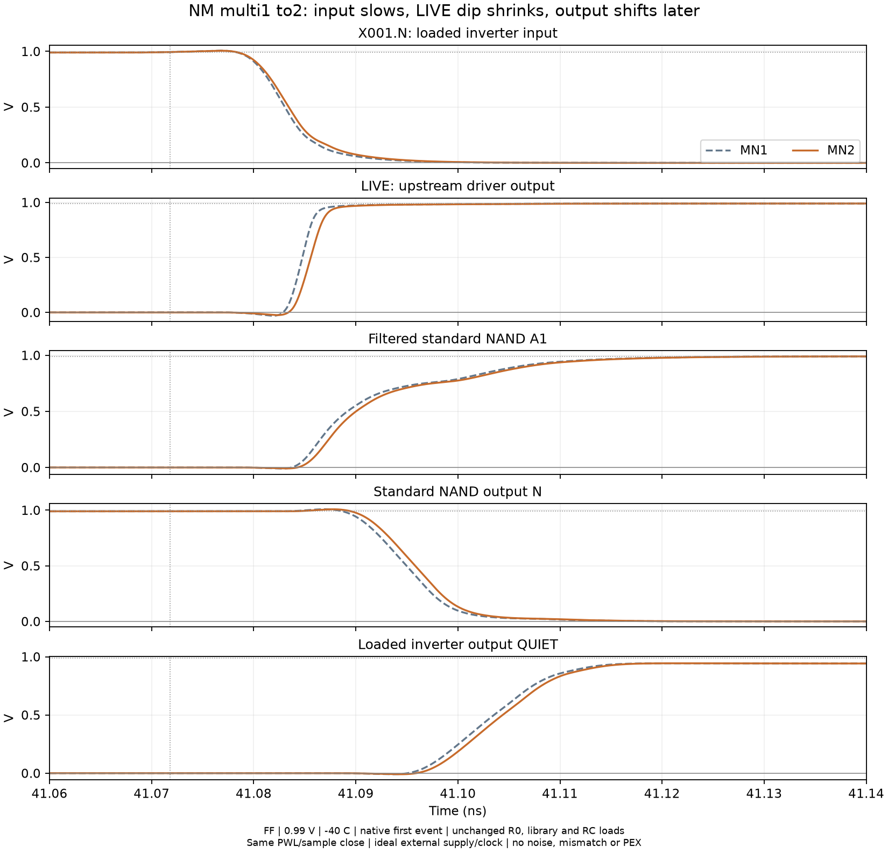
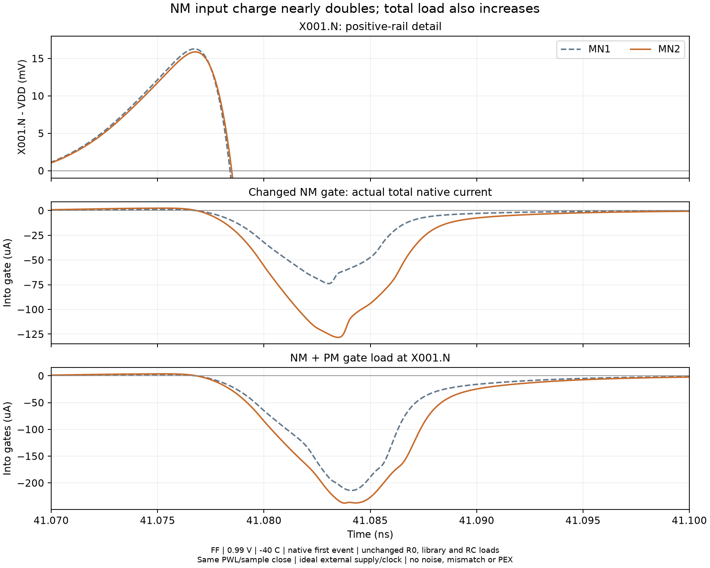
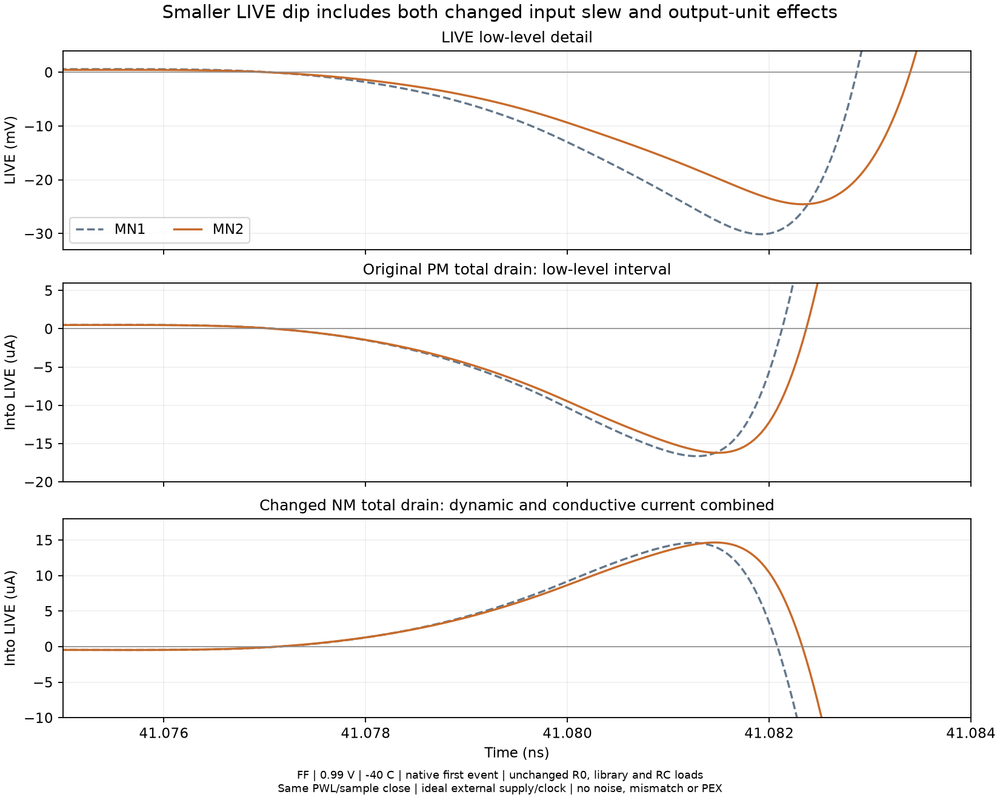

# LIVE下拉NM并联数1→2：峰值有收益，负载与时长有代价

**本结果来自q2实际完成的仿真；原v1从未启动Spectre。**

| 记录 | 实际状态 |
| --- | --- |
| `sar8audit-ctrl-stdcell-r0-mn2-ff-v1` | 内存余量准入等待超时，`rejected/queue_timeout`；没有child、started或native结果；2份状态/准入文件保留 |
| `sar8audit-ctrl-stdcell-r0-mn2-ff-q2` | 实际仿真及分析完成，9文件/9,399,303B均核对SHA/大小 |

q2 managed hash：`3b0e98474b6d0dc6e6a11484382c79e06d762e3a4d070c8134536097cedff31c`。
两次登记的21份冻结输入完全相同，管理器另附同一份`native_summary.py`，共22文件；
配方仅run ID不同。拒绝记录不是电路仿真失败，也没有覆盖为q2结果。

对照是已完成的源R0案例：`sar8audit-ctrl-stdcell-r0-ff-v1`。
唯一电路变量为原LIVE下拉NMOS的multi=1→2；每单元500nm/30nm/nf=1、PM、R0、
标准库、11份PWL、采样窗口/关闭沿及求解设置保持。均为FF/0.99V/−40°C，
理想外部电源/时钟，无噪声、失配或PEX。以下MN1/MN2分别指这两个实际完成的案例。

## 波形与代价

| 指标 | MN1：源R0 | MN2：q2 |
| --- | ---: | ---: |
| LIVE最低值 | −30.133mV | **−24.549mV，幅度减少18.53%** |
| LIVE低于−1mV累计时长¹ | 5.194ps | **5.599ps** |
| A1_FILTER最低值 | −9.857mV | −8.686mV |
| X001.N高于VDD最大超幅 | 16.273mV | 15.875mV |
| X001.N下降90–10% | 7.681ps | **8.484ps，增加0.804ps** |
| LIVE上升10–90% | 2.539ps | 2.927ps |
| A1上升10–90% | 20.086ps | 20.189ps |
| N高于VDD最大超幅 | 18.683mV | 18.098mV |
| N主峰超限连续段 | 5.584ps | **5.901ps** |
| QUIET最低值 | −9.211mV | −9.201mV |
| 关闭→QUIET半轨沿 | 31.665ps | **32.513ps，增加0.848ps** |
| VDD净供能，0..41.590786ns | 0.06785226pJ | **0.06810904pJ，增加0.378%** |
| 五路源有符号净供能之和 | 0.06742117pJ | 0.06767840pJ |
| R0吸收能量 | 0.28200fJ | 0.27571fJ |

¹−1mV只补充描述负脉冲宽度，不是新验收门限。所有器件端压仍按0.99V筛查。
时长由原生交叉样点线性定位，JSON保留原生括区；无波形对齐、平滑或补点。
整体时序的竖线为同一实际采样关闭沿，水平虚线为0.99V。

LIVE峰值有所改善，X001.N上冲也未放大；但输入更慢、负脉冲更宽，
N和QUIET仍有超轨。不能把18.5%的LIVE幅度改善表述为模块已经合格。

## X001.N新增负载已量化

| 输入端量，正向从X001.N进入MOS栅端 | MN1 | MN2 |
| --- | ---: | ---: |
| NM栅端最负电流 | −73.892µA | **−128.361µA** |
| PM栅端最负电流 | −156.914µA | −136.031µA |
| 两管栅端合计最负电流 | −214.104µA | −237.724µA |
| NM栅端事件净交换 | −0.39758fC | **−0.79490fC，1.9994倍** |
| PM栅端事件净交换 | −0.84415fC | −0.84403fC |
| 合计事件净交换 | −1.24173fC | **−1.63893fC，幅度增加31.99%** |

净交换按请求41.075ns至原截止点的实际原生样点积分，实际首点与终点逐案列在JSON。
负号表示栅端向该输入节点返回净端流。NM净交换接近翻倍，但整个反相器还有未改尺寸的PM，
且输入波形本身改变，不能把整个输入负载或峰值电流直接按2倍估算。
这里直接使用原生总端流，没有再次乘multi。

X001.N两管栅端的净端功由−0.52191变为−0.71865fJ；这是局部端口的有符号交换，
不是“负功耗”，也不与VDD净供能重复相加。总供能增加约0.2568fJ已单独记录。

## LIVE改善的归因仍需区分

在MN2自身最低点41.082334ns，LIVE=−24.549mV、X001.N=0.662673V。
原PM总漏端从LIVE抽出1.525µA，目标NM总漏端也净抽出0.272µA，R0端1补回1.798µA，KCL闭合。
这不能据此判定NM关断或认为“更大的NM不提供恢复”：总漏端电流同时含动态电荷项，
当前没有独立沟道电流证据。

按各自谷点积分，NM向LIVE的净端流交换由0.03245增至0.03545fC；
但两组谷点时刻不同，不能把这个差额当成纯恢复电导增益。
用源谷点作共同请求截止时刻，NM交换量反而近似相同；具体原生首尾时刻和全部支路积分均保留。

当前对照同时改变了两件事的物理结果：

- 并联NM改变输出侧恢复能力及输出寄生；
- 额外栅负载让X001.N变慢，原PM也收到更慢的输入，从而改变其总漏端抽取过程。

因此可以确认**整个multi=2改变带来较浅的LIVE低谷**，但还不能把18.5%的收益全部归给更强下拉。

## 全部端压没有被“统计改善”掩盖

源R0的95个保留MOS中包含目标NM；本报告把两组统一拆成目标1、标准门6和其他94，避免分组变动造成误读。

| 统一分组 | MN1超限对数 | MN2超限对数 |
| --- | ---: | ---: |
| 目标NM：6对 | 3 | 3 |
| 标准门：36对 | 15 | 15 |
| 其他94MOS：564对 | 219 | 219 |
| 合计606物理端压对 | **237** | **237** |

门限0.99V、物理端点及全部609项观察（含3旧别名）保持不变。
同一事件的VGS/VGB等可能重复计数，不能把237叫成237个独立故障。
目标NM的VGD最大值略降，但其超限累计时长约14.14→18.27ps，仍需同时看幅度和时长。

LIVE关联PM的|VDS|从1.020133降至1.014549V，仍超限。
其他核心最坏现在是原SR复位支路：|VDS|约1.015523V；RB下冲约25.523mV几乎不变。
这是原有问题在峰值排序中变为最大，不是本次新增了SR过压。
目标NM的VGS/VGB仍约1.005875V，标准门内部仍有18.098mV超幅。

两组CMI-2751至2755均保留，见[native_CMI_excerpt.txt](native_CMI_excerpt.txt)。
警告受打印抑制，不能靠数量判通过；微小轨外值与幅度分组保存在JSON，未放宽门限。
两组全节点KCL残差约3.954/3.956pA，X001.N归约约1.96pA。
原生有效设置一致：gear2only、reltol=1e−7、vabstol=10nV、iabstol=100fA。
QUIET_D、CLOCK_SET、CLOCK_Q及CMP_CLK在本短窗内仍无半轨沿，不据此判断完整复位/闭环。

## 下一项：固定输入波形的单级对照

建议在独立的LIVE驱动级测试台中，**两组使用同一份完整、已测得的X001.N输入，唯一变量仍为multi=1或2**。
保留原PM、每单元NM参数、R0、标准NAND/INV及已识别的实际后续负载和共同边界，不用一个猜测电容替代真实负载。

这样可判断：固定输入后若改善仍明显，说明输出单元的恢复/寄生贡献较大；若改善明显缩小，
说明本次前级变慢贡献较大。这个实验仍不能自动分离沟道与Cgd分量。
输入重放仅用于机理对照，需在反相器栅输入处切开，不能把理想源直接钳在仍连接的原NAND输出上。
先核对multi=1局部台的原版重现和真实负载，再比较multi=2；输入源交换功与VDD功分开。

当前本地电压表仅从40.81ns起，后续应先流式导出完整0..END原生输入及必要边界，
不能凭初态给前段补常值。**本次只有建议，未生成测试台或候选，未提交远端。**

原始拒绝记录、两次登记输入一致性及实际数据身份见[comparison.json](comparison.json)。
脚本：[review_standard_cell_r0_mn2_result.py](../../review_standard_cell_r0_mn2_result.py)。
源R0回收9文件/9,440,208B；MN2 q2回收9文件/9,399,303B，均通过receipt/输入身份及PASS/END检查。
q2实际原生49.391s、峰值337,760,256B，分析37.730s、峰值13,385,728B；这些运行时间不作电路速度结论。
本次仍只是FF首事件模块对照，没有宣称PVT、寿命或整机修好。
