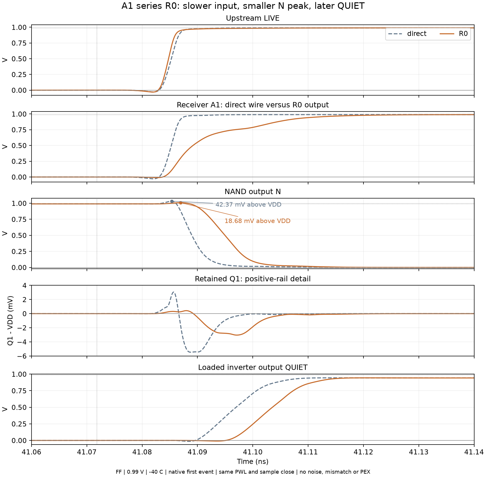
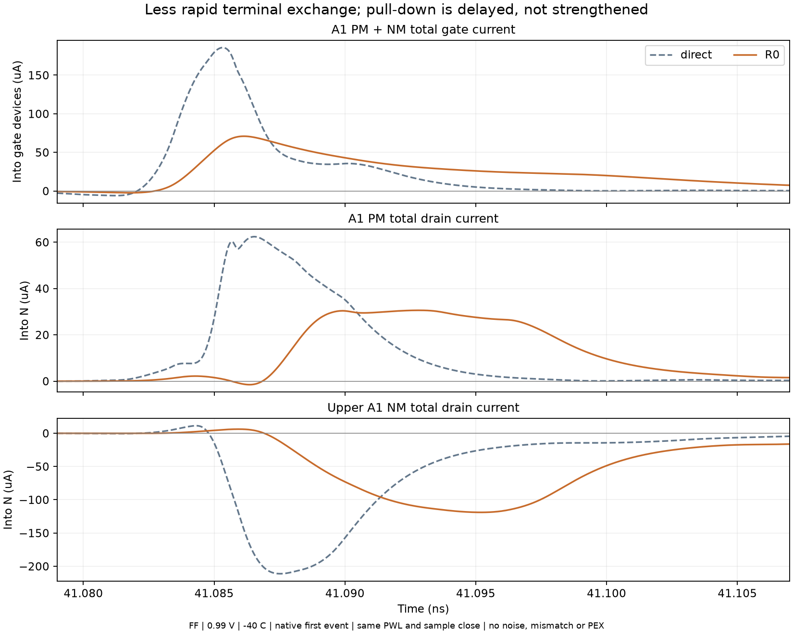
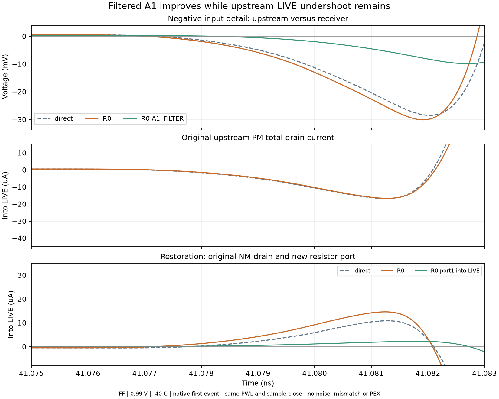

# A1串R0：降低峰值、拉宽交换，上游仍未闭合

主会话已完成并回收`stdcell-r0-ff-v1`；managed hash：
`f182531c14a57e1a6aabb8a38fb532c17b7ae56b8889ec504e8fadc8244f990a`。
对照为已完成的`stdcell-ff-v1`直接连接版。两组库、驱动管、Q1、实际RC/SR负载、
11份PWL和采样关闭沿不变；唯一新增器件是整个A1输入前的原生`rupolym` R0。
条件均为FF/0.99V/−40°C，理想外部电源/时钟，无噪声、失配或PEX。

## 收益与代价

| 指标 | 直接连接 | 串R0 |
| --- | ---: | ---: |
| N峰值 | 1.032372V | 1.008683V |
| N高于0.99V的最大超幅 | 42.372mV | **18.683mV，减少55.9%** |
| 主峰所在连续超限段 | 3.760ps | **5.584ps，变宽** |
| N高于0.991V的累计时长¹ | 3.526ps | 5.041ps |
| 上游LIVE最低值 | −28.512mV | **−30.133mV，略变差** |
| 标准NAND A1最低值 | −28.512mV | **−9.857mV** |
| Q1高于VDD的最大超幅 | 3.057mV | 0.419mV |
| QUIET最低值 | −13.267mV | −9.211mV |
| LIVE上升10–90% | 2.944ps | 2.539ps |
| A1上升10–90% | 2.944ps | **20.086ps** |
| A1半轨沿相对LIVE | 0 | 4.351ps |
| N下降90–10% | 5.796ps | **9.099ps，放电变慢** |
| 采样关闭→QUIET半轨沿 | 25.100ps | **31.665ps，增加6.565ps** |
| QUIET上升10–90% | 13.431ps | 13.874ps |
| 0..END VDD净供能 | 0.06833995pJ | **0.06785226pJ，减少0.714%** |
| 五路源有符号供能之和 | 0.06790885pJ | 0.06742117pJ |
| 新R0吸收能量 | 无此器件 | **0.2820fJ** |

¹0.991V只用于补充说明主峰时长，0.99V筛查门限未改变。
N还有一段µV级小凸起，计入后严格门限累计时长为12.951→14.386ps。
主峰连续段为41.082424–41.086185ns→41.083113–41.088697ns。
持续时间按原生样点交叉作线性估计，保留交叉时间步；没有对齐/拟合或重采样波形。
竖线为保持不变的实际采样关闭半轨沿约41.071796ns；水平虚线为0.99V。

## 主要机制：把交换摊慢，不是把电荷挡掉

A1两只MOS的总栅端电流峰值由185.696µA降至70.915µA。
但从41.075ns附近的实际原生样点积分至41.590786ns，进入两栅端的净端流积分是
**0.75535→0.75553fC，几乎相同**。串阻限制的是瞬态交换速度，不能称为去掉了最终输入电荷。
新RINPUT的原生V/I在|I₁|>1nA的诊断样点中为9790.67–9791.83Ω，两端电流和最大1.11×10⁻¹⁷A。

N变小也不是因为下拉更强：下拉总漏端峰值由211.249µA降至118.953µA，
且N下降时间由5.796ps延至9.099ps。相反，直接影响是输入边沿和各支路电荷交换时序改变。
按同一请求区间41.079ns至直接版N峰值积分，A1 PMOS向N净注入
**0.03476→0.00433fC**；各案例实际积分首尾样点在JSON中列明，不伪造共同端点。

残余上冲的支路比例也变了。到各自N峰值时：

| 向N的净端流积分 | 直接连接 | 串R0 |
| --- | ---: | ---: |
| A1 PMOS `MM1`总漏端 | +0.03476fC | +0.00338fC |
| 上管NMOS `MM4`总漏端 | +0.00129fC | **+0.01250fC** |

串R0后，上管NMOS的前段净注入占比增加；这不表示其沟道从地向N持续供电。
在串阻版N峰值41.086963ns，A1=0.301966V、LIVE=0.948829V，PM总漏端注入0.8734µA，
上管NM总漏端抽出0.8453µA，其余端流补足差额。直接版自身峰值的对应量约为47.493/47.820µA。
总端流包含动态电荷，不能把这些量直接拆成纯Cgd或纯沟道电流。

因此证据支持：**边沿变缓、快速耦合/净注入受限是主要收益；下拉竞争也改变了，但并未加强放电。**
幅度下降与超限时间变长同时存在，不能只凭更低的峰值宣布修复。

## 上游应力仍在，不能把它移出视野

保留驱动PMOS `X001.X001.MP`的最大|VDS|从1.018512V变为**1.020133V**，
超幅30.133mV，已经大于标准门内部的18.683mV。
串阻版LIVE最低点41.081920ns：原PM总漏端抽出8.436µA，原NM补回6.161µA，
电阻端1补回2.274µA，KCL闭合。两组自身谷点并非同一时刻，不能用这些快照比值宣称抽取电流成倍增大。

用同一请求截止时刻41.082017ns比较前段积分，原PM抽取量近似相同：0.03846→0.03777fC；
来自下游输入网络的净回补由0.01705fC降至经电阻的0.00490fC，原NM回补增至0.03287fC。
这与串阻改变驱动器所见负载/回补、LIVE需要更负电位来恢复的现象一致。
PM总抽取支路没有消失；A1变干净不等于原驱动也已满足端压要求。

## 屏幕、能量与结论边界

全部606个物理端压对及3个旧别名保留，两个A1栅节点映射到实际FILTER端，门限仍为0.99V。

| 端压对统计 | 直接连接 | 串R0 |
| --- | ---: | ---: |
| 标准门超限对/36对 | 23 | 15 |
| 标准门超幅>10mV | 12 | 6 |
| 保留电路超限对/570对 | 230 | 222 |
| 保留电路超幅>10mV | 58 | 47 |
| 保留电路≤1µV的超幅对 | 5 | 8 |

对数可能重复反映同一事件，不是独立故障个数；µV级量级照实保留，不用局部求解容差充当放行裕量。
SR内部RB下冲约25.523mV、RESET上冲约24.007mV仍存在。
CMI-2751至2755均未消失，原生摘录见[native_CMI_excerpt.txt](native_CMI_excerpt.txt)；
日志有打印抑制，警告数量不能替代完整波形筛查。两组最大KCL残差均约3.954pA。

新电阻吸收的0.2820fJ已由电源网络供给，不应再次从VDD净供能中扣除。
上述供能仅覆盖0–41.590786ns，不是整周期ADC耗散或整机功耗。
两组有效设置相同：gear2only、reltol=1e−7、vabstol=10nV、iabstol=100fA；
所有库、求解器、PWL及冻结输入身份已核对。
QUIET_D/CLOCK_SET/CLOCK_Q/CMP_CLK在本短窗内仍无半轨沿，不作完整反馈或复位判断。

## 下一项最有价值的单变量

建议针对现已更突出的**原LIVE低电平保持**：只把
`XDUT.XCTRL.XTIM.X001.X001.MN`的并联数`multi=1→2`。
保持其单元W=500nm、L=30nm、nf=1及每单元其他参数，保留当前串R0、标准库、PMOS、
11份PWL、采样窗口和关闭沿，不替换其他门。

检验下拉恢复能力增强后，LIVE下冲是否缩小，同时维持A1/N收益。
并联也会增加寄生/对X001.N的负载，因此需同时看X001.N、两侧电压、全部606对端压、
N/Q1/QUIET、KCL、原生时序及能量，结果不预设通过。
**这里只给建议，未生成候选、未提交远端，也未采用为新基线。**

来源：直接版9文件/8,997,843B，串阻版9文件/9,440,208B，均核对receipt SHA/大小、
登记输入、原生PASS/END和KCL。原生点数5974/6058；诊断窗1893/1977点。
数据：[comparison.json](comparison.json)；脚本：[review_standard_cell_r0_result.py](../../review_standard_cell_r0_result.py)。
本次仍为FF首事件模块对照，不等于完整复位、PVT、寿命或ADC合格。
