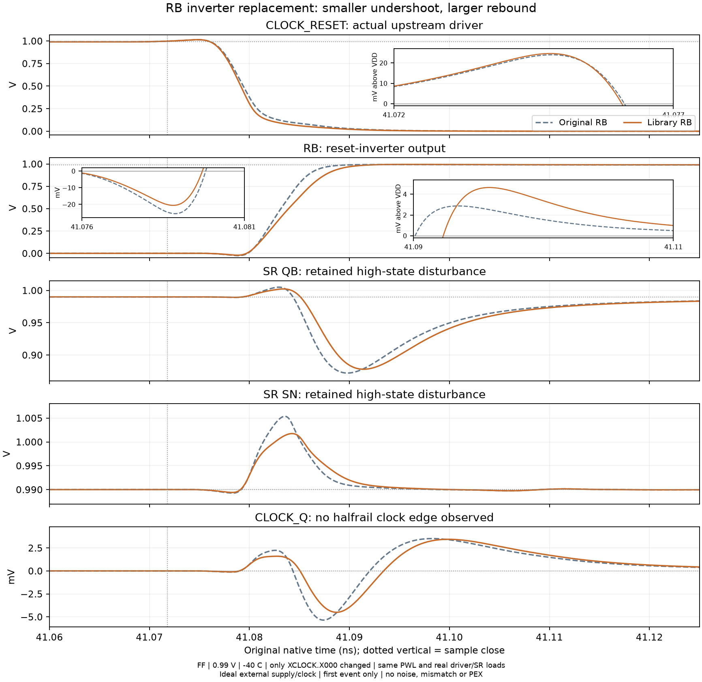

# RB标准反相器：下冲改善，回弹和上游过压仍在

只替换`XCLOCK.X000`两管反相器，无显式电容增删；其余127个实例、11份PWL和采样边沿不变。
两组均为FF/0.99V/−40°C，真实CLOCK_RESET驱动和SR扇出保持。尺寸、固有寄生随整级改变。

| 指标 | 原RB反相器 | 原生INVD1 |
| --- | ---: | ---: |
| RB最低值 | -25.523mV | **-20.571mV，幅度减小19.40%** |
| RB低于−1mV累计宽度 | 3.890ps | 3.735ps |
| RB上冲，参考VDD | +2.873mV | **+4.650mV** |
| RB超过VDD+1mV累计宽度 | 12.931ps | **17.305ps，变宽** |
| CLOCK_RESET上冲，参考VDD | +24.006mV | **+24.622mV** |
| CLOCK_RESET超过VDD+1mV累计宽度 | 6.844ps | 6.850ps |
| SR QB / SN上冲，参考VDD | +15.041 / +15.368mV | +12.319 / +11.749mV |
| SR QB高电平下陷，参考VDD | 117.863mV | 112.002mV |
| R下降→RB上升半轨延迟 | 3.706ps | **4.712ps** |
| VDD净供能，0..41.590786ns | 0.0665266pJ | 0.0660315pJ |

宽度按原生样点交叉估计；1mV仅描述脉冲，器件筛查仍为0.99V。237/606个物理端压对仍超限，
新RB级为8/12对；不能因峰值改善判定合格。CLOCK_Q未越半轨，新的reset断言尚无观测。

**端流来源。** RB低谷发生在41.078810ns，此时CLOCK_RESET仍为0.575647V。
新INV的NM `MM1`总漏端从RB抽出19.006µA，PM `MM0`补回18.311µA，四个SR栅端合计补回0.695µA。
到41.095793ns的RB回弹峰，QB已从下陷恢复，`X003.MN0/MP0`栅端合计注入10.470µA，INV漏端净抽走9.812µA，
另一路SR栅负载抽走0.658µA。这支持“前沿输入耦合、随后真实SR负载回馈”的动态交换，
总端流不能唯一拆成沟道/Cgd；两组各自极值也不是同偏置比较。全部节点最大KCL残差约3.937pA，56个库端流均已绑定。

新级输入栅端负向电流峰值215.4→150.5µA，事件净交换−1.232→−0.756fC；
CLOCK_RESET下降沿6.852→5.520ps，但RB上升沿5.271→6.957ps，释放延迟增加1.006ps。
上游过冲未随输入负担减小而消失；其峰值处仍由原`X023.X002.MP0`总漏端注入约13.118µA。

**剩余问题与阶段。** 按越出电源轨的幅度排序：①41.074778ns，高电平末端CLOCK_RESET **+24.622mV**；
②41.081723ns，SN上升激励LIVE **−21.368mV**；③41.078810ns，复位释放前沿RB **−20.571mV**；
④41.087198ns，LIVE传播到下一NAND时X020.N **+17.966mV**；⑤41.101422ns，QUIET激励的延迟链AB **+14.032mV**；
⑥41.075975ns，SN激励的LIVE内节点X001.N **+12.512mV**；⑦RB上升期间SR QB/SN **+12.319/+11.749mV**。
其中最大实际端压约1.014622V，落在CLOCK_RESET驱动NM漏/体及接收NM栅/源等端对。
另一个较大的功能扰动是QB在41.091408ns下陷112.002mV；它仍为0.877998V，尚未越0.495V，需和端压超限区分。

**下一项建议。** 仅将产生CLOCK_RESET的末级NAND `X023.X002`换成已验证原生`ND2D1`，
保持`AB→A1、BB→A2`、两个前级INV、当前RB/SR负载和全部时序。
它直接产生当前最大过压，下降沿又激励RB下冲，优先检查此源级比继续放大RB单管更有针对性。
这是整NAND（原4MOS及MID电容）实现替换，须重新测上游输入负担、两侧过压和复位延迟；标准核心门也不保证自动满足端压限制。
这里只提出实验，不生成下一级包。

原始CMI-2751..2755保留。五路原有源、七路理想边界源与被动R0功分开，VDD净供能不是整周期ADC功耗。
源9文件/9,416,094B，新9文件/9,487,824B，输入/回收SHA、PASS/END及实际求解设置已核对；新6065点。
仍为理想外部电源/时钟、无噪声/失配/PEX的首事件台，不证明完整复位、PVT或ADC闭环合格。

[完整数值与端流快照](comparison.json)。新run：`sar8audit-ctrl-stdcell-rb-ff-v1`，managed hash `745d10a01ded0cc487e7d2e5ff4ba57d130f7de2ec4e2959979f937375524bc4`。
本轮无远端操作、OA修改、采纳、commit或push。
