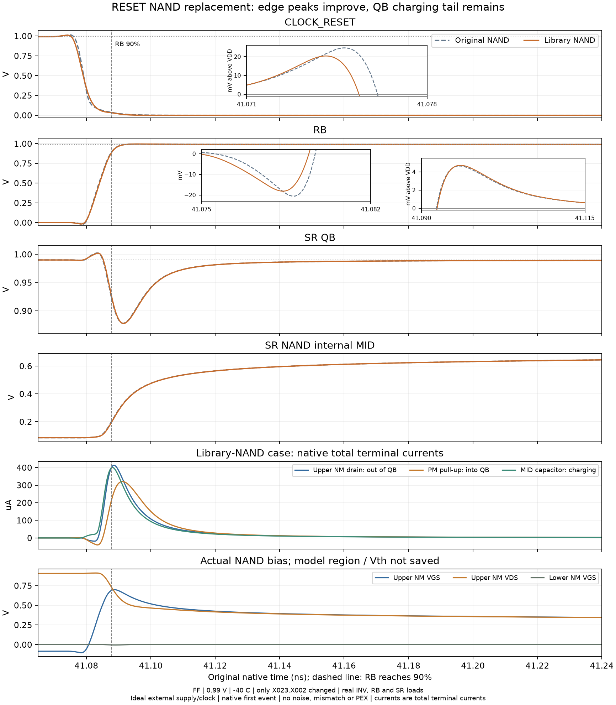

# RESET NAND替换：前沿改善，QB充电恢复未解决

仅替换`X023.X002`，原4MOS及MID电容一起退出；AB/BB真实INV驱动、RB/SR负载和11份PWL不变。
FF/0.99V/−40°C，同一首事件台。不是单管或单电容归因实验。

| 指标 | 原NAND | 原生ND2D1 |
| --- | ---: | ---: |
| CLOCK_RESET峰值，参考VDD | +24.622mV | **+20.340mV，降低17.39%** |
| CLOCK_RESET最低值 | +0.647µV | **-83.280µV** |
| RB最低值 | -20.571mV | **-18.144mV** |
| RB低于−1mV累计宽度 | 3.735ps | **4.104ps，变宽** |
| RB回弹，参考VDD | +4.650mV | +4.724mV |
| QB最低值 | 0.877998V | 0.877733V |
| QB低谷→回到VDD±1mV¹ | 131.674ps | **131.898ps** |
| R下降→RB上升半轨延迟 | 4.712ps | 5.008ps |
| 物理超限对/606 | 237 | **245** |
| VDD净供能，0..41.590786ns | 0.0660315pJ | 0.0651130pJ |

¹原生样点首次回到±1mV且至本次结束未再离开；不是完整复位/闭环合格门限。CLOCK_Q仍无半轨沿。

**新增8对具体是什么。** 按A1/A2、NM/PM角色对齐旧新四管后，进入8对、清除0对：
`XCLOCK.X000.MM0`的VGS/VGB两对、`X023.X002.MM1/MM2`的VDS/VDB四对，
均因41.104090ns的CLOCK_RESET −83.280µV而最大超出83.280µV；
`X023.X002.MM2`的VGD超44.030µV（41.104287ns），`MM4`的VGS超13.837µV（41.108219ns）。
−83µV最低点，RB反相器两栅端合计抽走77.090nA，本级三个漏端补回77.090nA，显示尾部仍有实际门间电流交换。
它们发生在低电平恢复尾部，不是新增8个20mV尖峰；也不能按幅度小就删除或判通过。精确0.99V门限及原生CMI均保留。

**两个不同时间尺度。** CLOCK_RESET上冲仍在41.074075ns；新NAND的A1 PM总漏端注入12.326µA，
A1 NM抽走12.327µA，另一个PM及RB输入栅端补齐KCL。RB下冲发生在41.078367ns，
INV NM总漏端抽走10.865µA、PM补回10.247µA、SR栅端补回0.619µA。此类短前沿交换仍在，标准门自带寄生也不是理想钳位器。

AB输入栅端峰值185.554→99.866µA，事件净交换1.615→0.756fC；BB对应32.002→16.940µA、0.176→0.092fC。
上游负担减小不等于下游内部储荷过程已经消失。

QB则在RB跨过90%（41.087884ns）后继续下降，到41.091571ns最低0.877733V。
前沿前上管VGS/VDS约**−0.067/0.907V**；
在低谷，`XCLOCK.X003.MN0`上管VGS/VDS=**0.654/0.546V**，下管MN1 VGS=**−2.444mV**；
上管总漏端从QB抽走**320.657µA**，源端向MID注入300.310µA，MID电容吸收**286.536µA**；
保持高电平的PM1同时向QB补回319.969µA。MID已由前沿前约0.085V升至0.332V。

30ps后，MID为0.569V，上管VGS/VDS约**0.422/0.413V**，仍从QB抽走22.669µA，
电容仍吸收20.415µA、PM1补回25.435µA。QB到41.223469ns才在本窗口内稳定回到±1mV。
QB仍高于0.495V半轨，当前没有错误翻转证据；约132ps是局部恢复过程，不能直接当作错误码或整机失败的证明。
RB90%之后到这个时点，MID电容净吸收**4.365fC**，对应上管源端提供4.572fC，差额由下管总漏端0.207fC平衡。
这直接支持**内部MID充电、QB电荷共享及PM再充电恢复**，不能仅用瞬间栅漏耦合解释约132ps尾巴。

下冲前、低谷、恢复的四端偏置/电流都保存在JSON；未保存region、Vth或沟道电流分量。
因此不把它直接称为教材中的放大器过驱恢复，也不宣称三极区、纯沟道或Cgd分解；下管的瞬态漏端流同样含位移分量，不能据此称作漏电。

**为什么仍有问题。** 本次源级替换减小了CLOCK_RESET上冲及RB下冲，未改动上述SR内部储荷节点，QB尾巴基本不变。
0.99V供电已等于当前核心端压筛查上限，没有上冲余量；标准核心门不会消除本体寄生或真实负载回馈。
当前较大的轨外扰动仍是LIVE −21.368mV、CLOCK_RESET +20.340mV、RB −18.144mV、X020.N +17.966mV。

**最有效的下一项辨因实验。** 只将`XCLOCK.X003.CMID`原生MOM的`multi=2→1`，
所有MOS尺寸、驱动、负载、供电与时序不变；对比MID净充电、QB低谷/恢复及RB返注、全部端压。
它直接扰动已观测到的储荷量，能检验充电负担对长尾的贡献，比继续逐门换库更有辨别力。
减小电容也可能放大短时过冲，不能预设改善。本轮只提出实验，不生成候选。

72个库端流已原生绑定；全部节点最大KCL残差约3.937pA。源9文件/9,487,824B，新9文件/9,448,118B，
输入与回收身份、PASS/END、实际求解设置已核对；新6058点。五路源、七路边界源与R0功分别保存，VDD净功不是整周期ADC功耗。
外部电源/时钟理想，无噪声/失配/PEX；没有新reset断言或完整复位验证，不作PVT/整机合格结论。

[完整数值、8对清单、分阶段偏置及端流](comparison.json)。run `sar8audit-ctrl-stdcell-resetnand-ff-v1`，managed hash `7f60d766e2c8f6f4b964d5744cdd1442292e7f86485596b8374694a5ec616c9d`。
本轮无远端操作、OA修改、新候选、commit或push。
