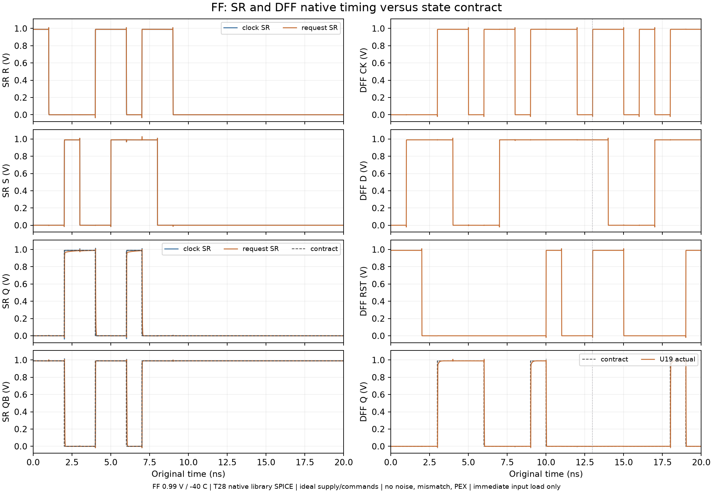
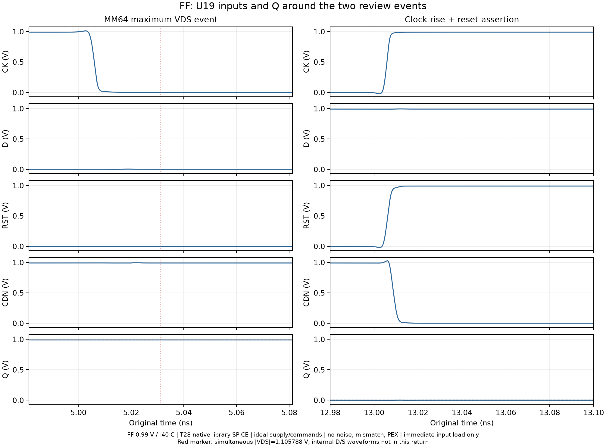
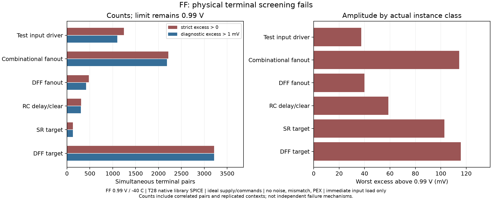
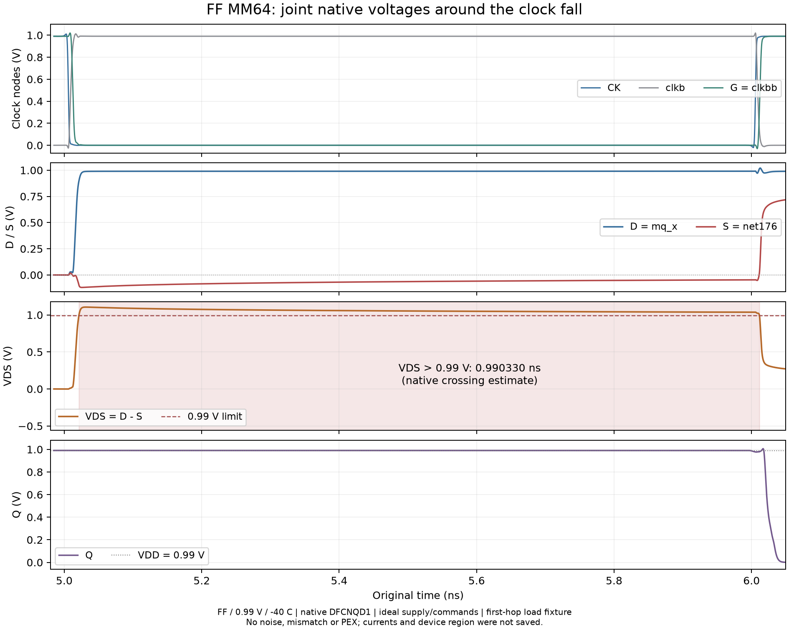
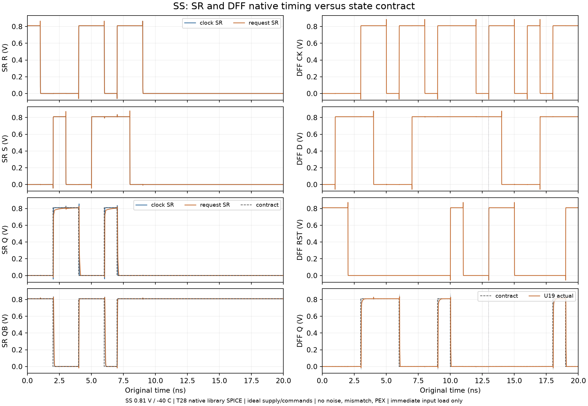

# 标准存储模块：FF／SS结果

**当前结论：两角26个上下文状态检查通过；FF端压筛查未通过，SS无0.99V端对超限。仍是存储模块烟测，不是整机通过。**

| 项目 | FF 0.99V／−40°C | SS 0.81V／−40°C |
| --- | --- | --- |
| 完整原生点 | 30060 | 31020 |
| 稳定保持阶段 | 502／502通过 | 502／502通过 |
| 额外／缺失Q沿阶段 | 0 | 0 |
| 实际引脚→Q范围 | 7.739–22.704 ps | 16.495–46.782 ps |
| 严格超限端对（超额>0） | 7596／11220 | 0／11220 |
| 超额>1mV端对（仅诊断） | 7348 | 0 |
| 最坏端压 | 1.105788 V | 0.959787 V |
| 测试台VVDD净供能／20ns | 185.594 µW | 110.601 µW |

## FF：功能与电气应力分开看

两个SR、24个DFF的502个保持阶段全部满足本台10/90%VDD观察带；每阶段预期Q沿均匹配，复位重叠阶段未出现额外半轨Q翻转。此结论不替代任意偏斜、setup/hold或recovery/removal表征。

实际引脚→Q共有152次预期转换，测得152次；带符号延迟7.739–22.704ps，缺失／歧义0次。交点为原生相邻点间线性估计，保留原始括区。

最坏为测试实例`XDUT.XU19.XFF.MM64`的VDS=1.105788040V，时刻5.031257327ns；对应完整候选`XDUT.XREF.XSTORE6.XFF.MM64`。它是库DFCNQD1内部N管，不是外部参考开关，也不是本台的理想输入源。

该时刻属于phase5：CK下降、D=0、RST=0、Q应保持1。原生同刻实际CK/D/RST/CDN/Q依次为-3.19253642e-06V, 0.000125244378V, 3.21301124e-07V, 0.989996811V, 0.989995087V。

**MM64同刻D/S/G电压已通过原始PSF的联合节点导出补齐**，见下节。原135路返回电压不包含这些节点；本次直接读取同刻值，没有组合不同时间的节点极值。

原生日志首批MM45 Vgs告警出现在约0.990003ns，显示−990.001mV，约1µV超额是日志舍入值。它不是DC初值，也不是全历史最大值。当前7596对严格超限中7348对超额>1mV，99对>100mV，不能概括为只有数值边界告警；1mV仅用于分组，0.99V筛查从未放宽。
同一`XU25.XFF.MM45`的全历史|VGS|最大为1.038641961V，发生于1.007445556ns；需与日志首条告警区分。

逐器件归属、对应候选实例和同时刻端对见[端压明细](ff/terminal_failures.csv)；本台激励driver单列，不能误标为完整ADC原实例。重复端对及复制上下文不等同独立失效机制。

## 功耗与证据范围

测试台VVDD在20ns净交付3.711878pJ，除以时长为185.594µW；瞬时峰值19.883mW。它包含并行的26个存储上下文、76个负载副本及驱动，不能当作单个ADC功耗或与整机1mW指标直接比较。六路独立理想命令／条件源的功单列保存在[数值报告](ff/summary.json)，不混作器件耗散。

当前只有89路选定端流；其余7466路及完整KCL明确未知。MM64本身电流未保存，因此尚不能把内部动态过冲唯一归为沟道、电荷注入或漏电。

结果支持标准门存储网络在此激励下完成预期状态转换，同时暴露FF边沿附近的内部端压问题。联合节点证据已补齐，仍需核对实际输入slew、截断输出负载与库表征范围；不能由该台直接推断库不可靠或整次标准化失败。

测试环境：T28原样标准单元SPICE；FF0.99V／−40°C；理想外部供电／命令；无瞬态噪声、失配、PEX；仅真实第一级扇出／RC输入负载，后级输出截断。实际日志设置gear2only、maxstep10ps、reltol100e−09、V/I abstol10nV/100fA。

FF由完整原生仿真复用分析得到：30060点、native PASS及零错误footer、原始日志／输入／回收SHA和gzip逐字节身份已核对；并非重新或伪造仿真。

## MM64联合节点：已补齐

原始同刻 **5.031257327 ns**：D=**0.988246124 V**，S=**−0.117541916 V**，G=0.000332838 V，B=0；因此VDS=**1.105788040 V**。峰时D已接近供电，S的负向偏移使两端差值增大。

按原生相邻点线性估计，VDS>0.99 V的区间为**5.021254939–6.011584995 ns**，约**0.990330056 ns**，包含970个超限原生点。图中S的下冲状态维持到下一时钟附近，不能概括为只有几十ps的尖峰；这里的持续时间是带原生括区的估计。

显式连接中net176为MM64源端与MM65漏端之间的串联节点。峰时两管栅极分别为clkbb≈0.333 mV、mq≈90.896 µV，下级net184≈−4.682 µV；这与时钟翻转后内部负向状态恢复受限相符。未保存MM64端流及region，仍不能唯一归因于纯Cgd、某条沟道或完全零漏电。

本图只读原FFv2的同一PSF，原始SHA、全部六端对统计与先前分析逐项匹配；没有新增仿真。[联合数据与源证明](ff/mm64_joint_snapshot.json)。

## SS：相同序列、保留本角结果

SS完整31020点，502个保持阶段通过、额外Q沿阶段0，0／11220对严格超限，原生CMI=False。最大端压0.959787487V；这与FF的0.99V供电恰处筛查上限不同，不能把SS无告警外推为FF可靠性通过。

[SS逐相位检查](ss/phases.csv) · [SS数值与源证明](ss/summary.json) · [SS端压分类](ss/terminal_classes.png)

两角原生波形与阈值定义相同，电源／模型按本角设置；当前未包含TT、PVT全覆盖、失配、噪声和真实SAR闭环。
