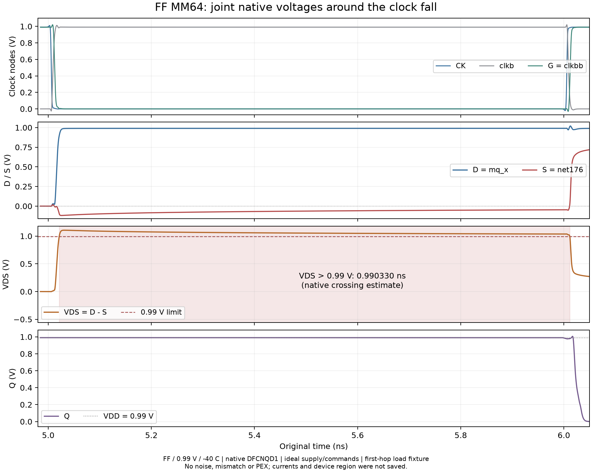

## MM64联合节点：已补齐

原始同刻 **5.031257327 ns**：D=**0.988246124 V**，S=**−0.117541916 V**，G=0.000332838 V，B=0；因此VDS=**1.105788040 V**。峰时D已接近供电，S的负向偏移使两端差值增大。

按原生相邻点线性估计，VDS>0.99 V的区间为**5.021254939–6.011584995 ns**，约**0.990330056 ns**，包含970个超限原生点。图中S的下冲状态维持到下一时钟附近，不能概括为只有几十ps的尖峰；这里的持续时间是带原生括区的估计。

显式连接中net176为MM64源端与MM65漏端之间的串联节点。峰时两管栅极分别为clkbb≈0.333 mV、mq≈90.896 µV，下级net184≈−4.682 µV；这与时钟翻转后内部负向状态恢复受限相符。未保存MM64端流及region，仍不能唯一归因于纯Cgd、某条沟道或完全零漏电。

本图只读原FFv2的同一PSF，原始SHA、全部六端对统计与先前分析逐项匹配；没有新增仿真。[联合数据与源证明](mm64_joint_snapshot.json)。
