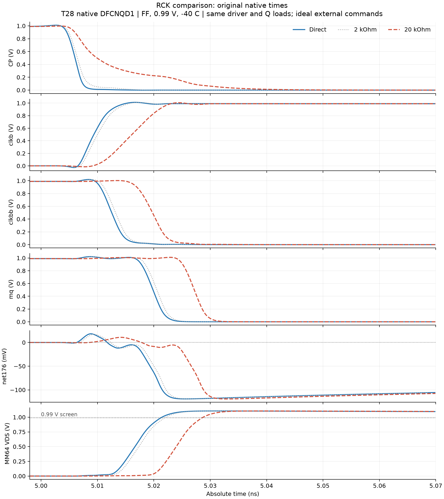
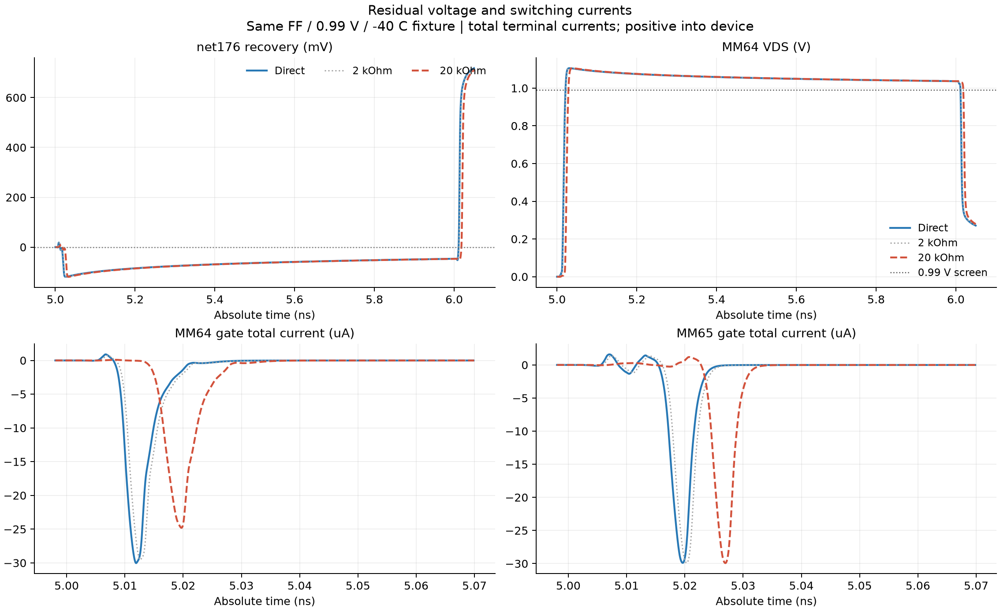

# 直连／2 kΩ／20 kΩ：停止串阻修复方向

**CP 已明显放缓，但 MM64 应力和负节点恢复没有改善。** 20 kΩ 候选不采用，不再增加阻值扫描。变化在 clkb、clkbb 后逐级减弱，mq 重新形成近乎相同的陡沿；不能笼统说所有内部节点都没变化。

测试：T28 原生 DFCNQD1，FF／0.99 V／−40°C；同一上游驱动、三组真实 Q 首级负载、外部 PWL。理想外部电源与命令，无噪声／失配／PEX。各曲线使用原生绝对时间，未移位对齐。下表边沿取 5 ns 同一命令事件。

| 测量 | 直连 | 2 kΩ | 20 kΩ |
| --- | ---: | ---: | ---: |
| CP 实际 10%/90%（ps） | 2.793 | 3.581 | 20.718 |
| CP 实际 30%/70%（ps） | 1.187 | 1.356 | 7.421 |
| CP 查表坐标：30%/70% ÷ 0.5（ps） | 2.374 | 2.712 | 14.842 |
| clkb 实际 10%/90%（ps） | 5.113 | 5.439 | 9.319 |
| clkbb 实际 10%/90%（ps） | 4.386 | 4.453 | 5.385 |
| mq 实际 10%/90%（ps） | 4.172 | 4.172 | 4.168 |
| MM64 最大 VDS（V） | 1.105789 | 1.105796 | 1.105858 |
| net176 前沿最低值（mV） | −119.126 | −119.135 | −119.217 |
| MM64 此次 VDS>0.99 V 时长（ns） | 0.990330 | 0.990336 | 0.990026 |
| 严格端对失败数 | 256/348 | 256/348 | 256/348 |

20 kΩ 的 CP 实际 10%/90% 放缓约 7.42 倍，mq 边沿只变化约 −0.10%；MM64 峰值反而增加约 68.8 µV。查表坐标在 1.5–262.9 ps 轴内，不能再把“输入 slew 越界”当作已证实原因。三组失败端对集合完全相同：新增 0、消失 0，未用数值容差删除微小超限。

从上到下为 CP、clkb、clkbb、mq、net176、MM64 VDS。20 kΩ 主要推迟切换，最后的 mq 陡沿和负节点下冲仍然出现。MM64 峰值使用同一原生时刻的 D−S，不能用不同时刻的极值相减。

## 电流、恢复和功能

MM64 栅极总流前沿最低值从 −30.031 µA 降至 −24.805 µA，但 MM65 栅极最低值仍约 −29.9 µA。5–6 ns 相位内两只管的栅极交换电荷几乎不变：MM64 为 −0.141140→−0.141132 fC，MM65 为 −0.112535→−0.112526 fC。这支持“脉冲展宽／延后，未消除相关电荷交换”，不能直接归结为某一个 Cgd 或纯沟道电流。

5.5 ns 同绝对时刻线性估计的 net176 为 −63.515／−63.548／−63.880 mV；5.95 ns 仍为 −47.913／−47.931／−48.109 mV。其后正向恢复来自下一时钟重新配置，不能当作保持阶段已自然回零。插值均保留原生括区，图中曲线保留原生点。

三组均通过 20 个保持相位和相同的 6 个 Q 沿模式；相位 3 的实际 CK→Q 延迟为 19.171／19.451／22.446 ps，复位到 Q 延迟近乎不变。功能正确不消除内部应力。六节点最大 KCL 残差分别约 2.971／2.970／2.984 pA。

## 能量及证据

| 0–20 ns 净供能（fJ） | 直连 | 2 kΩ | 20 kΩ |
| --- | ---: | ---: | ---: |
| VDD 源 | 162.487 | 162.484 | 162.785 |
| 全部五个理想源之和 | 164.426 | 164.423 | 164.726 |
| RCK 吸收能量 | 0 | 0.503 | 1.643 |

净供能是该 20 ns 诊断激励下的源做功，包含理想激励源且受初末储能影响，不是 ADC 总功耗或纯耗散。20 kΩ 全源净供能增加约 0.18%，没有对应的应力收益。

三组原生点数为 22772／23083／24253；收据、冻结输入、gzip 解码 SHA、348 端对峰值／越界计数、六节点全部入射端流和五个源的能量均核对。原生日志为 PASS／0 errors，CMI-2751～2756 保留。实际设置一致：gear2only、maxstep 10 ps、reltol 1e−7、V/I abstol 10 nV／100 fA。20 kΩ 仿真 21.850 s，分析 24.734 s；回收 9 文件、20,965,819 B，无跳过。

完整数值与时间括区：[results.json](results.json)；同绝对相位的 12 路有符号端口电荷：[terminal_charges.csv](terminal_charges.csv)；全部端对：[stress_pairs.csv](stress_pairs.csv)；[本地验证](validation.json)。所有原始结果和 17 项运行输入保持只读，未新建仿真、候选或提交。

## 下一项物理定位建议

现有原生 probe／truth 只覆盖 **一个 DFF 主单元 DFCNQD1**，另外两种是 INV、NAND；没有其他 DFF 的复位优先级和内部连接证据，当前不能负责任地推荐替代主单元。

已知连接为 `mq_x—MM64—net176—MM65—net184—MM66—VSS`；MM64.G＝clkbb、MM65.G＝mq、MM66.G＝RN。mq 由原生 MM0/MM1 级及相邻传输支路驱动，现有数据把下一观察点具体收敛到 **MM65／mq 与这条恢复堆叠**。

最小新增物理观测建议：**在原电路同一 5 ns 前沿及 5.5 ns 保持点，取得 MM65 的本征 D–S 沟道电流轨迹**，与已有四端总流并列。先核对当前模型真正支持的保存量，不把未确认含义的 `ids` 当作本征电流。保持点总流已知约为 D +5.60、G −1.53、S +0.22、B −4.28 nA（20 kΩ，线性估计）：D 端数值明显不能直接等同经 MM66 回地的电流。新增这一分量可区分持续沟道恢复与主要由栅／体泄漏、位移电流参与的近浮置状态；若模型不提供可辨识分量，应明确停止该归因，不凭总端流继续改管或改库。此处仅建议观测，不生成 deck 或远端任务；0.99 V 门槛保持。
