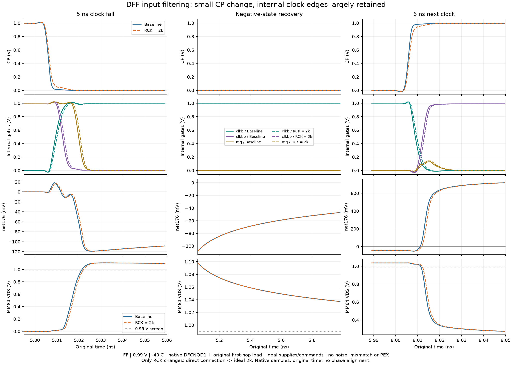
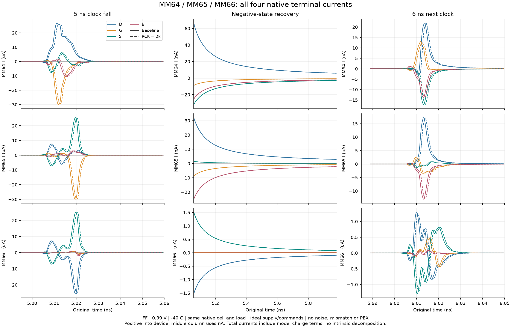

# DFF输入整形对照：2 kΩ没有抑制内部下冲

**这次对照未修复端压问题。** CP虽放缓，库内时钟仍重新整形；MM64峰值及负节点
恢复过程基本相同。功能状态／Q沿模式两例均通过，但严格端压筛查仍为256／348对超限。
这是单个参考bit6存储DFF与原第一级真实负载测试，不是完整ADC通过或库可靠性结论。

测试：T28原生`DFCNQD1BWP12T30P140`，FF、0.99 V、−40°C；理想外部电源与命令，
无瞬态噪声／失配／PEX。唯一电路变量为CP前理想串联电阻：直连→2 kΩ。
原外部PWL、驱动、三组输出负载、复位及库内部晶体管不改。
两例原生日志均为0 errors／35 warnings／12 notices，tran_first PASS；实际设置一致：
gear2only、maxstep10 ps、reltol1e−7、V/I abstol10 nV／100 fA。

## 复现和边沿量化

基线22772点、对照23083点均完整无损回收；全部文件SHA、注册输入、原生日志和
解码SHA已核对。基线MM64峰值相对原全存储测试只差0.980 µV／0.060 ps，满足预先
提出的复现门槛；该门槛与严格0.99 V端对筛查分开。

下表边沿取5 ns事件的0.99 V标称10/90%交点，保留各自原生括区：

| 观测 | 基线 | CP前2 kΩ |
| --- | ---: | ---: |
| CP下降沿 | 2.792653 ps | 3.581318 ps |
| 内部clkb上升沿 | 5.113220 ps | 5.438536 ps |
| G64＝clkbb下降沿 | 4.386320 ps | 4.453282 ps |
| G65＝mq下降沿 | 4.172345 ps | 4.172143 ps |
| MM64最大VDS | 1.105789020 V | 1.105795516 V |
| 前沿net176最低值 | −119.126 mV | −119.135 mV |
| VDS>0.99 V线性估计时长 | 0.990329896 ns | 0.990336210 ns |
| 六节点最大KCL残差 | 2.971 pA | 2.970 pA |

CP边沿增加28.24%，clkbb只增加1.53%，mq几乎未变。峰值变化+6.496 µV，发生时间
延后0.895 ps；当前结果只支持“2 kΩ的小幅输入整形没有改善”，不能排除更大slew变化。

从左到右为5 ns前沿、保持段、6 ns下一时钟；原始绝对时间不对齐平移。从上到下为
CP、内部clkb／clkbb／mq、net176和MM64 VDS。基线实线、2 kΩ虚线，0.99 V为筛查参考线。

## 电流说明了什么

基线CP在5.006050 ns下降；clkbb在5.012561 ns下降；mq在5.019876 ns下降
（均为半轨交点）。MM64栅极总流最低−30.031 µA，随后MM65栅极最低−29.897 µA。
两次内部栅极切换和net176分段变化同处此前沿，支持多条端口共同参与的电荷交换；
仅凭总端流不能把它拆成纯Cgd、纯沟道或某种寄生分量。

在MM64峰值原生时刻5.031317284 ns，同刻D＝0.988269216 V、S＝−0.117519804 V、
G＝0.000325188 V。net176最小值则出现在更早的5.025691 ns；两者不能混用成峰值解释。

图中每行分别为MM64／MM65／MM66，颜色表示D／G／S／B，实线／虚线表示两例。
中列使用nA，左右为µA；正号表示电流流入器件端口。

负节点并非整段恒定：基线net176从约−119 mV缓慢回到约−47 mV，下一时钟前仍未回零。
约5.5 ns的最近原生点为5.501095 ns，端流如下：

| 器件 | D（nA） | G（nA） | S（nA） | B（nA） |
| --- | ---: | ---: | ---: | ---: |
| MM64 | +11.232 | −1.510 | −5.505 | −4.216 |
| MM65 | +5.505 | −1.509 | +0.215 | −4.212 |
| MM66 | −0.215 | +0.018 | +0.197 | −0.000053 |

net176连接MM64.S与MM65.D，net184连接MM65.S与MM66.D，两处总流分别相抵。
MM65的D端5.505 nA并没有等量流到S端；栅极和体端也有显著总流，因此不能把D端值
直接称为“经MM66泄放的纯沟道电流”。可确认存在持续端口交换及缓慢恢复，region及
intrinsic电流分解仍未知。6 ns后net176被下一时钟重新配置到正电位，也不是保持段自然回零。

## 分相位电荷与证据边界

完整原命令phase5为5.000–6.000 ns，签名积分Q＝∫I dt如下，单位fC：

| 器件／版本 | D | G | S | B |
| --- | ---: | ---: | ---: | ---: |
| MM64基线 | +0.230052 | −0.141140 | −0.026724 | −0.062188 |
| MM64／2k | +0.229743 | −0.141140 | −0.026416 | −0.062188 |
| MM65基线 | +0.026724 | −0.112535 | +0.078205 | +0.007605 |
| MM65／2k | +0.026416 | −0.112533 | +0.078511 | +0.007606 |
| MM66基线 | −0.078205 | +0.000018 | +0.078186 | +0.000001 |
| MM66／2k | −0.078511 | +0.000018 | +0.078492 | +0.000001 |

全部原生点参与梯形积分；恰好不落在原生点的相位端点采用相邻点线性估计，并记录括区。
另外单列5–5.06 ns前沿、5.06–5.95 ns安静段、5.95–6 ns尾部、6–6.05 ns下一沿；
前三段覆盖phase5，第四段属于下一相位，不能当同一保持电荷相加。所有原命令相位均保留：
[基线积分CSV](baseline/phase_charges.csv)／[2k积分CSV](rck2k/phase_charges.csv)。

六个显式节点的KCL列已由全部入射端流逐点精确重算一致；这证明测量连接自洽，
不等于分辨了器件内部电流机制。峰值和积分不能独立证明寿命安全。

当前最必要的下一步是确认170a SPICE要求的PDK模型配套及同版Liberty使用条件。
原因是本对照只对内部边沿产生很小扰动，而准确slew／load范围和瞬态可靠性规则仍未取得；
应先补接口与模型依据，再决定是否值得更强整形。此处没有继续试扫、改库或放宽筛查。

源证明与完整数值：[配对结果](comparison.json)、[基线端流](baseline/current_analysis.json)、
[2k端流](rck2k/current_analysis.json)。原失败导出与完整PSF均保留；两次恢复只重做分析。
