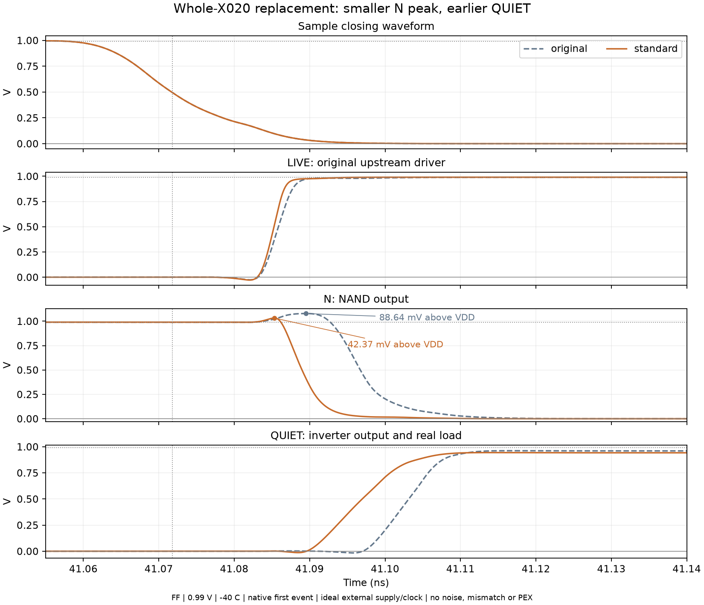
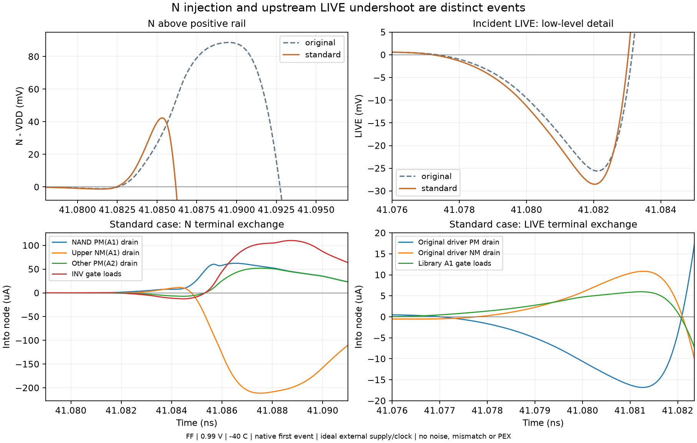
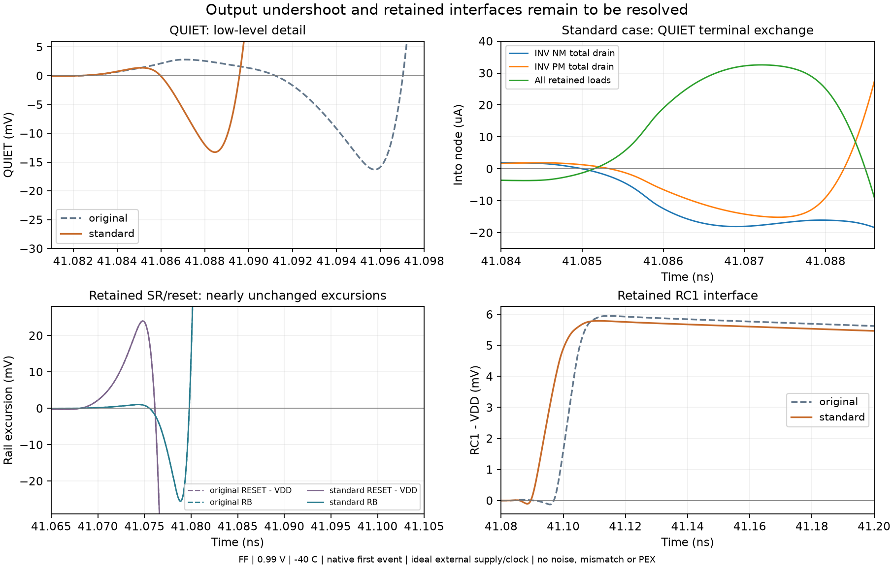

# X020标准门首跑：改善，但没有消除过压

原样foundry SPICE的M调用、inline subckt和六只MOS的24个端流均已原生绑定成功。
比较对象为原`snload-both`，不是后来的IO/分压修复版。两组均为FF、0.99V、−40°C，
相同11份PWL、实际Q1/LIVE驱动、RC/SR负载和采样关闭沿；外部电源/时钟理想，无噪声、失配或PEX。
本次只有0–41.5908ns首事件，尚不能验证完整比较、跨帧复位或ADC性能。

## 对照结果

| 指标 | 原版 | 标准NAND＋INV |
| --- | ---: | ---: |
| N最大值 | 1.078642V | 1.032372V |
| N高于0.99V的最大超幅 | 88.642mV | **42.372mV，降低52.2%** |
| 最大峰所在超压段 | 41.082536–41.092733ns | 41.082424–41.086185ns |
| 上述主峰段持续时间 | 10.198ps | 3.760ps |
| N高于0.991V的持续时间¹ | 9.911ps | 3.526ps |
| LIVE最低值 | −25.612mV | **−28.512mV，略变差** |
| Q1高于VDD的最大超幅 | 2.206mV | 3.057mV |
| QUIET最低值 | −16.291mV | −13.267mV |
| 采样关闭→QUIET半轨沿 | 31.295ps | **25.100ps，提前6.195ps** |
| 截止时QUIET | 0.967861V | 0.954542V |
| VDD净供能，0–41.5908ns | 0.0707303pJ | **0.0683399pJ，减少3.38%** |
| 五路源有符号净供能之和 | 0.0702992pJ | 0.0679089pJ |

¹额外列出“门限＋1mV”仅帮助看清主峰，验收门限仍是0.99V。
严格门限下N还有一段约12–13µV的小凸起；将其计入后，累计超限时间为20.117→12.951ps。
持续时间按原生样点间线性交叉估计，交叉所在时间步保存在JSON；不是首尾跨度，也没有重采样波形。
图中的水平虚线为0.99V，竖线为相同的实际采样关闭半轨时刻41.071796ns。

## 为什么标准门仍超压

**进入标准门之前，LIVE已经下冲。** 在41.082017ns，原驱动
`X001.X001.MP`总漏端电流从LIVE抽出3.312µA，原NMOS补回2.594µA，
库门A1两只栅端补回0.718µA，KCL闭合。41.075ns至该低谷的原生积分也显示：
驱动PM抽出0.03846fC，驱动NM与库输入端分别补回0.02141/0.01705fC。
库输入端不是此阶段的主要净抽取支路；其输入LIVE为−28.512mV时，
库内A1 PMOS的|VGS|自然达到**1.018512V**，超幅28.512mV。
原版已有同类下冲，换下游门并没有修好原驱动的动态电荷交换。

**随后LIVE快速上升，N发生净注入。** N在41.085325ns达到1.032372V，
此时LIVE=0.515475V、Q1=0.992607V。NAND的A1 PMOS `MM1`总漏端向N注入
47.493µA，上管NMOS `MM4`抽出47.820µA，其余端流补足差额。
从41.079ns至N峰值，MM1累计净注入0.03476fC；其余支路大体吸收，KCL总和接近零。
这支持“输入变化期间寄生电荷耦合与放电竞争”的解释，但总端流没有拆成Cgd/沟道/结分量。
不能把47.493µA直接叫作纯Cgd电流，也不能把所有端流积分之和再解释为额外储存电荷。

原版A1 PMOS至自身峰值净注入0.16472fC，但积分终点不同；JSON另列共同截止点的结果。
整门替换同时改变了库尺寸/寄生、NMOS栈位，并移除了旧显式CMID。
旧MID初态0.862471V，新内部net10仅0.525µV；因此52.2%的改善不能单独归功于某个尺寸或栈位。

**N下降后，QUIET也有下冲。** 在41.088460ns，QUIET=−13.267mV，
INV NMOS总漏端抽取17.286µA，PMOS补回14.983µA，保留负载共补回约2.303µA。
它与N下降阶段一致，使库INV PMOS的|VDS|达到**1.003267V**。
这里仍只判断总端流的净方向，没有将NMOS总漏流误认成单纯沟道电流。

三处快照均按所有真实支路求和；新例全节点最大KCL残差仅3.954pA，原版3.937pA。

## 标准门与保留电路分开看

| 最大超幅分组，原0.99V门限不变 | 标准门6MOS/36对 | 保留95MOS/570对 |
| --- | ---: | ---: |
| 0–0.11µV | 0 | 2 |
| 0.11–1µV | 0 | 3 |
| 1µV–1mV | 9 | 104 |
| 1–10mV | 2 | 63 |
| >10mV | 12 | 58 |
| 总超限对数 | 23 | 230 |

保留电路最差为LIVE驱动PMOS，超幅28.512mV；RESET上冲24.005mV、
SR内部RB下冲25.523mV几乎与原版相同，RC1上冲5.951→5.791mV。
这说明还有未修复的周边问题，不能说都是库替换新引入。
VGS/VGB等可能是同一波形事件的重复端压对，230不代表230个独立故障。
旧版未汇总全部606对，不能比较新旧“失败对数”来判断变好或变坏。

原生日志两组都保留CMI-2751至2755。首批在41.0001ns起，仅有µV级轨外值；
每类最多打印5条，后续警告被抑制，因此打印记录不是最大超压清单。
实际日志摘录见[native_CMI_excerpt.txt](native_CMI_excerpt.txt)。
两组有效设置相同：gear2only、reltol=1e−7、vabstol=10nV、iabstol=100fA，
PDK scalefactor=0.9；SAMPLE_INT不连续处的LTE临时放宽警告也保留。
上述微小分组只是数值量级说明：局部求解容差不能直接当全波形误差界，不能据此放行。

## 下一项单变量

建议仅在**实际LIVE驱动与标准NAND的整个A1输入之间串一个现有PDK R0单元**，
比较直接连接与一只R0。库内不改线/尺寸，Q1、驱动管、其他负载、11份PWL和采样沿均保持。
这与历史“只给一只PMOS栅极加阻”不同：本次同时隔开A1的NMOS和PMOS栅端，库内拓扑保持原样。

目的：区分入射负向耦合/边沿速度对N上冲的贡献，并量化时序代价。观察电阻两侧、
N/Q1/QUIET、受影响管端压、KCL、原生slew/延迟及源能量；不能把应力移到另一侧就判通过。
这是机制对照，不能保证消除SR/RC等其他超压。本次只提议，**没有生成或提交新远端实验**。

数据：[comparison.json](comparison.json)；本地脚本：[review_standard_cell_result.py](../../review_standard_cell_result.py)。
新例9文件/8,997,843B、原版9文件/1,725,886B及原版能量重分析7文件/1,707,968B
均核对receipt SHA/大小、输入身份、原生PASS/END和来源绑定。六MOS端流绑定成功；
没有将本首事件试验宣称为闭环、完整复位、PVT或整机合格。
