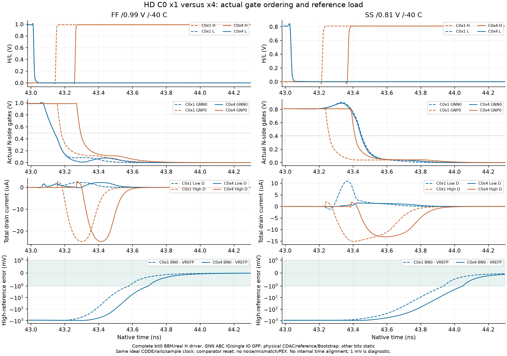
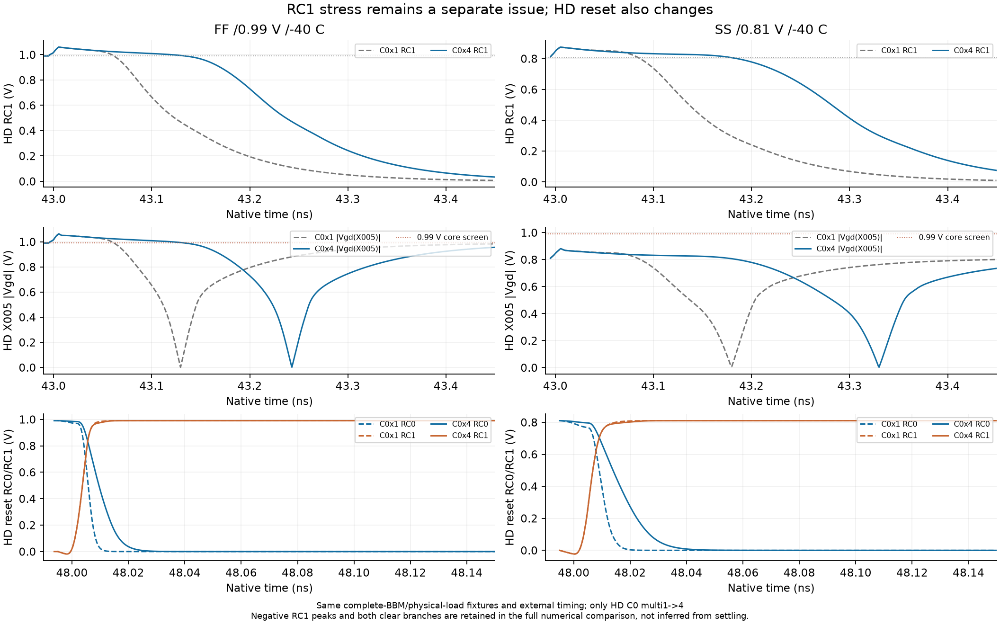

# HD C0 ×4 对照

状态：FF／SS两角已回收。

C0×4减小了SS的后级负间隔和相反参考总端流，但没有消除负间隔；FF端压超限仍在，过压持续时间与输入能量增加。这组旧诊断到此结案，不采用新基线，后续转入标准单元迁移。

仅 HD 延迟腿 C0 的 MOM 并联数从1改为4。其余195条器件记录与完整测试台不变；不对齐内部边沿。完整 bit0 BBM／高端驱动、GNN ABC IO／单级 IO GPP、物理 CDAC／参考／Bootstrap，其他位静态；CODE／电源／采样时钟理想，比较器复位。FF 0.99 V／SS 0.81 V，−40°C，52 ns，无噪声、失配、PEX。

| 角落 | 高方向 BBM 间隔 ps：1→4 | N侧／P侧实际栅极间隔 ps：1→4 | 低方向 N侧／P侧 ps：1→4 |
| --- | --- | --- | --- |
| ffcold | 130.413 → 244.612 | 39.346/104.226 → 153.710/218.538 | 181.126/107.617 → 181.126/107.617 |
| sscold | 185.134 → 337.295 | -191.747/127.748 → -35.697/279.948 | 551.002/254.018 → 551.004/254.019 |

间隔来自真实负载栅极的半 VDD 交点，不是 MOS 导通阈值。相反方向的参考总 D 电流另作对照，包含位移电流，不能直接当作纯沟道直通。

| 角落 | N侧0–52 ns相反总D电流较小者峰值 µA：1→4 | 高状态持续进入1 mV：BN0／BP0 ns，1→4 | 低状态进入1 mV ns，1→4 |
| --- | --- | --- | --- |
| ffcold | 3.317 → 3.317 | 43.583991/43.391137 → 43.698327/43.505600 | 48.451880/48.585845 → 48.451840/48.585732 |
| sscold | 10.863 → 1.491 | 43.938057/43.990761 → 44.048998/44.140323 | 49.363714/48.973808 → 49.364107/48.974242 |

高建立只评价 [43.005,47.995) ns，低建立评价 [48.005,52] ns，误差均相对实际选中参考。原跨半 VDD 终点的高窗口保留为切换诊断，其 false 不再误称稳态高参考未建立。1 mV 是既有诊断值。

| 角落／腿 | RC1最小／最大 V：1→4 | X005最大绝对Vgd V：1→4 | MP_CLEAR最大绝对Vds V：1→4 |
| --- | --- | --- | --- |
| ffcold/HD | -0.018802/1.059705 → -0.018788/1.059717 | 1.062566 → 1.062579 | 1.008802 → 1.008788 |
| ffcold/LD | -0.019062/1.056843 → -0.019062/1.056843 | 1.056645 → 1.056645 | 1.009062 → 1.009062 |
| sscold/HD | -0.023037/0.874604 → -0.022996/0.874604 | 0.880250 → 0.880250 | 0.833037 → 0.832996 |
| sscold/LD | -0.021337/0.866203 → -0.021337/0.866203 | 0.868579 → 0.868579 | 0.831337 → 0.831337 |

表中两项 |V| 表示端压绝对值。MP_CLEAR源/体均接VDD，所列绝对Vds也等于绝对Vbd；两腿clear在FF的负向RC1阶段都仍超限。RC1正、负两相及两条腿的clear D/体端峰值与电荷均保留在JSON，不能只检查X005接收栅极。超过门限的持续时间采用原生点间线性插值估计，仅用于比较，不是寿命签核。

| 角落 | HD X005绝对Vgd >0.991 V 累计时长 ps：1→4 | BBM／H驱动／X025／负载严格超限项数：1→4 |
| --- | --- | --- |
| ffcold | 70.601 → 141.989 | 121/70/10/12 → 121/70/10/12 |
| sscold | 0.000 → 0.000 | 0/0/0/0 → 0/0/0/0 |

全部738项仍按原门限筛查：核心0.99 V、IO暂用1.98 V；上表0.991 V只用于排除微伏级边界的时长比较，不放宽筛查。两版 GNN/GPP IO、完整逐端压及原生告警均在 JSON/CSV 中保留。

| 角落 | HD整腿复位进入1%延迟 ps：1→4 | LD整腿复位延迟 ps：1→4 | BBM直接VDD能量 fJ：1→4 | CODE源净供能 fJ：1→4 |
| --- | --- | --- | --- | --- |
| ffcold | 12.737 → 24.485 | 21.444 → 21.434 | 76.976 → 82.299 | 8.796 → 23.337 |
| sscold | 21.970 → 40.193 | 42.338 → 42.342 | 41.478 → 41.741 | 5.922 → 15.590 |

- ffcold CODE上升／下降事件绝对电荷：14.400/7.202 → 29.093/7.655 fC。含R0充放电与栅端回流，不是固定线性输入电容。
- sscold CODE上升／下降事件绝对电荷：11.087/5.511 → 23.028/6.132 fC。含R0充放电与栅端回流，不是固定线性输入电容。

复位定义为 RC0→0、RC1→VDD、腿输出→0 均进入1%并保持到本相位末；HD相位从48.005 ns开始，LD从43.005 ns开始。延迟表相对 CODE 中点，JSON另存实际腿输入交点参考。1%是诊断阈值；只能说明该52 ns测试内的复位，不替代连续转换验证。

能量为0–52 ns本台端口积分。增加 C0 会加重经R0连接的CODE负载；CODE源、VDD源与内部传递分别记录，不用这张静态其他位／比较器复位的测试台评价整机功耗。

FF说明增加C0实现了延后开启，但HD复位、CODE源供能及过压持续时间均有代价；峰值和严格超限没有消失。SS虽从−191.747 ps改善至−35.697 ps、相反总D电流峰值10.863→1.491 µA，仍不是正裕量或纯沟道无直通的证明。FF该全窗峰值约在48.320 ns的低方向，因此HD上升延迟对它基本没有影响。

结论：该对照检验真实参考接口的延迟取舍。必须同时看后级次序、参考电流、建立、复位、输入负担及过压；增加延迟或得到正半 VDD 间隔均不能独自判为修复完成。RC1与clear支路仍需按实际端压判断，不采用新基线、不追加实验。后续按用户方向推进标准单元边界，见 [替换接口](standard_cell_boundary.md)。

## 证据

回执文件大小／SHA、冻结输入、原生PASS/PSF_END、完整单调时间及无损表散列核对；两版738项模型/门限按同名逐项对应。候选新增的物理建立/复位字段与独立原生曲线测量一致。原始结果和冻结输入未改。`comparison.json`为数值，`terminal_pairs.csv`为全部逐端压，图无时间平移。

- `sar8audit-real-bbm-ffcold`：11326点、22435355 B；result SHA256 `ab94a7db91c451995c4ed6d7e146900e961cf39fa4410f9907ac807480e36e67`；告警：CMI-2751, CMI-2752, CMI-2753, CMI-2754, CMI-2755, CMI-2756, SFE-1131, VACOMP-2435。
- `sar8audit-bbm-hdc0x4-ffcold`：11421点、22574580 B；result SHA256 `3bbd74480e1411e9a5af5cec5093dc87ec6edcf993ca5ce74e1ea3e264a92331`；告警：CMI-2751, CMI-2752, CMI-2753, CMI-2754, CMI-2755, CMI-2756, SFE-1131, VACOMP-2435。
- `sar8audit-real-bbm-sscold`：10975点、22627864 B；result SHA256 `390f02eafdff0654f827bda65c90b75cb28e7c9f4da2f7c604c6d1083f65372c`；告警：SFE-1131, VACOMP-2435。
- `sar8audit-bbm-hdc0x4-sscold`：10861点、22387216 B；result SHA256 `90d71d6554ef057cb866de5db0ba9cae367fc543d1703e3a08496a585133ae86`；告警：SFE-1131, VACOMP-2435。
