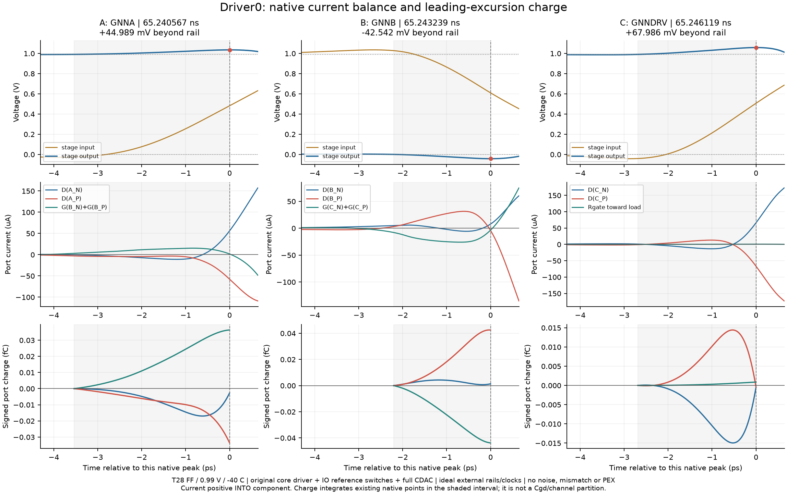
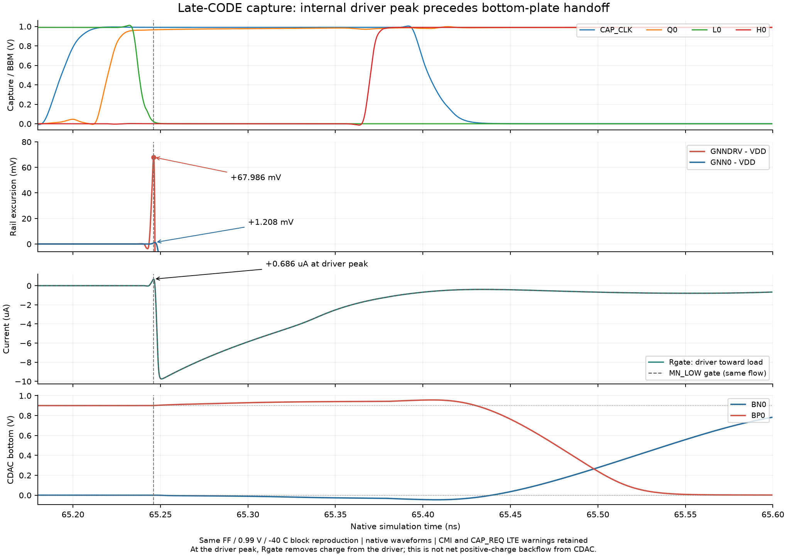

# 参考驱动：三处轨外尖峰来自哪里

结论：本例三处尖峰定位在 **driver0 的三级核心反相器内部动态电荷交换**。
前级输入快速变化时，本级输出尚处于原来的保持电位，出现轨外偏移；随后输出完成翻转。
Rgate 在 GNNDRV 正峰形成区间净带走电荷，CDAC 底板的主要换接更晚。
因此，这次正峰的净电荷来源指向驱动链自身。

证据来自已完成的 `sar8audit-ref-current-v2` 原生仿真和
`sar8audit-ref-current-v2-reduce1` 只读分析：147657 个原生点、故障窗14293点，
全部275路选存端电流齐全。原始结果及失败的旧分析保留，未修改。
环境：T28 FF、0.99V、−40°C；原核心驱动/比较器、IO参考开关、完整CDAC；
外部电源/时钟理想，无瞬态噪声、失配和PEX。

| 节点 | 原生峰值 | 时间/ns | 直接相关核心端压 |
| --- | ---: | ---: | --- |
| GNNA |1.034989V，超过VDD44.989mV|65.240567|GNNAN Vds、GNNBN Vgs 达1.034989V|
| GNNB |−42.542mV|65.243239|GNNBP \|Vds\|、GNNCP \|Vgs\| 达1.032542V|
| GNNDRV |1.057986V，超过VDD67.986mV|65.246119|GNNCN Vds 达1.057986V|
| Rgate后GNN0 |0.991208V|65.246860|此处连接1.8V IO参考MOS；本例主要越限对象是内部核心管|

本次是 **bit1 late-CODE 捕获更新 Q0** 引发的转换动作：CAP_CLK上升65.193281ns，
Q0上升65.219832ns，L0下降65.237821ns，随后三级驱动切换。
H0到65.369952ns才上升；BP0、BN0的半VDD换接分别在65.476758、65.538663ns。
后续底板负摆仍可见，本次三峰归因不宣称已解决整个参考网络。

从左到右是A/B/C级；每列横轴以该级的原生峰值为零点。
上排是输入/输出电压，中排是该输出节点完整KCL的三组电流，下排是阴影区间的有符号端口电荷。
正电流进入器件，负电流向节点注入；积分端点全部取已有原生点。

| 前沿积分区间 | 本级N漏端/fC | 本级P漏端/fC | 下一级负载端/fC |
| --- | ---: | ---: | ---: |
| A：65.237029→65.240567ns |−0.002694|−0.033633|B级两门端合计+0.036328|
| B：65.241034→65.243239ns |+0.001362|+0.042458|C级两门端合计−0.043820|
| C：65.243433→65.246119ns |−0.000501|−0.000376|Rgate输入端+0.000877|

A正峰期间，本级漏端合计向GNNA注入电荷，B级门端吸收电荷。
B负峰期间，本级漏端合计抽走电荷，C级门端向GNNB返回电荷。
C正峰期间，本级漏端合计供给Rgate负载；峰值瞬间，GNNCN漏端+65.966µA、
GNNCP漏端−66.651µA、Rgate输入端+0.686µA，三者闭合。
这里的净积分包含正负电流抵消，不能解释为某种寄生电容的贡献百分比。

第二排放大轨外部分，正常输出下降到0V的区段超出其纵轴范围。
Rgate与MN_LOW门端电流的同向波形说明正峰时电荷流向负载。
此后输出下降时有反向放电，不能把后续回流倒推成前面正峰的来源。

门端动态耦合的直接证据是C级峰值时 GNNCP 门端 **+224.159µA**，漏端
**−66.651µA**，源端 **−154.743µA**；门端输入电流同时向漏/源端释放。
其安静窗口门端电流仅约15pA量级。GNNCN门端同一时刻为+90.681µA。
这些端口方向及其与输入沿的同步关系支持动态馈通判断。
PDK记录的是总端口电流，尚不能从中分出精确的沟道、重叠电容或结电容比例。

五节点全时段最大绝对KCL残差3.78pA；故障窗最大1.30pA，远小于µA级事件电流。
近零电流处的归一化残差可能较大，不代表存在µA级缺失支路。
与原故障相比，四个峰值最大差1.97µV、峰值时刻最大差0.0251ps，
21路同源曲线最大偏差0.775mV、对应半VDD边沿最大差0.00181ps。
这些是复现诊断数字；原结果的 `acceptance_pass=null` 保持不变。
CMI-2751..2756与CAP_REQ等LTE放宽警告保留，警告次数受模拟器抑制上限影响。

## 下一项：只改变末级共同门输入的串联电阻

在driver0的GNNB与GNNCN/GNNCP的**共同门节点**之间串入一只理想 **1kΩ** 电阻；
两管W/L、模型及其余连接不变，其余七位驱动不变。外部PWL、供电范围、采样窗口与关闭沿不变。
这是一个元件/一个参数的局部诊断，先检验放缓门电荷脉冲是否降低C级正峰。
理想电阻尚不代表已完成PDK电阻器件实现，也不预告试验必定成功。

下一次同时量新门节点、两MOS门端和新增电阻两端电流；
GNNB的KCL用电阻输入端替代原两门端，并明确闭合新门节点KCL。
对照C峰与全部228项端压、A/B是否恶化、参考建立/边沿延迟，以及新增交叠电流和同窗口供电能量。
降低尖峰幅度不能替代0.99V端压检查；A/B仍是待修问题。
本测试的D/CODE来自回放，无法据其正确性宣称真实闭环ADC码字已通过。

数值明细：`generated/current_branch_review/branch_metrics.json`。
方案未仿真，未登记/提交远端任务。
