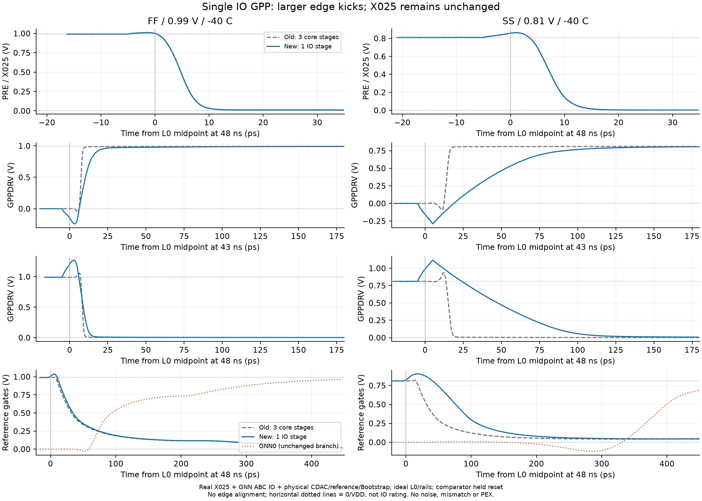
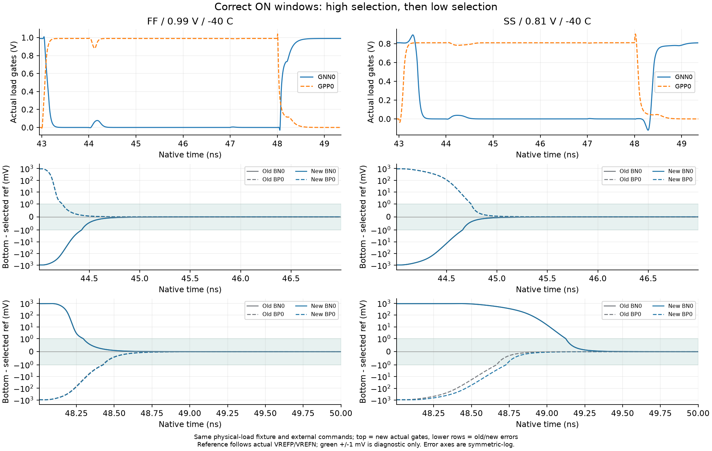

# GPP 单级 IO 对照：实际结果

三段核心反相器改为一对 IO 管，其余 140 条器件记录、Rgate、负载、模型设置与外部时序不变。器件数及寄生同时改变；本结果只评价该驱动块实现，不归因于某一只管。

测试：FF 0.99 V／SS 0.81 V，均 −40°C，52 ns；真实 X025、GNN ABC、CDAC／参考／Bootstrap 负载，理想 L0／电源，比较器保持复位；无噪声、失配或 PEX。

| 角落 | GPP 端压超限记录：旧→新 | GPPDRV 最小／最大 V：旧→新 | X025 最大端压 V：旧→新 |
| --- | --- | --- | --- |
| ffcold | 24/36 → 0/12 | -0.056194/1.056699 → -0.240667/1.270576 | 1.009124 → 1.009120 |
| sscold | 0/36 → 0/12 | -0.094953/0.935251 → -0.290528/1.115649 | 0.863144 → 0.863140 |

核心门限 0.99 V，IO 暂用 1.98 V 筛查。**GPP 筛查改善不代表尖峰变小**：新输出更偏离电源轨；FF 的 X025 残余与比较器负载微伏级严格超限仍需单独报告，原生 CMI 保留。

- ffcold：实际参考栅 GPP0 最小／最大 -0.000901/0.993547 → -0.016033/1.039710 V；GNN0 最小仍为 -30.496 mV。新 GPP 最大体结正向极性 280.576 mV，对应 bulk 总电流 -9.866 µA；不能据此直接认定二极管导通或其电流比例。
- sscold：实际参考栅 GPP0 最小／最大 -0.003152/0.819950 → -0.036535/0.903051 V；GNN0 最小仍为 -120.031 mV。新 GPP 最大体结正向极性 305.649 mV，对应 bulk 总电流 -30.579 µA；不能据此直接认定二极管导通或其电流比例。

48 ns 的 L0 上升期间，GPPDRV 在完成下降前先正向抬升；43 ns 的下降期间则先负向下冲。它们是原有输出电平受到输入边沿扰动，不能当成最终静态电平。原生 D/G/S/B 与 Rgate 电流及 KCL 支持局部动态电荷交换，但不提供内禀 Cgd、沟道与结电流分量。原三级链的中间级已删除，直接 IO 输入的负载与响应也同时改变。

| 角落 | GNN 比 GPP 滞后 ps，关低／开低：旧→新 | 最晚低参考 ±1 mV 建立 ns：旧→新 | L0 边沿绝对电荷 fC，关低／开低：旧→新 |
| --- | --- | --- | --- |
| ffcold | 62.46/60.71 → 56.47/58.24 | 48.428515 → 48.432439 | 2.464/2.465 → 3.666/3.661 |
| sscold | 353.56/348.26 → 313.39/300.27 | 49.125324 → 49.129284 | 1.740/1.740 → 2.238/2.235 |

时序均以实际电压的半 VDD 交点计，无内部波形对齐；正间隔不等于证明无同时导通。GNN 路径基本不变，分支差缩小来自 GPP 变慢；SS 的关低／开低延迟分别增加约 40／48 ps，不能称为整体提速。建立误差逐侧比较当前选中参考，只在正确 ON 窗口判定；46.995–47.995 ns 关断间隙的残差另存 JSON，不作 ON 建立失败。

| 角落 | GPP 直接 VDD 能量 fJ：旧→新 | L0 理想源净供能 fJ：旧→新 |
| --- | --- | --- |
| ffcold | 6.121 → 2.215 | 0.448 → 0.980 |
| sscold | 3.804 → 1.465 | 0.349 → 0.534 |

以上均为 0–52 ns 该测试台的端口能量。L0 供能、内部 PRE 传递与 VDD 端口能量分别计量，不相加作整机功耗结论；实际 L0 驱动尚未接入，其负载变重不能被理想源掩盖。

结论：单级 IO 为 GPP 提供端压筛查余量，负载最晚建立约推迟 4 ps，但边沿扰动和输入负载更大。X025、GNN 的下冲、真实 BBM 接口及整机验证仍未闭环；本次不采用新基线，也不生成下一候选。

## 可复核记录

全部来源回执、逐文件 SHA/大小、冻结输入 SHA、原生 PASS/PSF_END、单调原生时间戳与导出散列均核对。旧版每角 498 项、新版 474 项；完整记录见 `generated/gpp_single_io_comparison/terminal_pairs.csv`，数值及当前告警见同目录 `comparison.json`。

- `sar8audit-refcell-realpre-ffcold`：9237 个原生点，result SHA256 `46f279469d02856bee7d8daf734f7c277d61596aba1fb85ac379b7adf1fd1887`。
- `sar8audit-gpp-singleio-ffcold`：8844 个原生点，result SHA256 `7dc36e57f08e18f4e19f91bd3982a6c42c713f81449fda2bccbe6d28fff4d112`。
- `sar8audit-refcell-realpre-sscold`：8848 个原生点，result SHA256 `24e5f85b7cdbfc66631a093ea0d229bb8243aca78356bd891e5e9df50f8fe419`。
- `sar8audit-gpp-singleio-sscold`：8346 个原生点，result SHA256 `0898c622137de9eadad347ecedc6de5fb665396c2bb0eae2f483f46cbc3f848e`。
