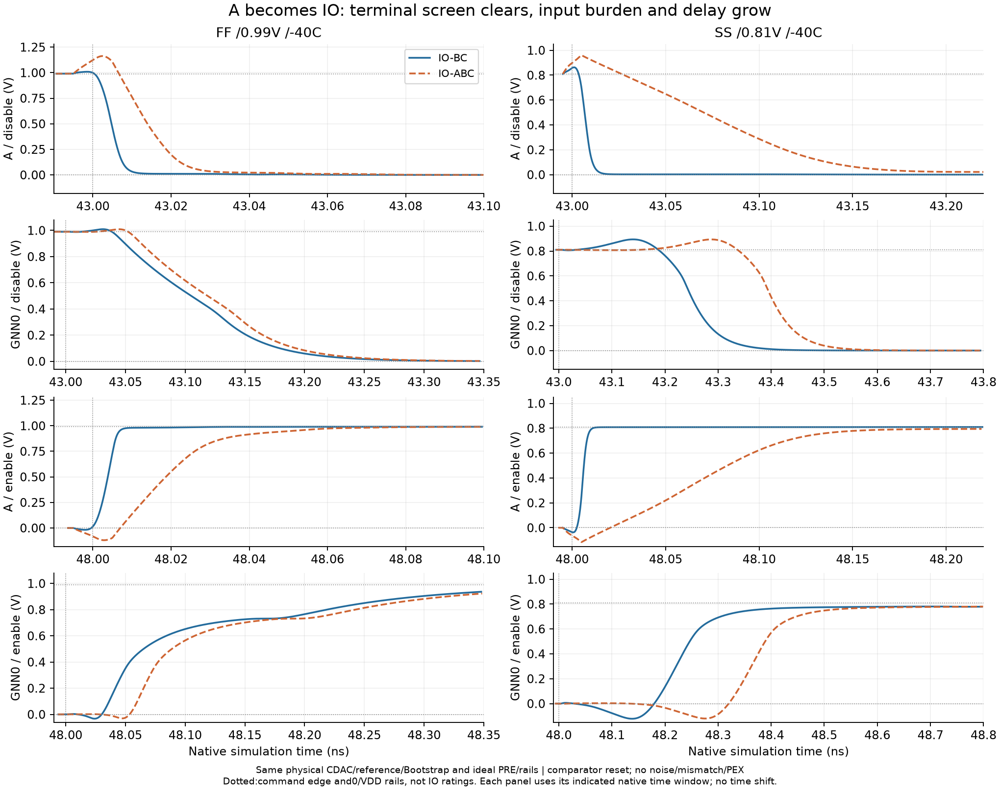

# IO-BC → IO-ABC：两个冷角，PRE 仍理想

**参考 A/B/C 链的所用端压筛查已无超限；真实输入接口尚未验收。**
仅 A 两只管子改为与 B/C 相同的 IO 参数，物理负载与命令保持。
PRE 仍由理想源直接驱动，原核心反相器 X025 不在本台中。

条件：FF /0.99 V、SS /0.81 V，均 −40°C、0–52 ns；完整 CDAC、参考开关与 Bootstrap 保留，
比较器复位；无噪声、失配、PEX 或活动 ADC 判决。新结果各 11 文件，4,121,724/4,037,948 B，
8410/7915 原生点、447 路电流；回收和冻结输入 SHA 已核对。

| 端压与下冲（旧 BC → 新 ABC） | FF | SS |
|---|---:|---:|
| A 最大端差 | 1.009099 → 1.162828 V | 0.863165 → 0.960077 V |
| B 最大端差 | 1.199118 → 1.162828 V | 0.959065 → 0.960077 V |
| C 最大端差 | 1.199118 → 1.140901 V | 0.971107 → 0.960807 V |
| GNN0 最低电压 | −32.803 → −30.565 mV | −121.881 → −120.084 mV |

A 的器件门限从核心 0.99 V 改为 IO 暂定 1.98 V，B/C 始终按 IO 1.98 V。
因此“通过”来自额定承受范围改变，不能说 A 的过冲消失。
FF 全台剩余 12 项严格超限均在复位 XCOMP，最大超出约 **2.933 µV**，CMI 记录保留；SS 450 项均未超限。
这些不是整机或寿命签核结论。

## 输入负担和完整延迟

| 测量（旧 BC → 新 ABC） | FF | SS |
|---|---:|---:|
| PRE→GNN0，关闭低参考 | 105.88 → 119.56 ps | 252.67 → **402.96 ps** |
| PRE→GNN0，开启低参考 | 64.36 → 88.05 ps | 234.00 → **375.91 ps** |
| PRE 上升换向的输入净电荷 | 1.232 → 2.429 fC | 0.870 → 1.365 fC |
| PRE 源净交付能量，0–52 ns | 0.236 → 0.630 fJ | 0.175 → 0.299 fJ |
| 低参考 BN0 持续进入 ±1 mV | 48.267782 → 48.291495 ns | 48.975269 → **49.117648 ns** |

新 ABC 的 PRE 源交付/回收能量分别为 FF **1.447/0.817 fJ**、SS **0.681/0.382 fJ**。
源功、A 栅极端口功与节点 KCL 相互对照；这些数与 VDD 能量分别报告，**不相加**，
也不能当作 X025 的实际供电损耗。新 ABC 部分 VDD 能量为 922.879/266.583 fJ。

高参考关断前两版都能建立；低参考 BN0 在 SS 晚约 **142.38 ps**，与新增传播时间一致。
46.995 ns 后的浮置扰动基本不变：FF BN0/BP0 约 +44.37/−35.37 mV，SS 约 +33.78/−32.39 mV。
ON 窗口和关断间隙分开统计，没有将 47 ns 边沿内末点当作导通建立失败。

## 端压门限通过，结正偏极性仍需保留

新 ABC 中 A 的 N/P 漏端结最大正偏极性电压：FF **119.6/172.8 mV**，SS **115.7/150.1 mV**。
相同时刻 body 端口总电流分别约 FF **+7.92/−14.03 µA**、SS **+12.43/−24.30 µA**。
N 按 Vbody−Vdiffusion、P 按 Vdiffusion−Vbody 定义；电流正方向为流入 body 端口。
这说明节点有越轨和对应端口电流，不能据此把总电流分解成二极管导通/位移分量，
也没有假设结导通阈值。完整 150 项结极性与体电流留在原结果中，比较文件列出 A/B/C 的 12 项。

## 下一步最小真实驱动台建议（尚未生成）

1. 保留本台 ABC、Rgate、CDAC 与参考网络。移除理想 VPRE，接回原 **XREF.XDRV0.X025**，
   使用原 N/P W=0.5/1 µm、L=30 nm 核心器件；其两个 drain pin1 接 PRE，A 两个 gate pin2 是负载。
2. 边界前移到 **L0**。恢复其共享的原 GPP 物理驱动支路及后级负载，并移除该支路的理想 GPPDRV 输出源，
   避免强迫真实输出。只加一只空载 X025 或用固定电容代替共享支路都不够。
   L0 的逻辑相位与 PRE 相反；采样关闭沿保持，实际 PRE 的延迟/反冲应自然测量，不人为对齐。
3. 单独测量核心 X025 的全部端差、PRE 越轨、body 电流/结极性、L0 输入负担和源功、总延迟及 ON 建立。
   **若 L0 仍理想，原 BBM 输出驱动 XBBM0.X004.X001 仍未验收**，不能把这个最小台叫完整数字链闭合。

精确实例、引脚和 L0 的共享扇出见 `pre_driver_boundary.json`。
本次没有扩大替换、准备该台或启动新仿真；下一判断应针对被理想 PRE 隐藏的真实核心 X025。

数据入口：`generated/io_astage_comparison/comparison.json`，四个案例共 1800 项端压记录在同目录 CSV。
旧 BC 的 PRE 测量仅复用已回收 94 列小波形和相同积分公式，保留其真实核心 A 模型标签，未改写历史结果。
