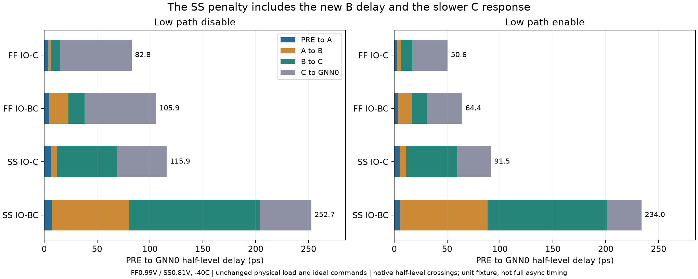

# B 级 IO 替换：FF / SS 对比

**B/C 现有 IO 尺寸在两个测试点均有端压裕量，但 FF 的核心 A 仍超压。**
B 替换使输入加载和传播延迟增加；C 节点尖峰变小，并不保证 Rgate 后的负载扰动变小。
当前结果不支持采用为最终驱动链，也没有准备下一候选。

IO-C：A/B 为原核心级、C 为 IO；IO-BC：只将 B 两只管子换成同 C 的完整 IO 参数。
供电 FF=0.99 V、SS=0.81 V，均 −40°C。命令、采样关闭沿、Rgate、完整物理 CDAC、
参考开关、Bootstrap 和复位比较器不变；电源/命令理想，无噪声、失配、PEX 或活动 ADC 判决。

来源为原 IO-C 完成结果及 `sar8audit-refcell-iob-{ffcold,sscold}`，分别 8496/8087 原生点。
两个新回收包各 11 文件，3,988,387/3,948,132 B；SHA、冻结输入及 450 项端压对照均核对。

## 端压：耐压提高，不等于过冲消失

| 观察量（旧 IO-C → 新 IO-BC） | FF | SS |
|---|---:|---:|
| 核心 A 最坏端压，门限 0.99 V | 1.010753 → **1.009099 V** | 0.875399 → 0.863165 V |
| B 最坏端压，门限 0.99 → 1.98 V | 1.026131 → 1.199118 V | 0.883946 → 0.959065 V |
| C 最坏端压，门限始终 1.98 V | 1.371385 → 1.199118 V | 1.113774 → 0.971107 V |
| C 输出节点最高电压 | 1.371385 → 1.147291 V | 1.113774 → 0.971107 V |
| GNN0 最高电压 | 1.006943 → 1.009425 V | 0.855405 → 0.893744 V |
| GNN0 最低电压 | −36.184 → −32.803 mV | **−77.163 → −121.881 mV** |

FF 中 A 仍超门限 **19.10 mV**，只比旧版减少约 1.65 mV。B 的尖峰实际上增大，
只是新器件可承受更大端压。C 的最坏端压还包括 B 输出施加在其栅极上的电压，不能只看 C 输出节点。
全台严格超限端压记录 FF 由 26→18、超出门限大于 1 mV 的记录 14→4；SS 两组均为零。
其中 A 的严格记录为 4→6，多出的两项仅超约 0.000271 mV；记录个数和最坏幅度应分开看。
端压记录数不是晶体管数，1 mV 分类不放宽原门限。FF 的 CMI-2751/2754/2755/2756 仍保留；SS 无 CMI。

[FF 同窗 A/B/C/GNN0 波形](generated/io_bstage_ff_comparison/ff_bstage_node_edges.png)
· [SS 同窗波形](generated/io_bstage_ss_comparison/ss_bstage_node_edges.png)

## 因果：B 的加载增大，整条链变慢

| 加载与能量（旧 → 新） | FF | SS |
|---|---:|---:|
| B 栅极换向净电荷幅度，A 上升方向 | 1.232 → 2.429 fC | 0.870 → 1.365 fC |
| B 栅极正向电流峰值 | 252.5 → 380.8 µA | 177.2 → 220.2 µA |
| A 直接 VDD 端口能量，0–52 ns | 2.197 → 3.397 fJ | 1.359 → 1.782 fJ |
| B / C 直接 VDD 能量，新版 | 4.211 / 2.248 fJ | 2.186 / 1.376 fJ |

仅 B 改变，实测栅极总电荷和 A 的供电负担增加，支持“输入加载发生改变”的解释。
较大的负载并未使 A 的峰值更严重，但也没有给它足够的端压保护。
同一个 C 现在由更慢的 B 边沿驱动，C 的传播过程和耦合脉冲被重塑；这是全链路波形变化，
不能把结果归结为“IO 抑制过冲”，也没有将总端口电流拆成未经测量的 Cgd/沟道比例。

| PRE→GNN0 总半电平延迟（旧 → 新） | FF | SS |
|---|---:|---:|
| 关闭低参考 | 82.84 → 105.88 ps | **115.94 → 252.67 ps** |
| 开启低参考 | 50.59 → 64.36 ps | **91.53 → 234.00 ps** |

SS 中 A→B 延迟由 5.30/6.07 ps 增至 73.07/82.57 ps；B→C 也由 57.49/48.25 ps
增至 123.55/113.20 ps。只看最后一段延迟会漏掉主要代价。
这仍是局部理想命令台，不能直接判断完整异步时序达标与否。

[FF 栅极电流/电荷与 A 供电电流](generated/io_bstage_ff_comparison/ff_bstage_A_load_current.png)
· [SS 对应波形](generated/io_bstage_ss_comparison/ss_bstage_A_load_current.png)

## 导通建立与关断浮置仍分开

两版均在高参考关断前进入 ±1 mV。低参考 BN0 持续进入诊断带的首个原生时刻：
FF **48.253032→48.267782 ns**（晚 14.75 ps）；SS **48.826950→48.975269 ns**（晚 148.32 ps）。
其余建立变化接近原生夹点宽度，不宣称已分辨的改善。静态平台可恢复，没有本台中的卡死证据。

46.995 ns 开始的关断间隙扰动基本不变：FF BN0/BP0 约 **+44.37/−35.37 mV**，
SS 约 **+33.78/−32.39 mV**。本次没有修复这条独立问题。
SS 原 47 ns 窗口末点为 +0.796250→+1.008048 mV，原生时刻为 46.999387→46.999953 ns，
都在关断边沿内；不能据此宣称新版导通建立失败。关断前残差约 10–24 nV，接近电压数值容差量级。

[FF 正确导通窗口残差](generated/io_bstage_ff_comparison/ff_bstage_load_settling.png)
· [SS 正确导通窗口残差](generated/io_bstage_ss_comparison/ss_bstage_load_settling.png)

全台部分 VDD 能量 FF 920.849→922.545 fJ、SS 265.546→266.212 fJ；
不包含所有理想命令源能量，不能当整机功耗。原日志及 SFE/VACOMP 警告保留，未将 CMI 筛查当寿命签核。

**下一步建议：优先解决剩余核心 A 与真实 PRE 来源之间的耐压接口。**
应把 SS 当前约 0.253/0.234 ns 的总传播时间纳入真实时序预算，再决定 A 的耐压实现；
不继续无目标扩大 B 尺寸，也不因为 B/C 通过就合龙。关断浮置扰动保持独立排查项。
本次只分析已有结果，未更改电路、冻结输入或历史结果，未新增仿真或候选。

精确数值、450 项 CSV、原始结果哈希和分角点图由
`generated/io_bstage_comparison_index.json` 统一索引。
旧分析器 PRE 上升延迟的空值由严格时间窗边界造成；本地用已存原生夹点和扩大 20 ps 的观察窗恢复，
没有移动波形、改动时钟或覆盖旧空值。
