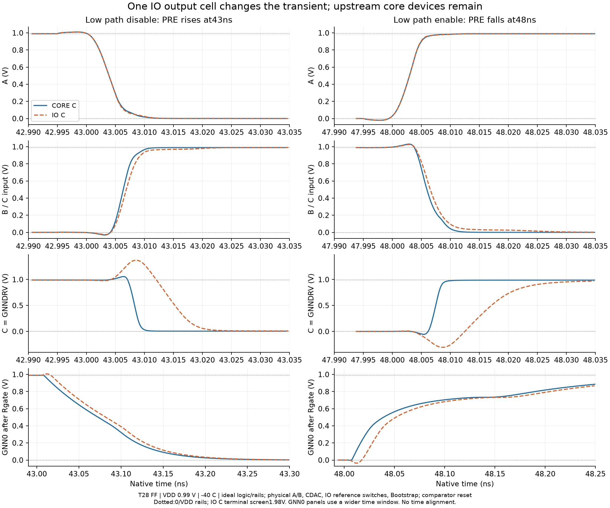
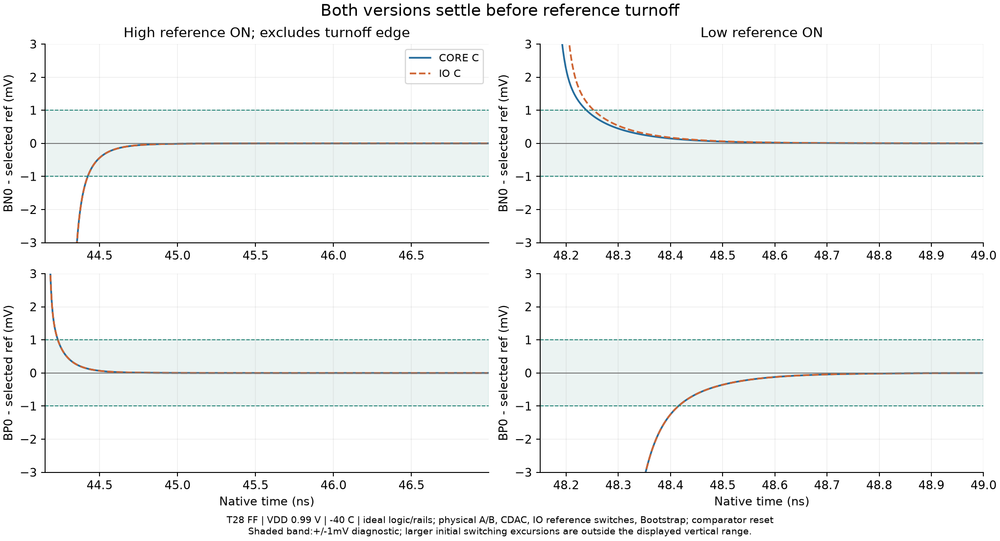
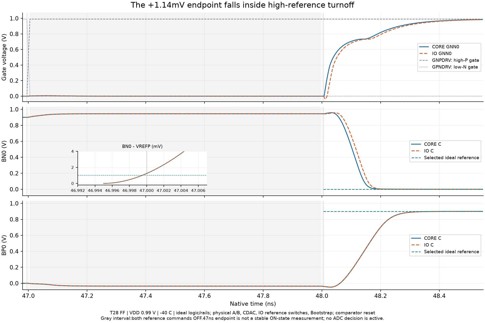

# FF 冷角：只替换末级 C 的结果

**IO 末级本身获得耐压裕量，但没有修好整条参考驱动链。** A/B 仍为核心管，
端压超限继续存在；C 的电压尖峰反而更大，且负载栅极翻转更慢。
两版底板均能在参考关断前建立。旧测量窗口末尾的约 +1.14 mV 属于关断扰动，
不能表述为导通阶段一直未建立。

条件：T28 FF、VDD=0.99 V、−40°C、0–52 ns。两版只差 C 的 N/P 器件，
A/B、Rgate、完整差分 CDAC、32 只 IO 参考开关、两只 Bootstrap 和复位比较器均保留。
PRE/伴随支路栅控及电源为理想边界，没有 ADC 判决，不含噪声、失配、PEX。

来源：`sar8audit-refcell-{core,io}-ffcold/collected`。
分别 8534/8439 原生点；11 个回收文件逐项 SHA/大小核对，零跳过。
输入冻结哈希与测量哈希均匹配，原数据未修改。450 项端压记录全数对照于
`generated/io_cell_ff_comparison/all_450_terminal_pairs.csv`，数值及来源见同目录 `comparison.json`。

## 端压与反冲

| 观察量 | 原 core C | IO C |
|---|---:|---:|
| A 最坏端压 / 超出 0.99 V | 1.010731 V / 20.731 mV | 1.010753 V / 20.753 mV |
| B 最坏端压 / 超出 0.99 V | 1.030930 V / 40.930 mV | 1.026131 V / 36.131 mV |
| C 最坏端压 / 器件筛查门限 | 1.056699 V / 0.99 V | 1.371385 V / 1.98 V |
| C 节点最低电压 | −56.197 mV | −305.699 mV |
| GNN0 最高 / 最低 | 0.991198 / −0.003405 V | 1.006943 / −0.036184 V |

C 的 12 项端压记录由 10 项超限变成 0 项；A/B 仍分别有 4/10 项超限。
全测试台 450 项严格超限记录由 36 降至 26，超出门限大于 1 mV 的记录由 24 降至 14。
这些是端压对数，不是晶体管数；1 mV 分类不放宽原门限。

A 的主要瞬态基本未变，B 略有改善；末级替换并没有隔离或保护上游全部核心器件。
C 的较大尖峰经 Rgate 过滤后仍在 GNN0 留下可测的过冲/下冲。
该节点接 IO 参考开关，不能仅因它超过核心电源轨就判为核心管过压；应按实际接收器端压检查。
本次只能确认候选改变了耦合和驱动瞬态，不能从总端口电流分配未经测量的 Cgd/沟道比例。

## 延迟、建立与能量

| 半电平延迟 | 原 core C | IO C | 增加 |
|---|---:|---:|---:|
| B→C，关闭低参考 | 1.987 ps | 8.441 ps | 6.454 ps |
| B→GNN0，关闭低参考 | 67.371 ps | 75.996 ps | 8.626 ps |
| B→C，开启低参考 | 1.487 ps | 10.431 ps | 8.945 ps |
| B→GNN0，开启低参考 | 32.309 ps | 44.025 ps | 11.717 ps |

两组 GNN0 半电平原生夹点宽度约 0.44–0.81 ps，延迟变化大于夹点宽度。
这只是局部输入到负载的延迟，不能直接当完整异步环路裕量。

| 进入并持续保持 ±1 mV 的首个原生时刻 | 原 core C | IO C |
|---|---:|---:|
| 高参考导通：BN0→VREFP | 44.424837 ns | 44.427897 ns |
| 高参考导通：BP0→VREFN | 44.233656 ns | 44.233657 ns |
| 低参考导通：BN0→VREFN | 48.240159 ns | 48.253032 ns |
| 低参考导通：BP0→VREFP | 48.418688 ns | 48.417111 ns |

高参考评估在 46.995 ns 关断边沿之前截止；低参考评估到 52 ns。
建立夹点宽度约 1.34–4.59 ps：IO 版低参考 BN0 晚约 12.87 ps，
而两版高参考 BN0 约 3.06 ps 的差异小于夹点宽度，不应宣称存在已分辨的性能变化。
45–46 ns 平台，BN0 最大绝对参考残差约 11.64/11.24 µV，BP0 约 2.42/2.34 µV。

同一 0–52 ns 区间：理想 VDD 供给能量 918.899→920.849 fJ（+0.212%）；
C 直接 VDD 端口能量 1.783→2.501 fJ；上游 A/B 为 4.440→5.659 fJ。
未包含独立理想栅控源全部能量，不能用于整机功耗达标判断。
七节点最大绝对 KCL 残差分别 55.63/21.09 pA；不使用接近零电流时失真的相对残差作结论。

## +1.14 mV 是在哪个阶段产生的

原 `high_reference=44–47 ns` 窗口跨入伴随栅控的关断边沿：
GNPDRV 从 **46.995 ns** 开始上升，GPNDRV 同时下降，进入两参考都关闭的间隙。

| BN0−VREFP 观察点 | 原 core C | IO C |
|---|---:|---:|
| 边沿前最后原生点 | 46.990430 ns，−0.011112 µV | 46.987059 ns，−0.011137 µV |
| 原 47 ns 窗口末点 | 46.999798 ns，+1.137641 mV | 46.999803 ns，+1.139886 mV |
| 关断后、下次命令前最大值 | +44.366838 mV @47.993904 ns | +44.366723 mV @47.993707 ns |

关断前约 11 nV 的残差已接近本次 10 nV 电压绝对容差，只说明数值接近参考，不能解释成物理精度。
同一关断间隙 BP0−VREFN 最小约 −35.37436 mV，两版近乎一致。
波形表明该扰动跟随伴随参考关断，在浮置间隙保留下来；仅替换 NN 末级 C 没有消除它。
这是真实的关断/浮置扰动，但 **+1.14 mV 不能作为导通建立失败的证据**。
此单元台没有活动比较器，不能直接把其幅度换算为整机码误差。

原 CMI-2751…2756、SFE-1131、VACOMP-2435 全部保留。
原生日志中既有 A/B 的明确核心管超限，也有复位比较器约 990 mV 附近的记录；
警告次数受抑制，不能用日志条数代替全程端压筛查。
实际 effective 设置为 reltol=1e−7、vabstol=10 nV、iabstol=100 fA、gear2only、maxstep=10 ps，两版一致。

当前不采用新基线、不扩大替换、不新增实验。先等待主聊天回收 SS 配对，
再判断该 IO 尺寸在低压冷角的速度/电平是否可用；FF 结果已经明确，下一层修复必须覆盖上游核心接口，
而不能将“末级耐压通过”当作整链通过。
