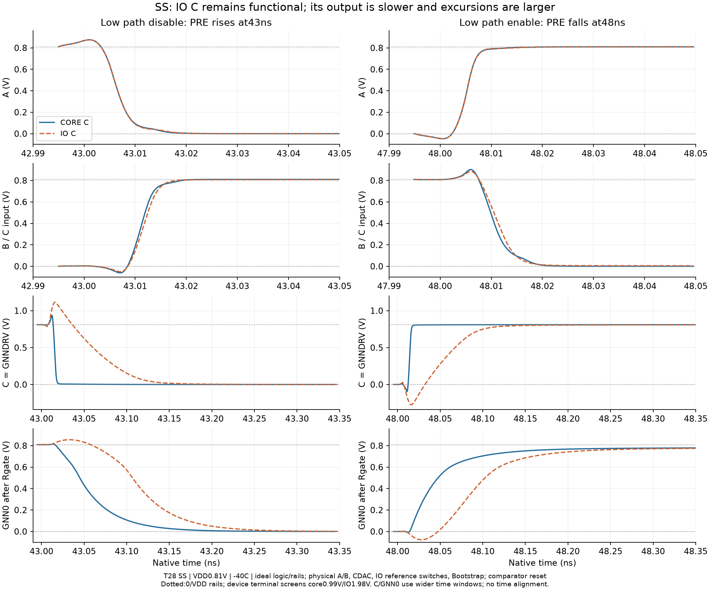
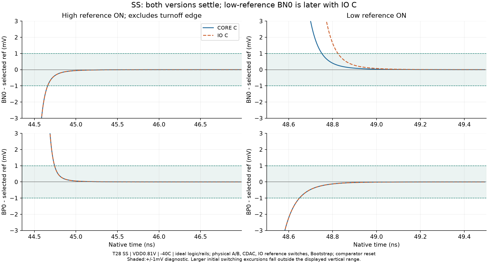
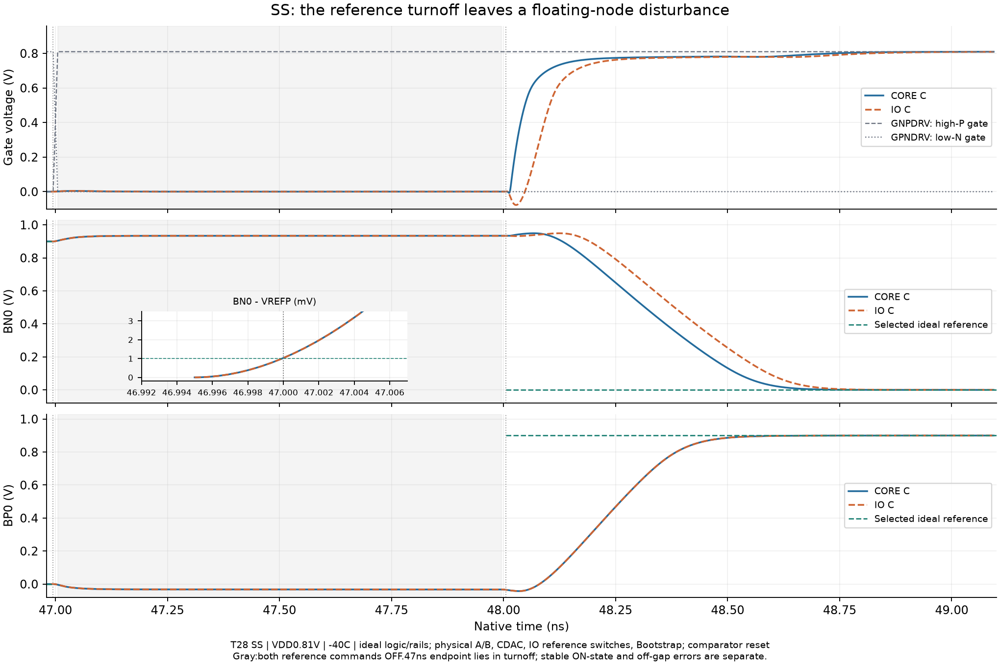

# SS 配对与末级 IO 路线判断

**两个已测点支持继续采用耐压 IO 作为 C 级设计方向；不支持冻结这组尺寸或宣布驱动链修好。**
SS 下 IO C 能完成双向翻转、恢复静态电平，全部选中端压低于相应器件门限。
代价是延迟和瞬态扰动增大。FF 的 A/B 核心管超压仍在，参考关断后的底板扰动也未被解决。

来源为 `sar8audit-refcell-core-sscold` 与 **`sar8audit-refcell-io-sscold-q2`**。
原 IO 任务明确排队超时且未启动，不作为电路失败；q2 使用同一冻结输入。
其 managed recipe 哈希为 `70189d38065071c2a25266856ec1eb94274817c9263b44138707956787c84e3b`。
两组各 11 文件、4,150,189/3,710,891 B、8142/8003 原生点；回收 SHA、输入和波形 SHA 全核对。

条件：T28 SS、0.81 V、−40°C、0–52 ns；与 FF 对照使用同一局部负载台结构。
保留真实 A/B、Rgate、完整 CDAC、IO 参考开关、Bootstrap 和复位比较器；
外部电源与命令理想，不含噪声、失配、PEX，没有活动 ADC 判决。

## SS：耐压与速度

| 观察量 | 原 core C | IO C |
|---|---:|---:|
| A 最坏端压（门限 0.99 V） | 0.875342 V | 0.875399 V |
| B 最坏端压（门限 0.99 V） | 0.901466 V | 0.883946 V |
| C 最坏端压（门限 0.99 / 1.98 V） | 0.935208 V | 1.113774 V |
| C 最低电压 | −94.990 mV | −274.963 mV |
| GNN0 最高 / 最低 | 0.814144 / −0.007034 V | 0.855405 / −0.077163 V |

两组全部 450 项端压筛查均为零超限；无 CMI，保留 SFE-1131/VACOMP-2435。
这不等于没有过冲：IO C 的节点仍超过 0.81 V 电源约 304 mV，只是处于其耐压门限以内。
SS 上游核心管仍有电源轨外扰动，也不能据此推断 FF 安全。

| 半电平延迟 | 原 core C | IO C | 增加 |
|---|---:|---:|---:|
| B→C，关闭低参考 | 4.328 ps | 57.494 ps | 53.166 ps |
| B→GNN0，关闭低参考 | 40.939 ps | 104.093 ps | 63.154 ps |
| B→C，开启低参考 | 3.749 ps | 48.252 ps | 44.503 ps |
| B→GNN0，开启低参考 | 27.972 ps | 80.201 ps | 52.229 ps |

GNN0 半电平原生夹点宽度约 0.42–1.01 ps，延迟变化可分辨。
三个静态窗口的最大逻辑轨偏差均不足 0.009 mV；未发现本台中不能恢复电平的情况。
但这不是完整异步环路的实测时序，也没有据此分配新预算或修改采样窗口。

## 导通建立与关断扰动分别看

| 进入并持续保持 ±1 mV 的首个原生时刻 | 原 core C | IO C |
|---|---:|---:|
| 高参考：BN0→VREFP | 44.660954 ns | 44.661677 ns |
| 高参考：BP0→VREFN | 44.745501 ns | 44.748471 ns |
| 低参考：BN0→VREFN | 48.753096 ns | 48.826950 ns |
| 低参考：BP0→VREFP | 48.649314 ns | 48.651162 ns |

IO 版低参考 BN0 建立晚约 **73.85 ps**。其余 0.72–2.97 ps 的差异小于相应
3–6 ps 原生建立夹点宽度，不宣称已分辨的改善或退化。
45–46 ns 稳定平台的 BN0 最大绝对残差约 55.33/52.87 µV，BP0 约 53.78/50.67 µV。
两版在 46.995 ns 关断边沿前都已充分进入本次 ±1 mV 诊断带。

原 44–47 ns 窗口末尾的 BN0 残差为 +0.979624/+0.796250 mV，
但原生末点分别在 **46.999881/46.999387 ns**，已进入关断边沿且时刻不同。
不能把这两个数的差值当成关断注入改善。原窗口数字保持不变。

关断前最后原生点在 46.991601/46.989701 ns，BN0 残差约 −0.02390/−0.02397 µV，
接近本次 10 nV 电压容差的量级，只说明数值接近参考。
关断后至下一命令前，BN0−VREFP 最大 +33.775231/+33.775134 mV，
BP0−VREFN 最小 −32.387559/−32.387453 mV，基本未变。
因此这条独立的浮置底板扰动仍在，C 级替换没有修复它；本台没有 ADC 码字，不能据此直接量化整机码误差。

同一 0–52 ns 区间，部分理想 VDD 能量 **264.661→265.546 fJ（+0.334%）**；
C 的直接 VDD 端口能量 1.039→1.477 fJ，A/B 为 2.753→3.171 fJ。
七节点最大绝对 KCL 残差 159.20/160.79 pA。
未包括独立理想栅控源全部能量，不作为整机 1 mW 验收。
实际 effective 设置与 FF 一致：reltol=1e−7、vabstol=10 nV、iabstol=100 fA、gear2only、maxstep=10 ps。

## FF 与 SS 合并判断

| IO C 候选 | FF / 0.99 V / −40°C | SS / 0.81 V / −40°C |
|---|---:|---:|
| C 最坏端压 / 1.98 V 门限 | 1.371385 V | 1.113774 V |
| 上游 A/B 是否均低于 0.99 V | 否：1.010753/1.026131 V | 是：0.875399/0.883946 V |
| B→GNN0 关闭 / 开启延迟 | 75.996 / 44.025 ps | 104.093 / 80.201 ps |
| 关断间隙 BN0 / BP0 扰动 | +44.367 / −35.374 mV | +33.775 / −32.387 mV |

可以继续研究这条路线，因为额定 IO 末级在两个测试点都能驱动真实负载并保留耐压裕量，
SS 也没有表现为失效或无法复位。104 ps 的局部延迟需要和真实模块时序预算核对，不能仅凭数值判快慢合格。

仍不能采用为最终方案：FF 上游 A/B 未受保护；输出扰动更大；关断浮置问题基本不变；
只测试了 bit0 NN 支路与两组角点，未覆盖完整 BBM、全部位权、真实控制输入、热角或整机。
后续耐压设计必须覆盖 A/B 和真实输入接口，同时把 SS 延迟纳入实际 BBM/异步时序契约。
本次只归纳已有证据，没有新仿真、尺寸扫描、替换范围扩大或基线采用。

全部 450 项表与精确数值在 `generated/io_cell_ss_comparison/`；
`comparison.json` 同时记录 FF+SS 判断矩阵和 q2 来源。
