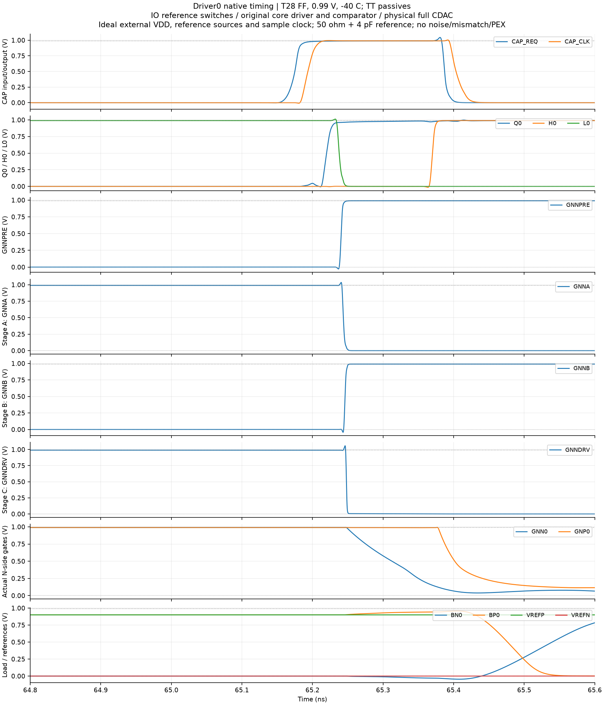
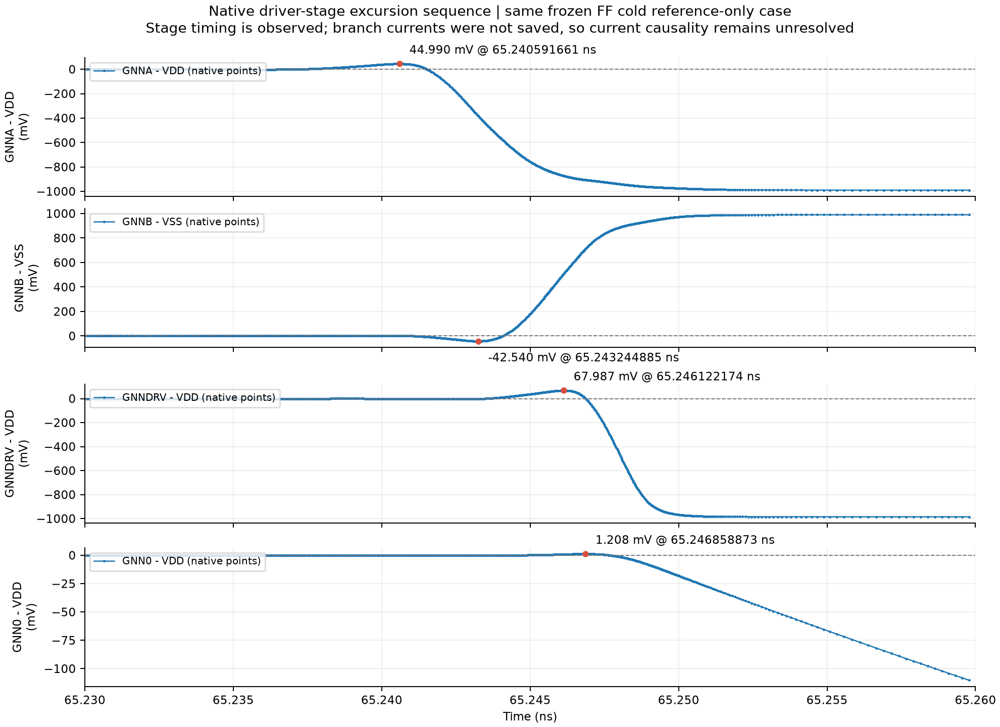

# Driver0 recovered native evidence

Scope: frozen `sar8fix-loaded-ref-ffcold`, recovered by the already completed
managed analysis run `sar8audit-ref-native-v1`. T28 FF,0.99V,-40C; TT passives;
IO reference switches, original core drivers/comparator and physical full CDAC.
External VDD/reference sources/sample clock ideal; each reference has50ohm+4pF.
No transient noise, mismatch sampling or PEX. No new remote operation here.

All14 collected files match receipt bytes/SHA256. The collection is26,671,191
bytes; its lossless boundary contains129,379 rows from0 through
65.99650423427015ns and31 voltage channels. Diagnostic data retain every11,424
native point64..66ns. Every diagnostic timestamp occurs exactly in the boundary.

| Node | Native extremum | Time/ns | Excursion beyond corresponding rail |
| --- | ---: | ---: | ---: |
| XREF.XDRV0.GNNA |1.034989914V|65.240591661|+44.989914mV above VDD|
| XREF.XDRV0.GNNB |-0.042540406V|65.243244885|-42.540406mV below VSS|
| XREF.XDRV0.GNNDRV |1.057987231V|65.246122174|+67.987231mV above VDD|
| GNN0, after Rgate |0.991208148V|65.246858873|+1.208148mV above VDD|

The event follows late CODE capture: Q0 rises, L0 releases, GNNPRE rises and
the three driver stages switch. H0 turns on later after BBM. Rgate separates
the large internal-driver excursion from the much smaller actual gate excursion.
This establishes event order and location; **branch-current causality is not yet
measured**. Driver0/LSB branch currents were absent from the source saves.

## Independent capture-input check

The approved command243 defines early D and late CODE independently of measured
gates/Q. All14 observed selected-input words (bit7 through bit1, early/late)
match that program over the native +/-10ps diagnostic guards. Half-VDD PHI_U
phase checks also match. CAP_REQ-to-CAP_CLK rising half-level delays are
15.07..18.45ps.

The stricter90%-VDD-across-the-whole-guard check is false for early captures;
that arbitrary guard/voltage fraction is **not** a characterized cell requirement
and cannot establish capture failure. No complete bit0 capture, second-frame
command12, eight-bit stored-Q proof or setup/hold characterization is inferred.
Digital protocol checks remain separate from analog rail-settling requirements.

Detailed records: `generated/native_review/review.json`.

## Replay size and separate approximate candidate

All29 replay inputs at all129,379 native knots would occupy183,356,435 bytes
as .17g Spectre PWL; gzip-level1 is65,275,785 bytes. Both exceed32MiB.
The large file was measured by streaming, not written.

Parent explicitly authorized local knot deletion with1uV diagnostic error bound.
`generated/approximate_replay/verification.json` records every channel's original
and retained count, worst error/time, exact source bytes and crossing audit.

- Retained466,801 of3,751,991 total input knots; no new knots, shifting or clipping.
- Every native point64..66ns retained on all29 inputs, plus first/last points,
  earliest global-min/max witnesses, and both brackets of every10/50/90%-VDD
  crossing. Equal-valued plateau points outside required witnesses may be deleted.
- Independent `np.interp` verification at every original point gives maximum
  absolute error0.9999874320820723uV, on CODE5 at50.29220536269969ns.
  Piecewise-linear difference extrema occur at original knots, so the same bound
  holds between knots. All crossing brackets/values/times remain exact.
- Actual written .17g pairs were read back and compared exactly with original
  time/value pairs; this is additional to the in-memory deletion check.
- PWL22,534,325 bytes, SHA256
  `60e98573553b9c87df48d961daee643701fb685cba217383e9fa38a5274015f4`.
- The three local input files total22,749,015 bytes, below33,554,432 bytes.
  Future managed analysis inputs also count toward that cap.

The original lossless archive/exporters are unchanged. This approximation is a
diagnostic replay choice, **not an ADC error budget or electrical qualification**.
Parent independently confirmed the PWL numerical review; physical fixture and
complete managed package/recipe approval remain outstanding.
