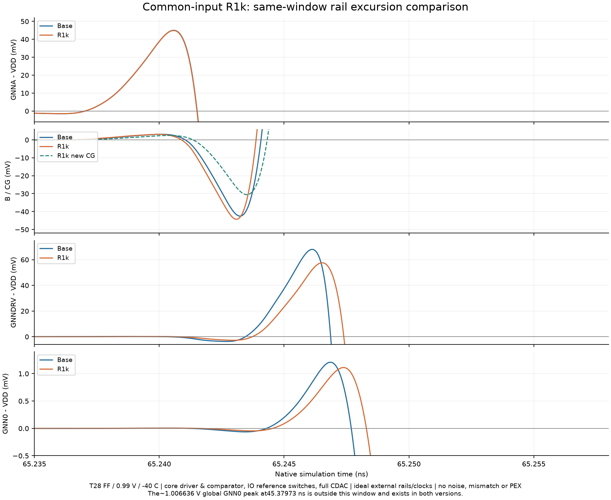
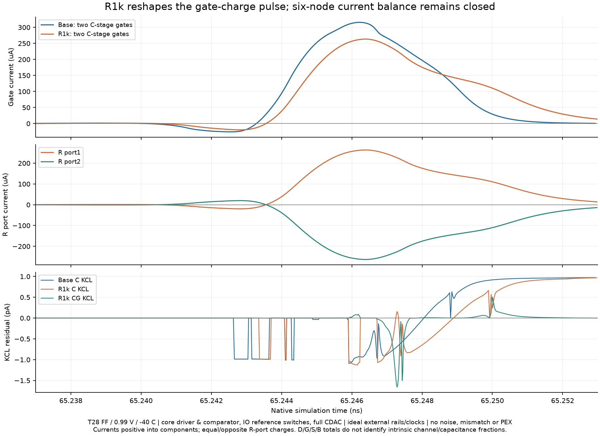
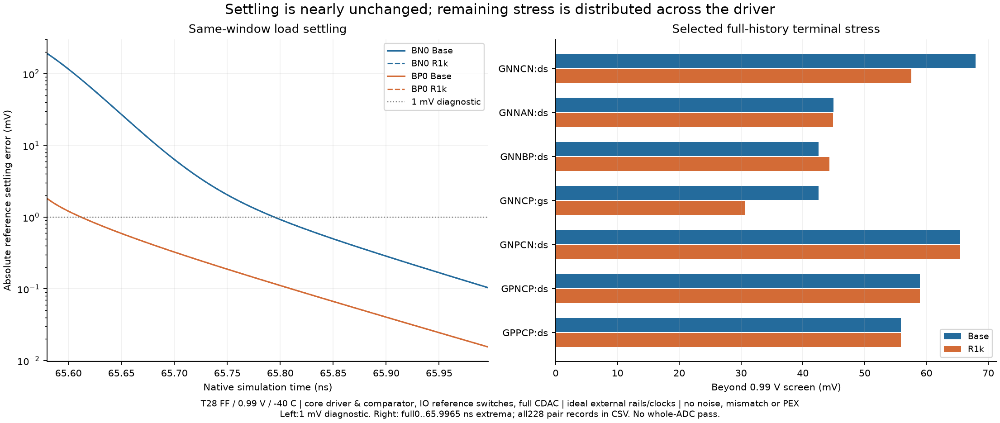

# R1k：局部缓解，未解决参考驱动耐压

结论：共同门输入1kΩ降低了C级门电流峰和正过冲，但B级负摆加深，
228项端压筛查的超限记录数不变。本结果不足以把R1k作为已修复基线。

比较对象是完成的current-v2与cinput-r1k-v1；FF、0.99V、−40°C，
MOS尺寸/模型、外部PWL、采样窗口/关闭沿、完整CDAC负载及实际求解设置相同。
图按原生绝对时间叠加，没有平移峰值。外部电源/时钟理想，无噪声、失配、PEX。

| 65ns同一故障窗 | 原版 | R1k | 结果 |
| --- | ---: | ---: | --- |
| GNNA轨外正峰 |44.989mV|44.878mV|基本保留|
| GNNB负峰 |−42.542mV|−44.300mV|加深1.757mV|
| GNNDRV轨外正峰 |67.986mV|57.580mV|下降15.3%，仍越限|
| GNN0轨外正峰 |1.208mV|1.111mV|局部减小|
| 新共同门节点CG |无|−30.582mV|对应GNNCP \|Vgs\|仍达1.020582V|

GNNDRV下降沿半VDD时刻延后0.838ps，GNN0下降沿延后0.853ps。
全程GNN0最大值在两版都是约1.006635639V、45.37973ns，几乎完全不变；
它不属于上表65ns事件，也不是R1k新产生的全程恶化。

末级两门端合计电流峰从315.485µA降到263.362µA，脉冲变宽；
同故障窗净门电荷仍分别为1.2319167、1.2319015fC，基本不变。
R主要整形了电荷交换，并改变B级所见负载与N/P翻转时序。
这些数据支持输入沿相关的动态机理，仍不能分出精确的Cgd/沟道电流比例。

新增R两端的故障窗净电荷为+1.23190145/−1.23190145fC，
全时段为+1.23085773/−1.23085773fC；两端电流和最大为0。
V差−1000I的最大数值残差约1.39e−16V；R输入电荷与两门端净电荷之差约2.86e−25C。
六节点全程最大绝对KCL残差1.66pA，原版五节点为3.78pA。

全部228项**全时段**端压对已经逐项比较：严格超过既定限值的记录两版均111项，
超过限值1mV以上的记录均87项。后者只是分档统计，不是放宽PDK限值，记录数也不是器件数。
R1k之后最差项转为未改动的GNPCN，\|Vds\|约1.055370V，仍超0.99V约65.370mV。
GNNBP \|Vds\|反而由1.032542V升至1.034300V。
当前局部电压波形能覆盖其中110对的同窗计算；其余118对只提供已有全程极值，局部列留空，不补造波形。

BN0/BP0相对独立CODE243目标的建立曲线基本重合。
终点65.9965ns的残差分别约−0.103455mV、+0.015432mV，两版几乎相同。
进入并持续小于1mV的首个原生点：BN0两版都约65.797206ns；
BP0为65.612781/65.612874ns。对应跨阈原生括点宽度约5.80/1.43ps，
因此BP0首点相差0.093ps不应解读为可分辨的真实建立恶化。1mV仅为诊断阈值。

相同0–65.9965ns区间，理想VDD供电能量为7.613665/7.613643pJ，
差约−0.00029%，没有实质功耗收益的证据。R本身全程耗散约0.227386fJ。
这是局部、部分周期的供电量，不是整机1mW验证。CMI与LTE警告继续保留，
警告文本计数受抑制上限影响；不宣布整机、码字或PVT通过。

**下一步建议：先做一个具有耐压裕量的T28驱动单元验证。**
用1.8V耐压器件在实际下一级/Rgate/参考开关负载下检查延迟和端压，
覆盖保留的0.81–0.99V供电范围，包含SS低压冷角风险点，再决定驱动链替换。
依据是剩余越限分布在A/B及GNP/GPN/GPP多个分支，单纯继续增大共同R不能解决这个结构性约束。
这里只提出方向，未生成新候选或远端任务。

数据：[完整228项CSV](generated/cinput_r1k_comparison/all_228_terminal_pairs.csv)、
[数值明细](generated/cinput_r1k_comparison/comparison.json)。冻结输入和原始结果未修改。
