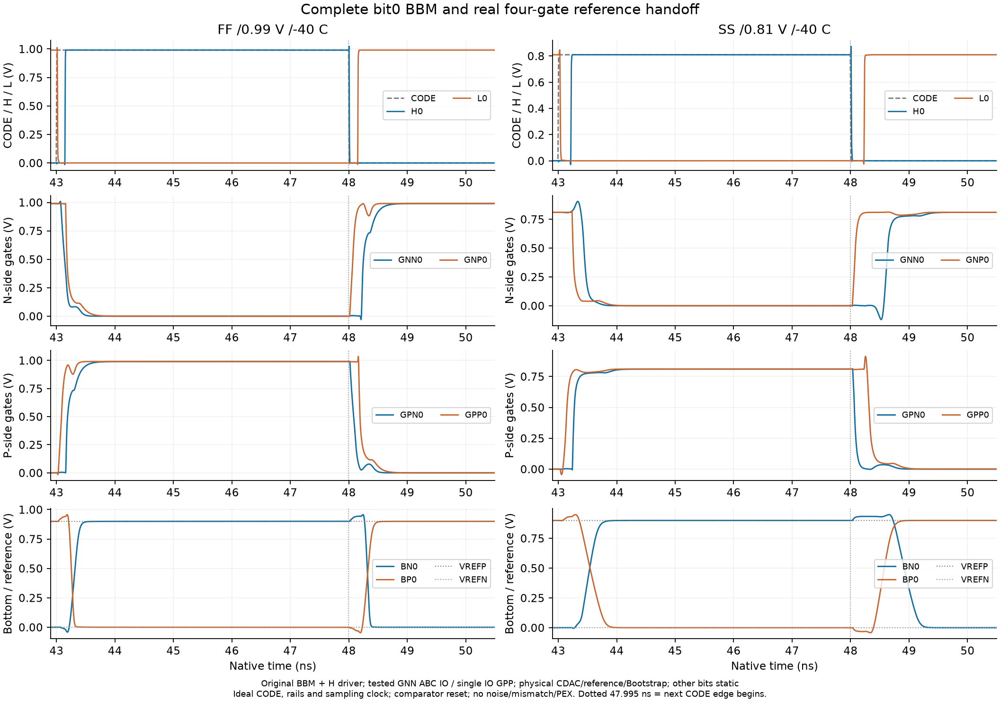
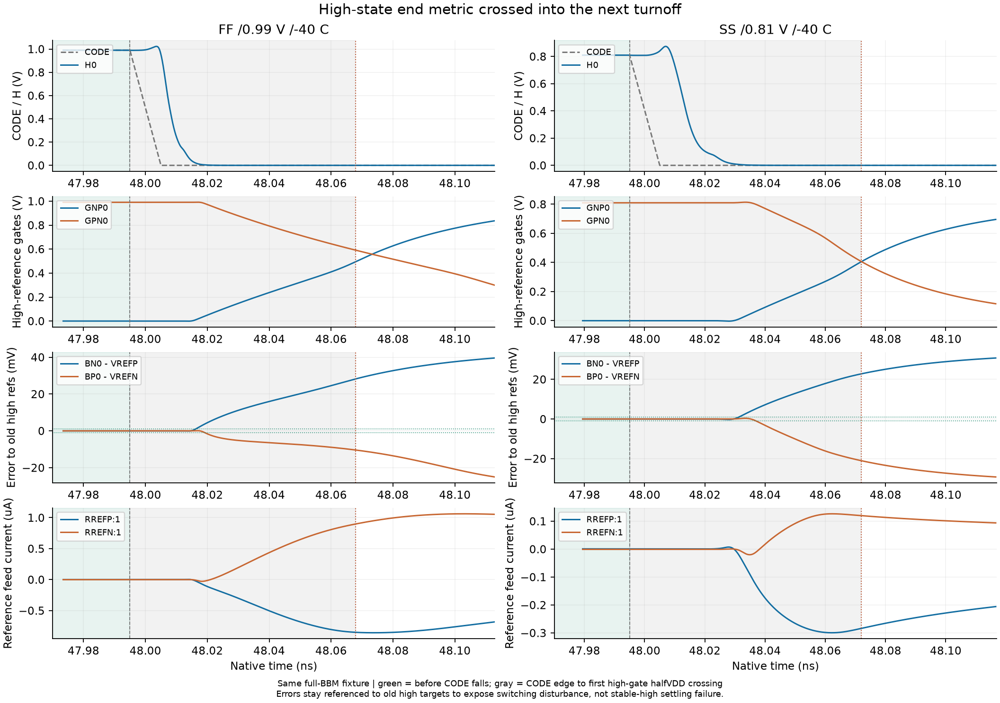
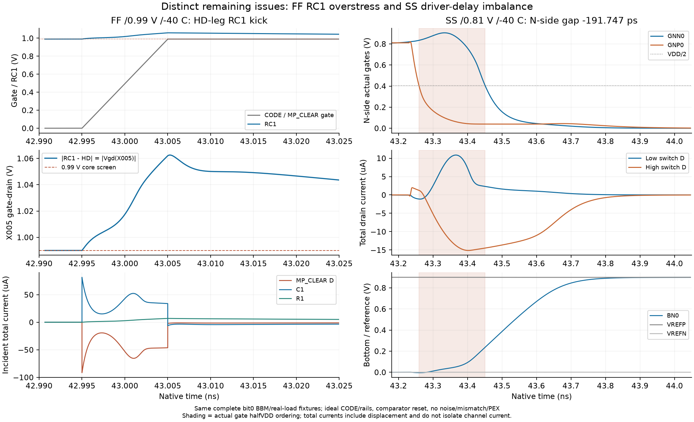

# 完整 bit0 BBM：建立与切换扰动分开判读

**高状态末值的原 `false` 不能直接解释为“高参考未建立”。** 冻结分析窗口延伸到高端栅极半 VDD 交点，已经跨过下一次 CODE 下降。原 JSON 不改，下面新增以 CODE 开始下降前为终点的独立测量。

环境：完整原 bit0 BBM／高端驱动，GNN ABC IO、单级 IO GPP、原 X025、物理 CDAC／参考／Bootstrap，其他位静态；理想 CODE／电源／采样时钟，比较器复位。FF 0.99 V／SS 0.81 V，均 −40°C，52 ns；无噪声、失配、PEX。

| 角落 | CODE 边沿前持续进入 ±1 mV：BN0／BP0 ns | 边沿前最后误差：BN0／BP0 mV | 原窗口最后时刻 ns／原误差 mV |
| --- | --- | --- | --- |
| ffcold | 43.583991/43.391137 | -0.000009402/+0.000001969 | 48.067848966 / +28.186, -10.387 |
| sscold | 43.938057/43.990761 | -0.000015967/+0.000012166 | 48.071620852 / +22.671, -20.910 |

独立高状态区间为 CODE 完成上升的 43.005 ns 到下次下降开始的 47.995 ns（终点不含）；逐侧误差比较实际 VREFP／VREFN。进入时间取最后一次超出 ±1 mV 后的首个原生点，并要求持续到区间末尾。1 mV 是原有诊断阈值，不替换 ADC 规格。

CODE 在 47.995–48.005 ns 下降，实际 H 与高端栅压随即变化。关断期间的电容耦合／电荷再分配可以在半 VDD 交点之前改变底板；半 VDD 是时序读数，不能当作晶体管开始关断的物理边界。因此原末值应称为“下一切换过程中的旧参考残差”，不能归为稳态高状态建立误差。切换扰动是真实电压变化，也不能因修正测量窗口而宣称其不存在。

| 角落 | BBM H/L 正间隔 ps，高／低 | N侧／P侧实际门控间隔 ps，高；低 | 低参考持续进入 ±1 mV ns，BN0／BP0 |
| --- | --- | --- | --- |
| ffcold | 130.413/148.175 | 39.346/104.226; 181.126/107.617 | 48.451880/48.585845 |
| sscold | 185.134/221.390 | -191.747/127.748; 551.002/254.018 | 49.363714/48.973808 |

**SS 的 H/L 正间隔没有传递成 N 侧实际栅极正间隔。** GNP0 在 43.259313 ns 越过半 VDD，GNN0 到 43.451059 ns 才越过，次序相差 −191.747 ps：核心高端链较快，IO GNN 链较慢。同阶段 N 侧相反方向总 D 电流峰值的较小者约 10.863 µA，需保留并通风险；不能因最终电平建立或无 CMI 而忽略。

H/L 半 VDD 同高采样时长为零只说明该逻辑诊断没有重叠，不证明后级 MOS 无同时导通。反向参考端总电流及偏置原记录保留；总端口电流包含位移电流，不能单独定量当作沟道直通或漏电。

SS 的 BN0 负峰较小也不能直接当作改善：最低点时 GNN0 约0.836 V、GNP0约0.378 V，低端栅压尚未下降，和 FF 的交接条件不同。比较尖峰大小前必须同时看门控次序及支路电流。

| 角落 | BBM 超限 | 高端驱动超限 | X025 超限 | GNN／GPP IO 超限 |
| --- | --- | --- | --- | --- |
| ffcold | 121/180 | 70/84 | 10/12 | 0/36 / 0/12 |
| sscold | 0/180 | 0/84 | 0/12 | 0/36 / 0/12 |

核心仍按 0.99 V、IO 暂按 1.98 V 筛查。不能把新台738项的失败数直接与旧台486项比较：先按同器件映射区分保留／迁移器件和新增恢复器件。

| 角落 | 同器件映射486项：旧→新超限 | 新恢复252项超限 |
| --- | --- | --- |
| ffcold | 28 → 32 | 181/252 |
| sscold | 0 → 0 | 0/252 |

映射包括 L0SRC→原 BBM 输出对；相同模型／尺寸的器件仍受新边界和 H 负载时序影响，比较不是同一刺激下的器件改尺寸实验。建立正常不抵消端压失效；原生 CMI／其他告警及比较器负载微伏级严格超限保留。

- ffcold HD_CODE_rise：RC1 峰值 1.059705 V；前沿 MP_CLEAR D／C1／R1／X005 栅端电荷 -0.436382/+0.345053/+0.032955/+0.058373 fC。
- ffcold LD_after_CODE_fall：RC1 峰值 1.056843 V；前沿 MP_CLEAR D／C1／R1／X005 栅端电荷 -0.433740/+0.331217/+0.049260/+0.053262 fC。
- ffcold BN0 最小 -41.347 mV，发生在 43.186831132 ns。实际门压、参考轨和四条参考支路总电流在 JSON 的同点 witness 中保留。
- ffcold BP0 最小 -46.976 mV，发生在 48.196887109 ns。实际门压、参考轨和四条参考支路总电流在 JSON 的同点 witness 中保留。
- sscold HD_CODE_rise：RC1 峰值 0.874604 V；前沿 MP_CLEAR D／C1／R1／X005 栅端电荷 -0.406917/+0.319853/+0.034876/+0.052188 fC。
- sscold LD_after_CODE_fall：RC1 峰值 0.866203 V；前沿 MP_CLEAR D／C1／R1／X005 栅端电荷 -0.372501/+0.278359/+0.049836/+0.044305 fC。
- sscold BN0 最小 -4.240 mV，发生在 43.261501226 ns。实际门压、参考轨和四条参考支路总电流在 JSON 的同点 witness 中保留。
- sscold BP0 最小 -42.526 mV，发生在 48.340616164 ns。实际门压、参考轨和四条参考支路总电流在 JSON 的同点 witness 中保留。

RC1 峰值与该延迟腿 MP_CLEAR 关断边沿同期，随后施加到 X005 的栅端；FF 最坏 |Vgd|=1.062566 V。HD 前沿中 MP_CLEAR D 端净输出约0.436 fC，C1、X005 栅端与 R1 净吸收，支持该支路的动态耦合／电荷交换来源；不分解内禀 Cgd、沟道注入或结电流。底板负向峰出现在参考交接过程中：FF BN0 为43.186831 ns、BP0为48.196887 ns，SS 对应43.261501／48.340616 ns，均应与当时门压和电流一起看。

| 角落／阶段 | RREFP／RREFN 端口1积分 fC | CODE／VDD 理想源供能 fJ |
| --- | --- | --- |
| ffcold/quiet_high | +0.0010/-0.0010 | +0.0016/+63.1105 |
| ffcold/CODE_to_first_half_off | -0.0263/+0.0233 | -2.5868/+41.6410 |
| ffcold/reference_handoff | -0.0305/+0.1519 | +0.0000/+31.8373 |
| ffcold/late_low | +0.0010/-0.0010 | +0.0000/+22.3505 |
| sscold/quiet_high | +0.0009/-0.0009 | +0.0001/+22.9576 |
| sscold/CODE_to_first_half_off | -0.0094/+0.0030 | -1.3847/+23.9331 |
| sscold/reference_handoff | +0.3790/+0.0187 | +0.0000/+24.2165 |
| sscold/late_low | +0.0009/-0.0010 | +0.0000/+20.3051 |

RREF 端口1正值表示向参考轨供电，负值表示回流到源端。各阶段使用区间内原生点积分，确切首末点在 JSON。H/L/PRE 等内部传递与外部 CODE／VDD 供能分列，不叠加为整机功耗。此台其他位静态、比较器复位，不能由其能量评价 ADC 功耗指标。

结论：边沿前高／低参考能够建立，原高末值窗口跨阶段；真实未闭环项是 FF 核心端压、SS 后级门控次序以及参考交接扰动。CODE 上游仍理想，不采用新基线。

**下一项只建议一个单变量对照：HD 延迟腿 C0 的 MOM 并联数由1增至4。** 目的优先检验 SS 高端开启偏早能否通过实际 H 延迟修正；按当前半 VDD 次序，额外延后至少约192 ps 才能消除负间隔，电容变化带来多少延迟须实测。CODE、其他尺寸／电容及外部采样时序不变，不重新对齐内部边沿；同时观察复位、输入负载、高参考建立和端压。该对照不会自动修好 RC1 过压，此处仅提出建议，未生成或执行新候选。

## 证据

回执逐文件大小／SHA、冻结输入、原生 PASS／PSF_END、完整时间及无损表散列均核对。原始 JSON 与冻结分析器未修改。`comparison.json` 同时保存原窗口结果和新增物理分期，`terminal_pairs.csv` 保存每角738项端压。三张图使用原生时间，无内部对齐。

- `sar8audit-real-bbm-ffcold`：11326 点，22435355 B，result SHA256 `ab94a7db91c451995c4ed6d7e146900e961cf39fa4410f9907ac807480e36e67`；告警：CMI-2751, CMI-2752, CMI-2753, CMI-2754, CMI-2755, CMI-2756, SFE-1131, VACOMP-2435。
- `sar8audit-real-bbm-sscold`：10975 点，22627864 B，result SHA256 `390f02eafdff0654f827bda65c90b75cb28e7c9f4da2f7c604c6d1083f65372c`；告警：SFE-1131, VACOMP-2435。
