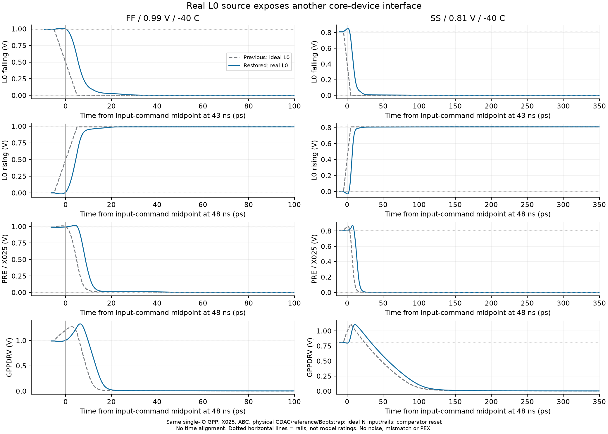
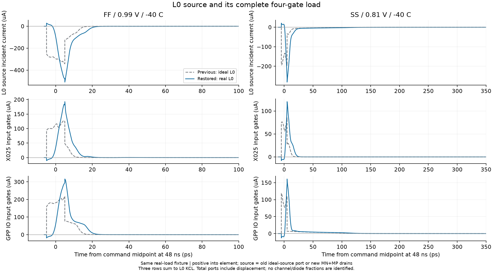

# 真实 L0 源级恢复：结果分析

状态：FF／SS 双角结果已回收。

从已完成单级 IO GPP 版本恢复原 BBM 最后一级反相器，两只核心管，L0 全部四个实际栅极负载保留。X025、GPP IO、ABC、Rgate 与物理负载不变。理想边界仅移至前级 NAND 输出 N，不补偿延迟；尚非完整 BBM。

测试：FF 0.99 V／SS 0.81 V，−40°C，52 ns；外部采样窗口／关闭沿不变，比较器保持复位；理想 N 与电源，无噪声、失配、PEX。

| 角落 | 新增 L0SRC 超限 | X025 超限记录：旧→新 | X025 最大端压 V：旧→新 | GPP 超限：旧→新 |
| --- | --- | --- | --- | --- |
| ffcold | 6/12 | 6/12 → 10/12 | 1.009120 → 1.016824 | 0/12 → 0/12 |
| sscold | 0/12 | 0/12 → 0/12 | 0.863140 → 0.872312 | 0/12 → 0/12 |

筛查采用原模型门限：核心 0.99 V，IO 暂用 1.98 V。新增源级实际端压不合格不能被 GPP 的 IO 余量掩盖；原生 CMI 与比较器负载的微伏级严格超限保留。

- ffcold：L0 -15.858 mV 至 1.007959 V；PRE -20.116 mV 至 1.016824 V。GPPDRV -0.240667/1.270576 → -0.247953/1.327264 V。
- sscold：L0 -30.099 mV 至 0.854366 V；PRE -39.184 mV 至 0.872312 V。GPPDRV -0.290528/1.115649 → -0.254910/1.105327 V。

SS 的 486 项均未超限，原生无 CMI，仅保留 SFE-1131／VACOMP-2435；这与 0.81 V 供电有较大核心端压余量有关，不能解释为动态扰动消失。FF 总计 28/486 项严格超限：新增源级 6、X025 10、比较器负载 12；其中超过 1 mV 的为 14 项。

FF 新增失效归属：L0SRC 的 ds／bd 因 L0 超出电源轨而超限，另有两条 gd 约 20.77 µV 的严格超限。原理想 L0 钳住了这些边界。L0 正向峰直接出现在 X025 NMOS 的 gs／gb，负向峰加重 PMOS 的 |gs|／|gb|；因此 X025 不再只是输出端超限。PRE 原有动态扰动也增大。这是恢复真实源级后暴露的接口问题，不是完整 BBM 修复通过。

- ffcold：L0 正向前沿 42.995000000–42.998614411 ns，源级 MN/P drain 积分 -0.013932/-0.030179 fC，X025／GPP 栅端 +0.014618/+0.029493 fC；最大 KCL 残差 5.79e-12 A。
- sscold：L0 正向前沿 42.995000000–43.001017558 ns，源级 MN/P drain 积分 -0.009286/-0.084795 fC，X025／GPP 栅端 +0.034146/+0.059936 fC；最大 KCL 残差 8.49e-13 A。

该正向前沿中，源级两条 D 端合计净输出电荷，X025／GPP 栅端净吸收；负载并非该区间的净注入者。电流符号均为流入各器件端口为正。前沿总端口流和电荷积分可区分交换方向；不能从总 D/G/S/B 电流推出内禀 Cgd 比例、沟道工作区或二极管电流比例。新 N 输入仍为理想源，未包含真实上游 NAND 的输出阻抗与反馈。

| 角落 | 新 N→L0 延迟 ps，关低／开低 | GNN 比 GPP 滞后 ps：旧→新 | 最晚低参考 ±1 mV 建立 ns：旧→新 |
| --- | --- | --- | --- |
| ffcold | 5.549/4.417 | 56.473/58.239 → 55.571/58.124 | 48.432439 → 48.435827 |
| sscold | 8.567/6.589 | 313.393/300.271 → 308.594/297.088 | 49.129284 → 49.133605 |

时序取实际半 VDD 交点，正控制间隔不证明无同时导通。建立误差逐侧比较当前选中参考，只在正确 ON 窗口判断；关断间隙另存 JSON。建立相近不能抵消端压失效。

| 角落 | 新 L0SRC 直接 VDD 能量 fJ | 理想边界源净功 fJ：旧 L0／新 N | 新内部 L0 输出→栅负载 fJ |
| --- | --- | --- | --- |
| ffcold | 4.639 | 0.980 / 0.251 | 0.950 |
| sscold | 2.501 | 0.534 / 0.175 | 0.519 |

以上为 0–52 ns 本台端口能量。旧 L0 与新 N 是不同外部边界，不能直接据净功减少宣称节能；新增反相器消耗 VDD 能量。新 L0／PRE 工作属于内部传递，不能再作为外部电源相加，也不是 ADC 功耗结论。

结论：双角仅完成这个源级切片的诊断；核心驱动失效、边沿扰动及理想上游接口仍未闭环。不采用新基线，也不生成新候选。

**一个优先建议：补齐 N 的真实驱动契约。** 下一项应验证原上游 `XBBM0.X004.X000` NAND 的实际边沿和回灌，而不先同时更换 L0SRC／X025 或调整内部时序。这样才能判断当前理想 10 ps N 边沿对尖峰的影响，再确定核心源级与接收级的修复方向。此处仅提出建议，未准备新候选或仿真。

## 证据

逐文件回执 SHA／大小、冻结输入 SHA、原生 PASS／PSF_END、完整单调时间与无损导出散列已核对。完整端压记录为同目录 `generated/real_l0_comparison/terminal_pairs.csv`，数值、源级新增端压、体端、告警及积分保存在 `comparison.json`。

- `sar8audit-gpp-singleio-ffcold`：8844 点，result SHA256 `7dc36e57f08e18f4e19f91bd3982a6c42c713f81449fda2bccbe6d28fff4d112`。
- `sar8audit-real-l0-ffcold`：8966 点，result SHA256 `99a17baaf89c48901d9d27edbfd3fbb94f4d2c0b2f2851d9306b845e897cc307`。
- `sar8audit-gpp-singleio-sscold`：8346 点，result SHA256 `0898c622137de9eadad347ecedc6de5fb665396c2bb0eae2f483f46cbc3f848e`。
- `sar8audit-real-l0-sscold`：8527 点，result SHA256 `ff04f0106789cb8671bbb245de9856ff627bcd50eb731b7718516021014814d9`。
