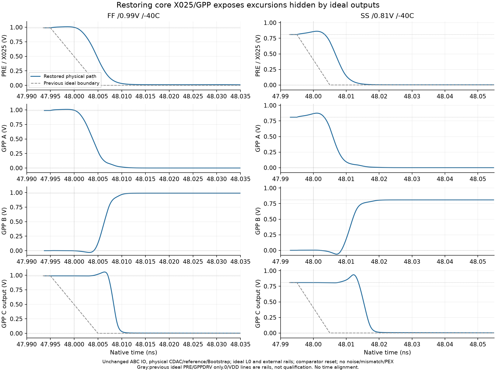

# 真实 PRE：被理想接口隐藏的两条核心支路

**当前优先级是 GPP 核心驱动，其次是 X025；ABC IO 链仍在所用端压门限内。**
本台恢复了此前不存在的核心 X025/GPP，并移除了理想输出钳制。
新发现属于原先理想接口没有覆盖的问题，不是 ABC 候选突然失效。
L0 仍理想，原 BBM 源未验收；没有新候选包或新仿真。

条件：FF /0.99 V、SS /0.81 V，均 −40°C；原物理负载、采样合同和命令不变，
比较器复位，无噪声/失配/PEX。两个已回收结果共 9237/8848 原生点，478 路电流完整。

| 分组 | FF 严格超限 / 端压记录 | FF 最坏端压 | SS 最坏端压 |
|---|---:|---:|---:|
| 原核心 GPP 三个级 | **24/36** | **1.056699 V** | 0.935251 V |
| 原核心 X025 | **6/12** | **1.009124 V** | 0.863144 V |
| GNN ABC IO | 0/36 | 1.199766 V | 0.960761 V |
| 其余物理负载 | 12/414 | 仅 XCOMP，超门限约 2.933 µV | 无超限 |

核心门限为 0.99 V，IO 为暂定 1.98 V。FF 共 42/498 项严格超限，SS 为零；CMI 原记录保留。
GPP 中最大为 GPPCN 的 ds/bd，超 **66.699 mV**；GPPCP 的 ds/bd 超 **56.194 mV**。
X025 的 PRE 最高/最低约 **1.009124/−0.018002 V**。端压记录数不是管子数。

## 两种动态：领先尖峰与边沿后的负载回灌

**领先正尖峰是输入翻转时的局部端流重分配。** FF PRE 峰值在 47.998554 ns，
领先波瓣中 X025 N/P drain 净流出约 0.01431/0.01722 fC，A 栅极净吸收 0.03153 fC。
GPP C 峰值在 48.006396 ns，其 P drain 净流出 0.002675 fC，N drain 吸收 0.001813 fC，
Rgate 吸收 0.000862 fC。下游在这两个领先波瓣中均不是净注入源。

GPP C 峰值时，P gate 电流约 **+222.37 µA**，P drain/source 为 **−70.78/−149.53 µA**。
符号为流入器件为正；这支持边沿触发的动态端荷传递，不能把 P drain 总电流当成来自 VDD 的恒定上拉电流。
也没有据此拆分 Cgd、沟道或结电流。

[领先波瓣及端流图](generated/real_pre_comparison/FF_real_PRE_GPP_current_cause.png)

**输入边沿结束后，确有持续几十到约 150 ps 的负载回灌尾巴。** L0 边沿在 48.005 ns 结束，
GPP B 在约 48.019 ns 前进入最终电平的 1% 内；随后 A 输出、GPP0 仍在变化。
在约 48.04 ns，FF 的 A 栅极向 PRE 回灌约 **9.70 µA**，X025 N drain 吸收约 **9.97 µA**，
PRE 维持约 **5.47 mV**；Rgate 向 GPP C 回灌约 **4.14 µA**，其 N drain 吸收约 **4.17 µA**，
输出尾电压约 **2.24 mV**。这与负载反馈同步，不应把全部恢复时间只叫“瞬时尖峰”。

| 输出持续进入最终轨 ±1 mV 的原生时刻 | FF | SS |
|---|---:|---:|
| X025 / PRE | 48.066391 ns | 48.153636 ns |
| GPP C | 48.100536 ns | 48.105387 ns |

到 49.5–50.5 ns，这些级的 N/P drain 总端流已降至 FF 约 1.8 nA 以下、SS 约 0.05 nA 以下，输出恢复到轨附近。
因此有短时尾恢复证据，没有本台中的持续失稳/无法复位证据。
**现有总端流和电压不足以判定三极区、饱和区或结导通，也不能直接确认示意图中的恒定 Iss＞Ip 机制。**
完整 KCL 接近零本身更不能证明没有动态充放电。

[边沿结束后的负载回灌与尾恢复](generated/real_pre_comparison/post_edge_load_feedback.png)

## 时序与真实负载

| 测量 | FF | SS |
|---|---:|---:|
| L0→GNN0，关闭/开启 | 122.68 /93.03 ps | 409.93 /386.75 ps |
| GNN0 落后 GPP0，关闭/开启 | 62.46 /60.71 ps | 353.56 /348.26 ps |
| 低参考 BN0 持续进入 ±1 mV | 48.296964 ns | 49.125324 ns |
| GNN0 最低电压 | −30.498 mV | −120.037 mV |

四项同侧控制间隔在本台均为正，最小约 FF **901 ps**、SS **612 ps**；它们使用 VDD/2 诊断门限，
不等于 MOS 导通判据。FF 中相反方向参考端流的重叠峰值约 3.3 µA，但含位移分量，不能直接叫直通。
正确 ON 窗口均能建立；关断后的底板浮置扰动仍约 FF +44.37/−35.37 mV、SS +33.78/−32.39 mV。

## 只建议一项候选：简化 bit0 的 GPP 驱动实现

优先验证 **将 GPP 的三个同尺寸核心反相级，整体改为一个已验证的普通 IO 反相驱动单元**，
仍由 L0 驱动，保留奇数次反相极性、原 Rgate/参考负载及输入时刻；X025 和 ABC 均不改。
可从已验证 W单元/L=320/150 nm、N/P multi=2/4 单元出发，当前只作建议。

依据是 GPP 占主要明确超限且三个核心级没有尺寸递增；这是一次驱动单元实现变化，
避免逐级换成三个慢 IO 后叠加延迟。目标是消除该核心支路的耐压短板，**不是宣称耦合消失**。
必须继续量化 L0 输入负担、实际相位间隔、下冲/体端流和 SS 建立；X025 的 FF 超限不会因此自动解决。
本数据尚未证明该候选最优，也不支持完整数字链验收。没有生成新包。

精确数据：`generated/real_pre_comparison/comparison.json`，双角 996 项端压记录在同目录 CSV。
新旧冻结输入/原始结果未修改；所有测量来自已有小波形。
