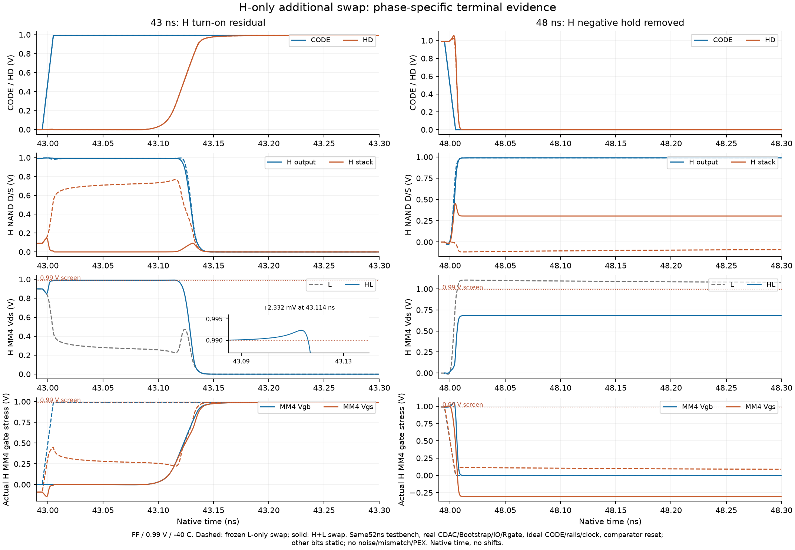
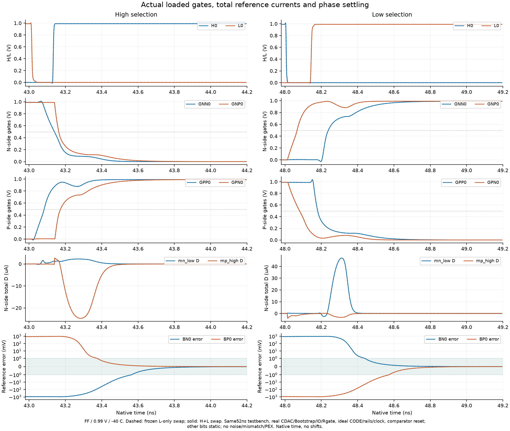

# H追加换序：与冻结L-swap配对

**48 ns的H内部负向浮置明显改善，但整台仍未通过端压检查。** H MM4在48 ns相位的最大Vds从1.105306降至0.684431 V；43 ns仍有0.992332 V，L侧仍有0.992307 V。严格超限由213变214，是新增6项、消失5项的净变化。

仅H NAND A1/A2由CODE/HD换为HD/CODE；L换序、其他190条叶记录、RC/clear、负载和52ns激励保持。FF0.99V/−40°C，CODE/电源/时钟理想，比较器复位、其他位静态；未含噪声、失配、PEX。

| H相位 | 内部栈节点最小/最大 V：L→HL | MM4最大Vds V：L→HL | 超0.99V累计ps：L→HL |
| --- | --- | --- | --- |
| CODE_rise | 0.000001/0.767608 → -0.000002/0.145472 | 0.899461 → 0.992332 | 0.000 → 46.407 |
| CODE_fall | -0.116073/0.000001 → -0.015037/0.453273 | 1.105306 → 0.684431 | 3993.475 → 0.000 |

两相位为[42.995,47.995)与[47.995,52]ns。表中旧版时长使用其完整原生诊断窗口，边界外未推断；新版全738项另有精确裁边的原生线性插值持续时间。时长仅用于比较，不作寿命签核。

## 同刻证据与原因

- CODE_rise：43.113586ns，D=0.993714V、S=0.001382V、G=0.202999V、B=0，Vds=0.992332V。
- CODE_fall：52.000000ns，D=0.990000V、S=0.305569V、G=0.000000V、B=0，Vds=0.684431V。

48ns双下降时，CODE控制靠地管先关、HD控制靠输出管后关，内部节点在短暂通路中先从输出充电，避免原长期负向浮置。43ns双上升时，内部节点先由靠地管放到地，输出仍接近VDD，后续开通扰动留下约2.332mV的Vds超限；这是另一阶段的残余。不能把输出/源节点在不同时刻的极值相减，也不能用大下冲的消失抵消小幅超限。

HD本身仍有RC/clear接口造成的过轨。换序把HD从原来的下管/另一PMOS输入接到上管MM4及MM1，端对的应力随真实端点重分配。新增6项中，MM1的gs/gb因源体同接VDD重复反映一个电压差；MM1/MM4的gd也共用门/输出节点。它们是6项实际筛查记录，不是6个独立故障。

## 新增与消失的严格超限

| 状态 | H NAND端对 | 峰值 V：L→HL | 峰值时间ns：L→HL | 峰值阶段：L→HL | 超0.99V累计ps：L→HL |
| --- | --- | --- | --- | --- | --- |
| 新增 | MM4:gs | 0.989999 → 1.005543 | 44.841864 → 47.998984 | high_select_and_LD_reset → CODE_fall | 0.000 → 5.433 |
| 新增 | MM4:gd | -0.990000 → 1.005034 | 41.001313 → 47.998214 | sample_close_edge → CODE_fall | 0.000 → 95.611 |
| 新增 | MM4:gb | 0.990000 → 1.055649 | 43.005000 → 48.003429 | high_select_and_LD_reset → CODE_fall | 0.000 → 6.029 |
| 消失 | MM9:gs | 1.025597 → 0.990000 | 48.003050 → 43.005000 | CODE_fall → high_select_and_LD_reset | 5.545 → 0.000 |
| 消失 | MM9:gb | 1.025597 → 0.990000 | 48.003050 → 43.005000 | CODE_fall → high_select_and_LD_reset | 5.545 → 0.000 |
| 新增 | MM1:gs | -0.990000 → -0.991678 | 0.000000 → 43.075129 | sample_track → high_select_and_LD_reset | 0.000 → 82.614 |
| 新增 | MM1:gd | -0.990000 → 1.005034 | 41.001313 → 47.998214 | sample_close_edge → CODE_fall | 0.000 → 95.611 |
| 新增 | MM1:gb | -0.990000 → -0.991678 | 0.000000 → 43.075129 | sample_track → high_select_and_LD_reset | 0.000 → 82.614 |
| 消失 | MM2:gs | -0.991661 → -0.990000 | 43.075169 → 0.000000 | high_select_and_LD_reset → sample_track | 68.853 → 0.000 |
| 消失 | MM2:gd | 1.020832 → -0.990000 | 47.998307 → 48.031418 | CODE_fall → low_select_and_HD_reset | 55.153 → 0.000 |
| 消失 | MM2:gb | -0.991661 → -0.990000 | 43.075169 → 0.000000 | high_select_and_LD_reset → sample_track | 68.853 → 0.000 |

0.99V严格门限未放宽；全738项按各自冻结模型门限核对（IO1.98V）。持续时间来自原生点间线性插值。CSV同时保留换序前后真实正负端点。表中“消失”仅指该实际MOS端对不再严格超限，并非对应波形或耦合不存在。MM4:ds也没有被计作新增：旧版48ns全窗已超限，换序后43ns仍有小超限，所以其状态仍是fail。

超过门限1mV的项数保持197，并不与严格净增1项矛盾：MM9:gd由1.028991 V降至0.990001954 V，仍严格超约1.954 µV，却退出“超1mV”集合。因此严格集合新增6/消失5，超1mV集合新增6/消失6。微伏级边界保留记录，不据此作可靠性或数值稳健性通过判断。

## 参考接口和残余

| 方向 | BBM间隔ps：L→HL | N实际栅间隔ps：L→HL | P实际栅间隔ps：L→HL |
| --- | --- | --- | --- |
| select_high | 118.036 → 117.653 | 23.890 → 23.524 | 90.356 → 89.978 |
| select_low | 138.150 → 137.447 | 172.175 → 171.487 | 99.637 → 98.949 |

| 方向 | L版BN0/BP0进入1mV ns | HL版BN0/BP0 ns |
| --- | --- | --- |
| high | 43.565679 / 43.376215 | 43.567572 / 43.376517 |
| low | 48.440912 / 48.574820 | 48.441501 / 48.576463 |

两方向参考均在各自相位内建立；两腿复位仍完成。半VDD交点仅是顺序诊断，参考总D电流含位移电流，不能称为纯沟道直通。

| 残余项 | L版 | HL版 |
| --- | --- | --- |
| HD X005最大绝对Vgd V | 1.059100 | 1.061623 |
| HD MP_CLEAR最大绝对Vds V | 1.009947 | 1.009953 |
| HD RC1 min/max V | -0.019947/1.061799 | -0.019953/1.061723 |
| LD X005最大绝对Vgd V | 1.052709 | 1.052709 |
| LD MP_CLEAR最大绝对Vds V | 1.010356 | 1.010355 |
| LD RC1 min/max V | -0.020356/1.052682 | -0.020355/1.052682 |
| L MM4全窗最大Vds V | 0.992307 | 0.992307 |
| H MM4全窗最大Vds V | 1.105306 | 0.992332 |

原生CMI告警仍在；严格端对213→214，超过模型门限1mV的项数197→197。RC/clear端压和L侧约2.307mV残余均未修复。

结论：两侧换序验证了内部浮置的连接机制，并未解决RC节点及其驱动信号的过轨和满供电端压余量。下一轮由主任务结合存储/驱动证据决定RC接口方案，本轮不追加候选或仿真。

## 证据

- sar8audit-ref-bbm-stdcell-lswap-ff-v1：11278点、21911695B；result SHA256 2219bef2be974df5833fd5d905f6cd1b213bb22776932f42f0ac612ee067405f；managed 2b62fa1e5f736c747ecc25f8573280df23276f5d6e69705b873865874b7bf99b。
- sar8audit-ref-bbm-stdcell-hlswap-ff-v1：11298点、26389195B；result SHA256 b1e3c3e50d73e6e2aebd478e3426fe1a8686131054527a645ee9d71eba365a5c；managed d0020c7f2887144d28c373ad052a6f24e81d0d4af120993e2c1066b7c8f186f7。

两个回执无跳过，逐文件SHA/大小、冻结输入、PASS/END、652路电流初始化及完整单调原生时间校验通过；求解设置相同。HL派生流441列、L372列，仅测量投影不同，仿真保存项和test.scs相同。terminal_pairs.csv为1476条全端压记录；status_changes.json列出6新增/5消失，comparison.json保存数值和原生phase-time证据。无时间平移，无电路采用或整机合格结论。

