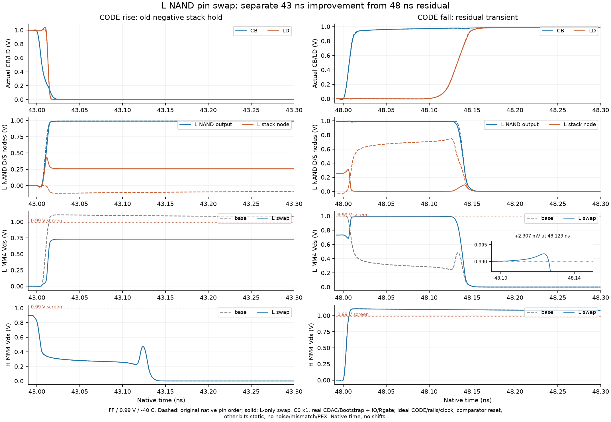
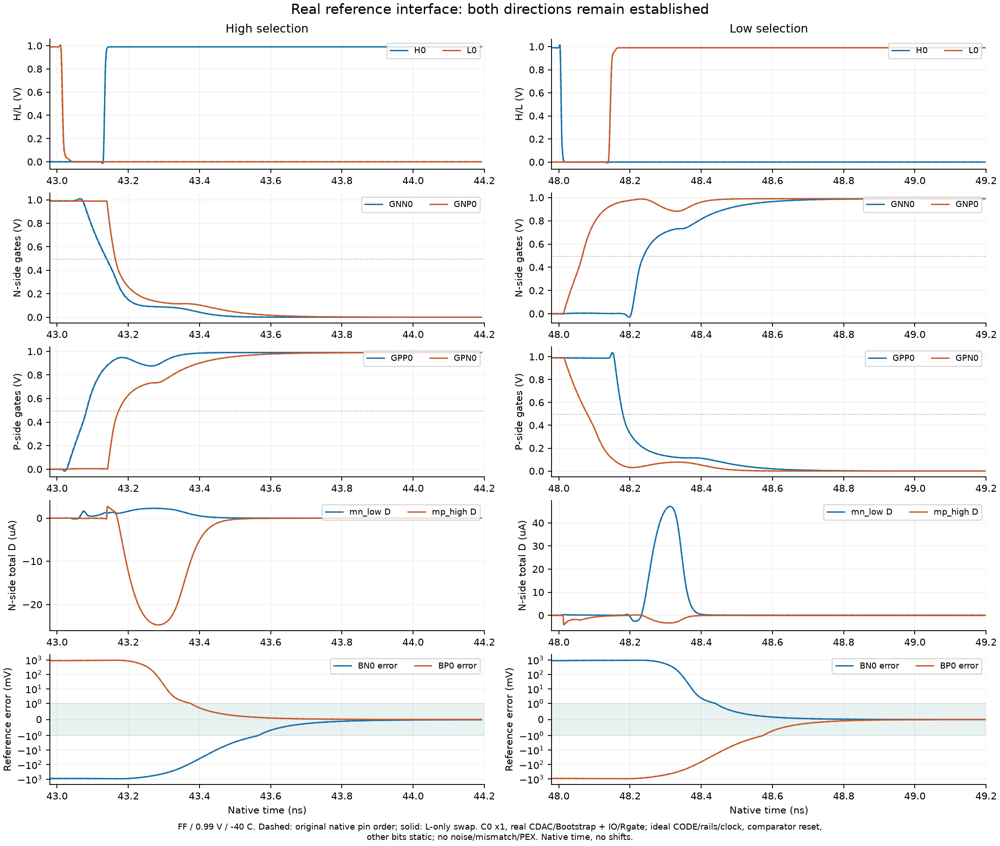

# L NAND 单只输入交换：FF 对照

**43 ns的负向浮置明显改善，但没有全部合格。** L MM4原最大Vds=1.108483 V；交换后全窗最大为0.992307 V，发生在另一相位48.123404 ns。必须分开评价旧43 ns机制与新48 ns残余。

只交换 L NAND A1/A2，H侧、其他190条叶记录、RC/clear、IO/Rgate及真实负载保持；52 ns测试台字节相同，FF 0.99 V/−40°C。CODE/电源/时钟理想，比较器复位、其他位静态；无噪声、失配、PEX。

| L侧相位 | 内部节点最小 V：原→交换 | 内部节点最大 V：原→交换 | MM4最大Vds V：原→交换 | 超0.99 V累计 ps：原→交换 |
| --- | --- | --- | --- | --- |
| CODE_rise | -0.118856 → -0.016002 | 0.001906 → 0.434874 | 1.108483 → 0.731909 | 4979.096 → 0.000 |
| CODE_fall | -0.026804 → 0.000001 | 0.749224 → 0.310948 | 1.016771 → 0.992307 | 8.819 → 34.328 |

相位分别为 [42.995,47.995) 与 [47.995,52] ns，使用原生同一时刻的D−S，不将不同时间的漏、源极值相减。持续时间为原生点间线性插值估计，不是寿命签核。

**残余发生于48 ns参考回切。** 在48.123404 ns，D=0.993660 V、S=0.001353 V、G=0.198965 V、B=0，Vds=0.992307 V，仍超0.99 V约2.307 mV；小幅超限持续时间由8.819增至34.328 ps。这不能被43 ns的改善抵消。

| 功能 | 全部检查项 | 原严格超限 | 交换后严格超限 |
| --- | --- | --- | --- |
| BBM_boolean | 84 | 54 | 54 |
| RC_clear | 24 | 15 | 15 |
| RC_input_reset_INV | 24 | 14 | 14 |
| RC_threshold_INV | 48 | 38 | 38 |
| analog_Bootstrap | 156 | 0 | 0 |
| analog_CDAC | 192 | 0 | 0 |
| analog_comparator_reset | 66 | 12 | 12 |
| reference_core_driver | 72 | 60 | 60 |
| reference_prebuffer | 24 | 20 | 20 |
| retained_GNN_IO | 36 | 0 | 0 |
| retained_GPP_IO | 12 | 0 | 0 |
| **总计** | **738** | **213** | **213** |

超出各自门限1 mV的项数：197 → 197。严格计数逐项使用冻结目录中该器件的screen_v（核心0.99 V/IO1.98 V）与完整正负极值；738对名称一一对应。原生CMI告警仍在。完整实际节点、极值时刻、阶段和逐项变化保存在CSV。

## 真实参考接口

| 方向 | BBM间隔 ps：原→交换 | N实际栅间隔 ps：原→交换 | P实际栅间隔 ps：原→交换 | N相反总D电流较小者峰值 µA：原→交换 |
| --- | --- | --- | --- | --- |
| select_high | 118.933 → 118.036 | 24.759 → 23.890 | 91.228 → 90.356 | 2.264 → 2.266 |
| select_low | 138.357 → 138.150 | 172.375 → 172.175 | 99.843 → 99.637 | 3.317 → 3.317 |

半VDD顺序只是控制诊断；总D电流包含位移，不能称为纯沟道直通。

| 方向 | 原BN0/BP0进入1mV ns | 交换后BN0/BP0 ns |
| --- | --- | --- |
| high | 43.566239 / 43.376392 | 43.565679 / 43.376215 |
| low | 48.441839 / 48.577040 | 48.440912 / 48.574820 |

两版高相位均在下个CODE边沿开始前建立，低相位均在52 ns前建立。旧半轨窗口跨入切换，false只作切换诊断；1 mV不是新规格。

## H与RC对照、原因及下一步

| 对照项 | 原 | 交换后 |
| --- | --- | --- |
| HD X005最大绝对Vgd V | 1.059100 | 1.059100 |
| HD MP_CLEAR最大绝对Vds V | 1.009947 | 1.009947 |
| HD RC1 min V | -0.019947 | -0.019947 |
| HD RC1 max V | 1.061799 | 1.061799 |
| LD X005最大绝对Vgd V | 1.052734 | 1.052709 |
| LD MP_CLEAR最大绝对Vds V | 1.010347 | 1.010356 |
| LD RC1 min V | -0.020347 | -0.020356 |
| LD RC1 max V | 1.053508 | 1.052682 |
| L NAND MM4 全窗最大Vds V | 1.108483 | 0.992307 |
| H NAND MM4 全窗最大Vds V | 1.105306 | 1.105306 |
| HD整腿复位1%延迟 ps | 11.506 | 11.506 |
| LD整腿复位1%延迟 ps | 19.055 | 19.012 |
| CODE源净供能 fJ | 7.919 | 7.919 |
| CB CODE_rise净负载绝对电荷 fC | 4.670 | 4.625 |
| CB CODE_fall净负载绝对电荷 fC | 11.402 | 11.361 |
| LD CODE_rise净负载绝对电荷 fC | 0.702 | 0.786 |
| LD CODE_fall净负载绝对电荷 fC | 0.788 | 0.785 |

电路参数不变不表示波形必须逐点不变：交换改变CB/LD的负载与输入耦合，可能经共享节点反馈；H侧仍作为未改拓扑对照。源电荷/分段电流/各源能量在JSON保留，内部端口功不重复计供电。

**机制判断：** 43 ns双下降时，交换让靠地CB先关、靠输出LD暂导通，内部节点可先从输出充电，避免原来长期负向浮置。这是输入串联位置影响端压的单变量证据。48 ns双上升则靠地CB先开、靠输出LD后开，内部节点已先放到地，因而接近VDD的漏端上冲/微小源端扰动仍可使Vds略超供电；实际同刻证据见上。H侧未交换，原48 ns内部负节点风险仍在，RC/clear过轨也不属于本次修复。

**下一最小实验建议：** 保持这版L交换和其余设置，只交换H NAND的A1/A2：CODE/HD→HD/CODE，在同一FF台验证H的48 ns负向浮置和全738项端压，同时保留L的2.307 mV残余为未解决项。先不叠加RC或驱动改动；该建议不是整机修复承诺，本轮未生成/提交新案例。

## 证据与限制

- sar8audit-ref-bbm-stdcell-ffcold-v1：11316点、21843637 B；result SHA256 24265b647dd9fae4105886acb45c6eb6e1b6b966bb75f943dc77a85f1edbb7d9；managed a7b09f5868cf81605a7ad3ff8b2fb7696b36dca88b19ec7cd20f13a61e3e1e8b。
- sar8audit-ref-bbm-stdcell-lswap-ff-v1：11278点、21911695 B；result SHA256 2219bef2be974df5833fd5d905f6cd1b213bb22776932f42f0ac612ee067405f；managed 2b62fa1e5f736c747ecc25f8573280df23276f5d6e69705b873865874b7bf99b。

原生PASS/PSF_END、652路电流初始化、11个回收文件大小/SHA和冻结输入逐项核验；两版实际求解设置相同。comparison.json保存完整量化，terminal_pairs.csv共1476条。只完成FF、单bit0理想边界对照，不能宣称SS/整机/功耗合格。

