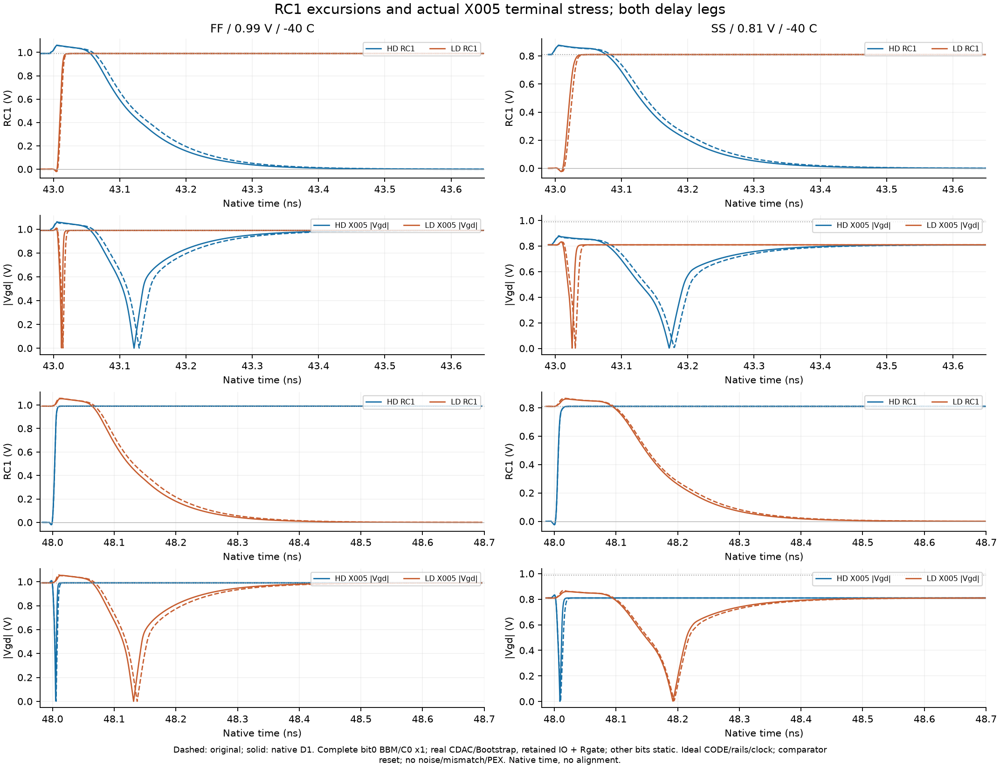
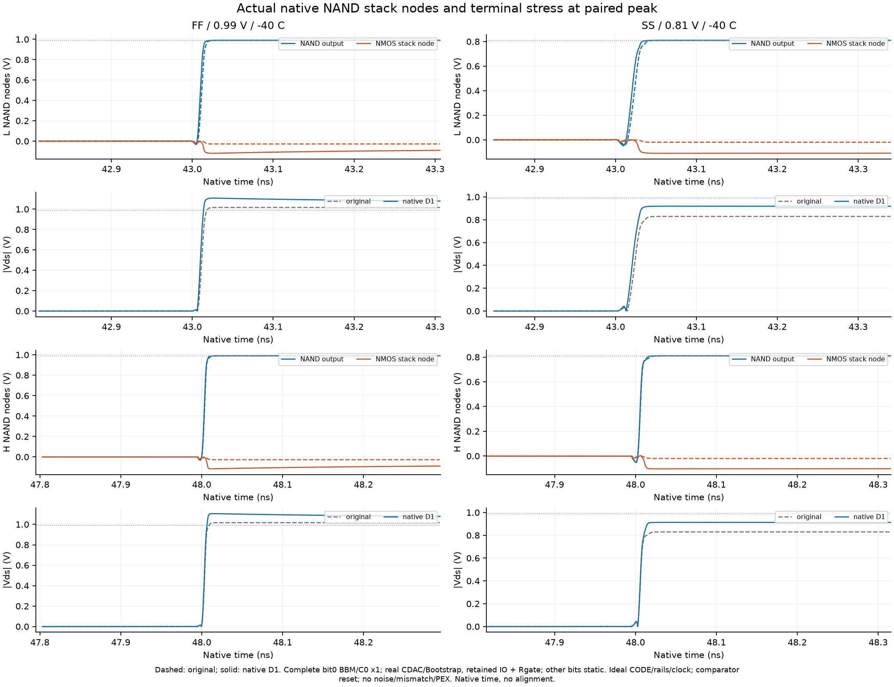
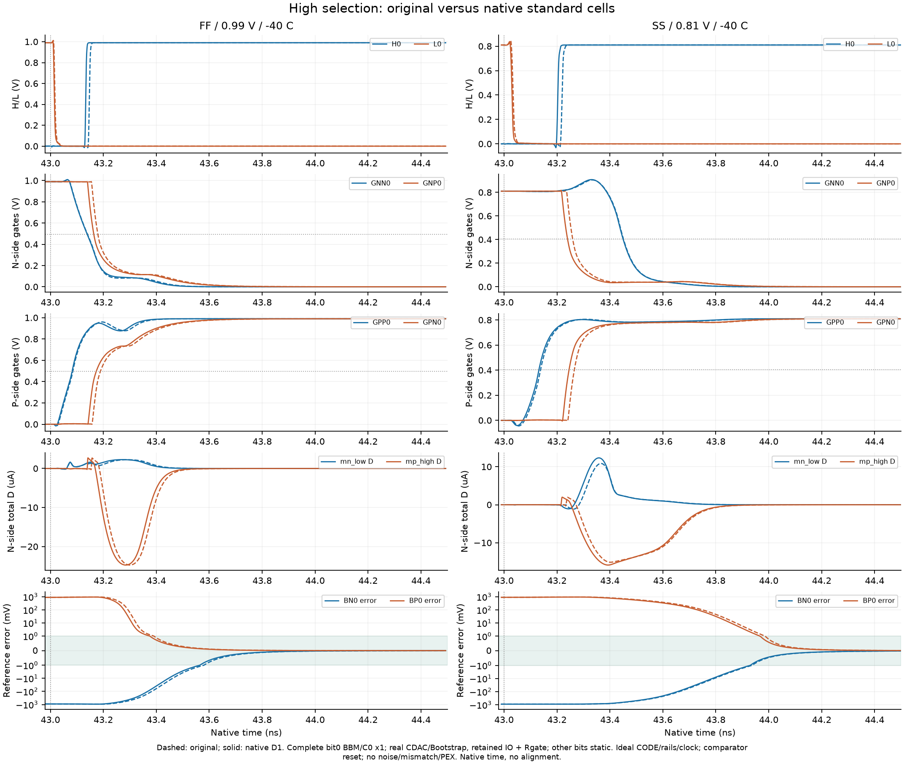
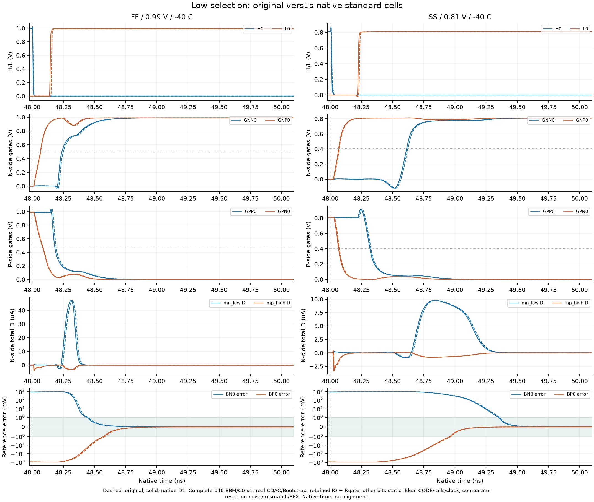

# 原 BBM 与原生标准单元对照

范围：原完整 bit0、C0 multi=1；普通核心门改用原生 D1，RC/clear、IO、Rgate、完整 CDAC/Bootstrap 负载保留。自建 NAND 两只 CMID 随原门移除。CODE/电源/时钟理想，其他位静态、比较器复位；无噪声、失配、PEX。FF 0.99 V、SS 0.81 V，−40°C，0–52 ns。

## 端压与来源

| 工况 | 严格超限：原→标准 | 超出门限1 mV：原→标准 | 原生告警：标准 |
| --- | --- | --- | --- |
| ffcold | 213/738 → 213/738 | 197 → 197 | CMI-2751, CMI-2752, CMI-2753, CMI-2754, CMI-2755, CMI-2756, SFE-1131, VACOMP-2435 |
| sscold | 0/738 → 0/738 | 0 → 0 | SFE-1131, VACOMP-2435 |

严格筛查沿用核心0.99 V、IO1.98 V；额外1 mV列仅帮助区分数值边界，不修改门限。告警与端压逐项同时保留，不因换成库门或进程正常退出宣称合格。

| 工况／功能 | 检查项 | 原严格超限 | 标准严格超限 | 标准最差实际器件／端对、峰值与时刻 |
| --- | --- | --- | --- | --- |
| ffcold/BBM_boolean | 84 | 54 | 54 | XDUT.XBBM0.X004.X000.XLIB.MM4:ds：1.108483 V @ 43.026695 ns，high_select_and_LD_reset |
| ffcold/RC_clear | 24 | 15 | 15 | XDUT.XBBM0.XD_LD.MP_CLEAR:ds：-1.010347 V @ 43.004303 ns，CODE_rise |
| ffcold/RC_input_reset_INV | 24 | 14 | 14 | XDUT.XBBM0.XD_LD.X006.XLIB.MM0:ds：-1.008113 V @ 43.004303 ns，CODE_rise |
| ffcold/RC_threshold_INV | 48 | 38 | 38 | XDUT.XBBM0.XD_HD.X005.XLIB.MM1:gs：1.061799 V @ 43.005000 ns，high_select_and_LD_reset |
| ffcold/analog_Bootstrap | 156 | 0 | 0 | XDUT.XBOOTP.MPCLK:ds：-1.026841 V @ 41.054807 ns，sample_close_edge |
| ffcold/analog_CDAC | 192 | 0 | 0 | XDUT.XCDAC.XSP0.MP_HIGH:gd：1.066800 V @ 48.150676 ns，low_select_and_HD_reset |
| ffcold/analog_comparator_reset | 66 | 12 | 12 | XDUT.XCOMP.MNLATP:bs：-0.990003 V @ 43.253883 ns，high_select_and_LD_reset |
| ffcold/reference_core_driver | 72 | 60 | 60 | XDUT.XSTD_GPNCN.MM1:ds：1.047727 V @ 48.013363 ns，low_select_and_HD_reset |
| ffcold/reference_prebuffer | 24 | 20 | 20 | XDUT.X008.XLIB.MM0:ds：-1.022966 V @ 48.005991 ns，low_select_and_HD_reset |
| ffcold/retained_GNN_IO | 36 | 0 | 0 | XDUT.GNNBN:gs：1.182963 V @ 43.021371 ns，high_select_and_LD_reset |
| ffcold/retained_GPP_IO | 12 | 0 | 0 | XDUT.GPPIN:ds：1.283667 V @ 48.147176 ns，low_select_and_HD_reset |
| sscold/BBM_boolean | 84 | 0 | 0 | XDUT.XBBM0.X004.X000.XLIB.MM4:ds：0.919203 V @ 43.060711 ns，high_select_and_LD_reset |
| sscold/RC_clear | 24 | 0 | 0 | XDUT.XBBM0.XD_HD.MN_CLEAR:gs：0.846105 V @ 43.000576 ns，CODE_rise |
| sscold/RC_input_reset_INV | 24 | 0 | 0 | XDUT.XBBM0.XD_HD.X006.XLIB.MM0:ds：-0.857944 V @ 48.000931 ns，CODE_fall |
| sscold/RC_threshold_INV | 48 | 0 | 0 | XDUT.XBBM0.XD_HD.X005.XLIB.MM1:ds：0.904689 V @ 48.006680 ns，low_select_and_HD_reset |
| sscold/analog_Bootstrap | 156 | 0 | 0 | XDUT.XBOOTN.MPCLK:ds：-0.935105 V @ 41.083952 ns，sample_close_edge |
| sscold/analog_CDAC | 192 | 0 | 0 | XDUT.XCDAC.XSN0.MN_LOW:gd：-1.050823 V @ 48.512353 ns，low_select_and_HD_reset |
| sscold/analog_comparator_reset | 66 | 0 | 0 | XDUT.XCOMP.MNINP:gb：0.842195 V @ 43.250101 ns，high_select_and_LD_reset |
| sscold/reference_core_driver | 72 | 0 | 0 | XDUT.XSTD_GPNCN.MM1:ds：0.920166 V @ 48.026947 ns，low_select_and_HD_reset |
| sscold/reference_prebuffer | 24 | 0 | 0 | XDUT.X008.XLIB.MM0:ds：-0.867072 V @ 48.012436 ns，low_select_and_HD_reset |
| sscold/retained_GNN_IO | 36 | 0 | 0 | XDUT.GNNCN:ds：0.962283 V @ 43.304822 ns，high_select_and_LD_reset |
| sscold/retained_GPP_IO | 12 | 0 | 0 | XDUT.GPPIN:ds：1.087374 V @ 48.231604 ns，low_select_and_HD_reset |

全部738项按原器件功能映射到标准单元的实际 MM 器件；NAND 串联位置对应不变。CSV保留实际端点、模型、正负极值时间与所属阶段，未将重命名当作新增/消失问题。RC/clear 与保留 IO/模拟负载单列。阶段标签来自外部采样/CODE 时间，不构成单凭相关波形即可认定的因果结论。

## 实际门次序与参考建立

| 工况／方向 | BBM间隔 ps：原→标准 | N栅极间隔 ps：原→标准 | P栅极间隔 ps：原→标准 |
| --- | --- | --- | --- |
| ffcold/select_high | 130.413 → 118.933 | 39.346 → 24.759 | 104.226 → 91.228 |
| ffcold/select_low | 148.175 → 138.357 | 181.126 → 172.375 | 107.617 → 99.843 |
| sscold/select_high | 185.134 → 172.997 | -191.747 → -209.799 | 127.748 → 113.737 |
| sscold/select_low | 221.390 → 213.809 | 551.002 → 545.475 | 254.018 → 251.601 |

半VDD交点只作顺序诊断；负间隔必须保留，正间隔也不能单独证明沟道无重叠。参考总 D 电流含位移电流，不称为纯直通电流。缺失或多次交点保持未知。

| 工况／方向 | 原 BN0／BP0 进入并保持1 mV的时间 ns | 标准 BN0／BP0 时间 ns |
| --- | --- | --- |
| ffcold/high | 43.583991 / 43.391137 | 43.566239 / 43.376392 |
| ffcold/low | 48.451880 / 48.585845 | 48.441839 / 48.577040 |
| sscold/high | 43.938057 / 43.990761 | 43.934221 / 43.969422 |
| sscold/low | 49.363714 / 48.973808 | 49.352182 / 48.962197 |

高相位只评价 [43.005,47.995) ns，低相位评价 [48.005,52] ns；误差基准是实际 VREFP/N。旧半轨终点跨入关断扰动，仅保留为切换诊断；1 mV不是新规格。

## 复位与源负担

| 工况 | HD整腿复位 ps：原→标准 | LD整腿复位 ps：原→标准 | BBM直接VDD能量 fJ：原→标准 | CODE源净供能 fJ：原→标准 |
| --- | --- | --- | --- | --- |
| ffcold | 12.737 → 11.506 | 21.444 → 19.055 | 76.976 → 51.625 | 8.796 → 7.919 |
| sscold | 21.970 → 19.635 | 42.338 → 37.802 | 41.478 → 28.505 | 5.922 → 5.355 |

复位要求 RC0→0、RC1→VDD、腿输出→0 都进入1%并保持到相位末，表中相对CODE中点；缺失/未复位不赋0。源能量积分覆盖0–52 ns，内部端口功另存，不重复计为外部供电；此台不能评价整机功耗。

## 原因与最小下一步

1. **SS的顺序问题仍在真实负载接口。** 标准门使H高方向更快，而保留的GNN IO链关断慢，N侧负间隔从−191.747变为−209.799 ps；相反方向总D电流较小者峰值从10.863增至12.333 µA。最终参考能建立，不代表切换期间已有正裕量。

2. **RC/clear的模拟电荷扰动没有被库门替换消除。** FF的HD RC1正峰1.061799 V；负峰−19.947 mV、LD负峰−20.347 mV，使保留MP_CLEAR的最大绝对Vds分别达到1.009947/1.010347 V。换接收反相器不等于消除其输入节点的过轨或clear管端压。

3. **标准NAND内部串联节点仍会被拉负。** FF在CODE上升后，CB、LD分别于43.006012/43.013271 ns落过半轨；L NAND输出升高后，源端相邻管的LD继续关断。内部net10在43.024816 ns到−118.856 mV。两只NMOS都关断后，内部节点没有强直流钳位，负电压会保持；输出仍被PMOS拉到VDD附近。

MM4的最差Vds发生在43.026695 ns，同一原生时刻：漏端输出=0.989731 V、源端内部节点=-0.118752 V，故Vds=1.108483 V。这是**高输出减去负源节点**的同时端压，不是输出本身冲到1.108 V。实际连接与先后边沿符合关断耦合/浮置机制；未把端流武断拆成某个本征电容电流。SS同类负移仍有−109.213 mV，只因0.81 V留下端压余量而未触及0.99 V门限。

| NAND／CODE方向 | 当前A1（靠输出）先动作 | 当前A2（靠地）后动作 | 内部串联节点的路径 |
| --- | --- | --- | --- |
| L／CODE上升 | CB下降43.006012 ns | LD下降43.013271 ns | 输出先升高；下管随后关断，双关断后内部节点浮置，可负向耦合并保持 |
| L／CODE下降 | CB上升48.006749 ns | LD上升48.132830 ns | 下管仍关断时，上管先接通，内部节点从高输出充电；下管后接通放电 |
| H／CODE上升 | CODE上升43.000000 ns | HD上升43.123030 ns | 同上：先由输出经上管充内部节点，后由下管放电 |
| H／CODE下降 | CODE下降48.000000 ns | HD下降48.006245 ns | 同L的双下降：上管先关、下管后关，内部net10负峰−116.073 mV |

以上是FF的实际半轨时间，表示先后关系而非MOS精确导通时刻。两NAND在对应双下降相位都有同类浮置风险；输入交换还会改变输入电容、延迟、耦合和下游顺序，不能只凭布尔对称认定电气等价。

**建议仅做一个接口实验：** 先只将L侧 `XBBM0.X004.X000.XLIB` 的A1/A2从CB/LD换成LD/CB，其余器件、RC、时钟和负载不动。双下降时，下管CB先关、上管LD暂保持导通，输出升高可先给内部节点充电，再由LD关断隔离；双上升时，下管CB先开并把内部节点钳到地，上管LD后开。这个因果预测能直接检验串联位置是否主导负向保持，但短暂导通时间不保证充分预充。先在同一FF台核对net10、MM4/MM9六对端压、输入电荷、两方向实际栅极次序和建立；H侧先保留作未改对照。它不是RC/clear或SS负间隔的完整修复，也不改库内部器件；本报告只建议该实验，未准备或提交。

## 结论与证据

本对照只验证标准门对真实参考接口的影响；结论必须同时依据端压、后级顺序、参考电流、建立、复位和源负担。没有完整异步转换、首帧启动及整机PVT结果，不能直接采用为合龙版本。

- sar8audit-real-bbm-ffcold：11326原生点，收集22435355 B；result SHA256 ab94a7db91c451995c4ed6d7e146900e961cf39fa4410f9907ac807480e36e67。
- sar8audit-ref-bbm-stdcell-ffcold-v1：11316原生点，收集21843637 B；result SHA256 24265b647dd9fae4105886acb45c6eb6e1b6b966bb75f943dc77a85f1edbb7d9。
- ffcold 实际solver设置是否完全相同：True。无等精度加速结论。
- sar8audit-real-bbm-sscold：10975原生点，收集22627864 B；result SHA256 390f02eafdff0654f827bda65c90b75cb28e7c9f4da2f7c604c6d1083f65372c。
- sar8audit-ref-bbm-stdcell-sscold-v1：10956原生点，收集22126021 B；result SHA256 c61c9a71f01e9485c455ec26e0424cfbd2847fae9e10d2d1618cdebb9be8615e。
- sscold 实际solver设置是否完全相同：True。无等精度加速结论。

comparison.json保留数值、原生告警/设置/体端与电荷；terminal_pairs.csv为2952条逐端压记录，device_mapping.json为123只MOS的真实对应。图使用原始时间，不平移、不归一化幅度。

