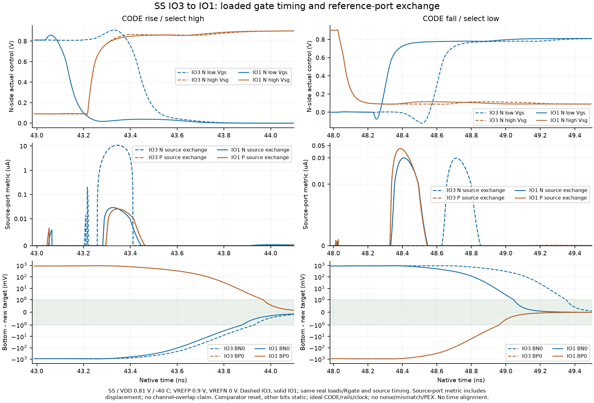
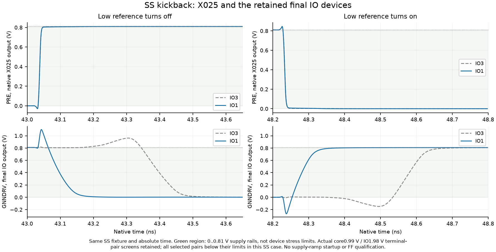

# GNN单级SS：同条件配对结果与FF冻结包

**这个级数对照在SS有明确收益，值得继续FF验证。** GNN关断路径419→114ps；N侧选高的参考源端交换峰值10.764µA→28.986nA，四项参考建立仍完成。代价是末级IO输出正负尖峰增大；上游PRE回踢变化约1mV，本点全部端压筛查通过，尚不能推断FF或整机合格。

两版均为SS／0.81V／−40°C，VREFP=0.9V、VREFN=0V，0–52ns；相同真实CDAC/Bootstrap负载、10段Rgate、原生逻辑、外部PWL/采样关闭沿及实际求解设置。唯一变化为删除GNN前两级，原末级改由真实PRE驱动。CODE/电源/时钟理想，比较器复位、其他位静态，无噪声/失配/PEX，没有完整ADC判决。

## 实际开关与参考建立

| 指标 | 原三级IO | 保留末级的单级IO |
| --- | ---: | ---: |
| L0→GNN0，关低参考 | 419.367ps | **113.643ps** |
| L0→GNN0，开低参考 | 387.354ps | **87.626ps** |
| 选高N侧栅半轨次序 | −209.799ps | +95.759ps |
| 选低N侧栅半轨次序 | +545.475ps | +245.746ps |
| 选高N侧声明源端交换峰值 | 10.763921µA | **0.028986µA** |
| 同指标选高窗积分 | 0.998385fC | **0.002820fC** |

关断方向，新末级PRE→GNNDRV仅59.226ps，原三级合计359.883ps；Rgate段51.646→46.773ps，X025段7.837→7.645ps。总改善不只是减掉两级旧延迟：最后一级的实际输入边沿也改变，其自身传播明显加快。

第一行画改动N侧的实际Vgs/Vsg，原慢GNN关断明显前移；第二行比较N/P两侧的声明参考源端交换；第三行是各底板相对本轮实际参考的残差。虚线三级、实线单级，保持原绝对时间。第二行采用对称对数显示小电流，绘图线性区不是导通门限。

源端指标仍为 `min(max(I_SP,0),max(−I_SN,0))`，包含位移分量，**不等于纯沟道直通电流**；半VDD间隔同样不是MOS精确导通/关断时刻。新选高N峰值虽约为原来的1/371，仍不写成零重叠或完成死区签核。

其他三个方向的源端峰值基本不变：P选高25.365→25.506nA，N选低29.681→29.918nA，P选低44.155→44.023nA。完整四开关的实际源极参考控制电压范围、峰值同刻D/G/S/B均保留在[comparison.json](comparison.json)，不只检查理想H/L命令。

| 持续进入±1mV的首个原生时刻 | 原三级 | 单级 |
| --- | ---: | ---: |
| 选高 BN0 | 43.934221ns | 43.879457ns |
| 选高 BP0 | 43.969422ns | 43.967991ns |
| 选低 BN0 | 49.352182ns | 49.047919ns |
| 选低 BP0 | 48.962197ns | 48.963884ns |

N侧底板选高早约55ps、选低早约304ps；不能把逻辑传播改善直接等同参考早建立同样时间。P侧数ps变化不作显著收益结论。判据沿用独立命令窗 `[43.005,47.995)ns` 和 `[48.005,52]ns`，未混入下一动作。

## 回踢、同一器件和能量

| 观察量 | 原三级 | 单级 |
| --- | ---: | ---: |
| PRE最小／最大 | −28.434／844.183mV | **−29.492／845.061mV** |
| GNNDRV最小／最大 | −0.149007／0.962283V | **−0.268270／1.100865V** |
| 原生X025两管最坏绝对端压 | 0.844183V | 0.845061V |
| 保留末级两只IO最坏绝对端压 | 0.962283V | 1.100865V |
| 全台严格超限项 | 0/738 | 0/714 |

绿色仅表示0…0.81V供电轨，不是器件端压门限。**末级输出过轨反而增大**，说明加快路径没有自动消除电荷耦合。实际IO按1.98V、核心X025按0.99V检查，本SS点均未超；仍保留体端电流/结极性，不能仅凭IO耐压门限宣布寿命或后级可靠性合格。

708项具有完全相同的实际模型、节点和门限，逐项结果见[同端对CSV](same_actual_terminal_pairs.csv)。原末级仍是相同器件/尺寸，其12端对中6项端点不变、6项因G改接PRE而改变；另24项随前两级删除。两版均零超限，不能把检查数量减少当成端压改善。原版动态导出只有47路诊断电压，其余端对比较直接使用完整原始测量极值，未补造波形；新台114路电压覆盖714端对。

| 同一0–52ns区间能量 | 原三级 | 单级 |
| --- | ---: | ---: |
| 理想VDD外部供能 | 303.972fJ | 299.740fJ |
| GNN全部IO级直接VDD端口能量 | 5.691fJ（A+B+C） | 1.464fJ（仅C） |
| X025直接VDD端口能量 | 1.537fJ | 1.534fJ |
| PRE门端内部传递功 | 0.298fJ | 0.359fJ |
| 理想CODE源净供能 | 5.355fJ | 5.355fJ |

删除两级降低了该链的供能，X025直接供能基本不变；相同栅面积仍不代表相同PRE交换功。PRE内部功和各级供能是内部归属，不能再与全台VDD重复相加。这是复位比较器的局部52ns切片，不能用于整机1mW验收。

HD/LD原1%复位仍完成，约20/38ps，未发现因此新增的复位失败。首次CODE前没有额外H/L半轨翻转；保留原DC初始化、采样关闭及完整启动历史。**未验证真实电源斜坡启动、连续转换或全部PVT。** 两版原生SFE-1131/VACOMP-2435告警保留，不将无CMI替代逐端压检查。

## 同一冻结电路的FF包

SS改善已足够支持继续检查FF回踢，不等纯沟道重叠时长提取。FF包已经完成一次条件一致性检查并冻结，由主聊天managed执行，本session未运行服务器。

主聊天已确认注册并提交，managed身份为 `e32ae97bcfe3022f58de068333ddeae1886752ba043e9f6df14cab3533f03e78`；本报告尚无FF结果，不重复查询或启动。

- ID：`sar8audit-ref-gnn-io1-ffcold-v1`。
- [FF recipe](../candidate/ffcold/recipe_proposal.json) SHA256：`f67e60b0ceab7a9205249aa46820d4abde98beba7bf6bebb95711886b2ba0bd7`；[FF包清单](../candidate/ffcold/package_review.json)，13输入483925B。
- DUT沿用SS原文件，SHA256 `a0f3665f1d43cba886bff9dfa8098dd1948bea998c920c06f30a8e12c809dcf0`；所有分析脚本、实际端点/电流/KCL/714端对/测量算法相同。
- [PVT_delta.json](../candidate/ffcold/PVT_delta.json)核对：仅原FF条件带来的4行变化——SUP、MOS模型section、VVDD及CODE高幅度。温度仍−40°C；参考0.9/0V、输入、边沿时刻、Rgate、物理负载、采样窗口/关闭沿和求解设置保持。
- 未修改任何SS输入，未另造拓扑/尺寸候选。沿用已通过的运行时契约检查，不重复测试或新增矩阵。FF仍需如实报告端压、回踢、源端交换、建立和原生告警，不能由本SS结果提前判通过。

证据来源：原SS10956点／11文件22126021B；单级SS10464点／11文件24264511B，managed `e42eefcc60054ad08228cd02fc809d40fff746d2e2f52fc22540c74a5e4d4b0c`。两源输入/回收文件/原生流SHA、PASS/END、652/636路电流初始化及实际求解设置一致性已核对；源端指标、传播和PRE功独立重算。当前未采用新整机/OA基线，未提交或push。
