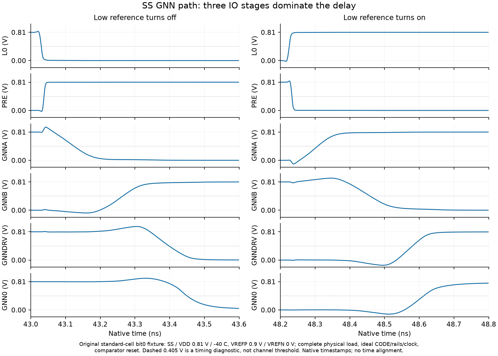

# GNN路径：三级IO改为保留末级的单级对照

**现有SS数据支持做这个对照：主要延迟在三级IO链，Rgate不是第一大项。** 已准备唯一单级候选和同条件SS测试台，尚未注册或仿真。

## 419ps主要花在哪里

版本为已完成的 `sar8audit-ref-bbm-stdcell-sscold-v1`：SS／0.81V／−40°C，VREFP=0.9V、VREFN=0V，10956原生点。PRE、GNNA、GNNB、GNNDRV、GNN0均有原生波形；没有缺节点或用理想波形代填。

| 原生半VDD传播段 | 选高：关低参考 | 选低：开低参考 |
| --- | ---: | ---: |
| L0→PRE，真实X025 | 7.837ps | 7.773ps |
| PRE→GNNA，IO A | 86.010ps | 73.888ps |
| GNNA→GNNB，IO B | 140.595ps | 150.904ps |
| GNNB→GNNDRV，IO C | 133.279ps | 122.459ps |
| GNNDRV→实际GNN0，Rgate及负载 | 51.646ps | 32.331ps |
| **合计** | **419.367ps** | **387.354ps** |

三级IO分别占总延迟 **85.8%／89.6%**；前两级分别贡献226.605／224.791ps。原生交点括点宽度约0.05–1.42ps，远小于这些段延迟。



这些是实际负载下的传播诊断，不是各管子的导通阈值。负尖峰也保留在图中。仅把旧A/B延迟从选高N侧−209.799ps半轨次序中扣除，得到约 **+16.806ps**；这只是量级估算，不能预测沟道非交叠通过。单级后最后IO的输入slew、输出轨迹与上游回踢都会改变。

## 只改这一个因素

```text
原：L0 → 原生X025 → PRE → IO A → GNNA → IO B → GNNB → IO C → GNNDRV → 原Rgate → GNN0
新：L0 → 原生X025 → PRE ─────────────────────────────→ IO C → GNNDRV → 原Rgate → GNN0
```

删除 `GNNAN/GNNAP/GNNBN/GNNBP` 四只IO管；原 `GNNCN/GNNCP` 的G从GNNB改接PRE，其D/S/B、模型、完整尺寸/寄生参数和并联数保持。A/B/C本来就是三组相同的IO N/P参数，因此新输入仍是一组同面积的栅负载，输出仍是原末级驱动原负载，未发现明显不可行的负载扩大。

**相同栅面积不代表相同输入电荷。** C的漏端接真实Rgate/开关负载，新PRE将直接承受这一末级的Miller回踢；保留的原生核心X025必须实测，不能因为末级是IO就认为前级安全。

反相级数3→1、奇偶不变；其他188条叶记录逐项相同，10段GNN Rgate全部相同，原生库单元及其内部不改。其他参考路径、CDAC、Bootstrap、比较器、外部PWL、采样窗口/关闭沿、参考网络和求解设置均保持。

## SS台具体测什么

- **原瓶颈是否减小：** PRE→GNNDRV→GNN0的实际传播、选高N侧双参考声明源端交换峰值/积分，以及四只真实开关的Vgs/Vsg和D/G/S/B端流。延续[已有四端证据](../standard_cell_ss_nonoverlap_v1/report.md)的方法，不把半轨或反向D电流当作沟道导通。
- **是否把问题推给上游：** 末级两只IO与原生X025两只MOS的全部端对、最坏端压同刻四端电压/电流；PRE正负尖峰、实际两门负载电流/电荷和X025内部传递功，保留功的KCL核对。
- **是否产生新失效：** 两个交接方向的H/L及实际参考栅次序、四项独立命令窗参考建立、HD/LD复位、全部119只实际MOS／714端对及超限持续时间。核心0.99V、IO1.98V门限保持。
- **启动边界：** 保留0–52ns完整历史，记录首次CODE前H/L额外半轨事件和PRE/GNNDRV/GNN0/底板范围；原初值见证和三个静态逻辑窗口保留。本台是原有DC初始化及采样关闭历史，不冒称已验证真实电源斜坡启动。

删除的GNNA/GNNB不再生成波形、延迟别名或零值能量。测量脚本已移除对旧A/B的依赖，实际当前节点和源端均有独立字段。新台仍为理想CODE/电源/时钟、复位比较器、其他位静态，无噪声/失配/PEX，没有完整ADC判决或PVT通过结论。

先由主聊天排队跑这一个SS案例；若源端回流和建立改善，再用同一冻结电路检查FF回踢。当前未准备第二个工况或其他尺寸/级数候选。

## 可执行包

- 唯一ID：`sar8audit-ref-gnn-io1-sscold-v1`。
- [recipe_proposal.json](candidate/sscold/recipe_proposal.json) SHA256：`7f75ed0953931628d7fdb2c0d72d34c5f510c8c551114e8abae0c583eef4fa88`。
- [package_review.json](candidate/package_review.json)：13个输入，共482073B；114路电压、636路实际电流、34个KCL节点、714项端压、421列原生导出。
- 一次局部检查通过（0.802s）：精确拓扑/188条保留记录/末级参数/Rgate/PWL/输入哈希核对，并用合成原生数据贯穿解析器，核实实际PRE负载、四端/源交换、最坏端压同刻采样、714项筛查及删除节点无别名。**这不是Spectre物理仿真或电气通过。**
- 预算沿用：串行managed、4线程、仿真RSS≤1GiB、分析≤256MiB、derived≤30MiB、回收≤32MiB。未注册、未远端执行、未采用新基线，未提交/push。

基线身份及分段见[baseline_attribution.json](baseline_attribution.json)，单变量变化见[delta.json](candidate/delta.json)。原结果、模型、标准库、OA和其他模块未修改。
