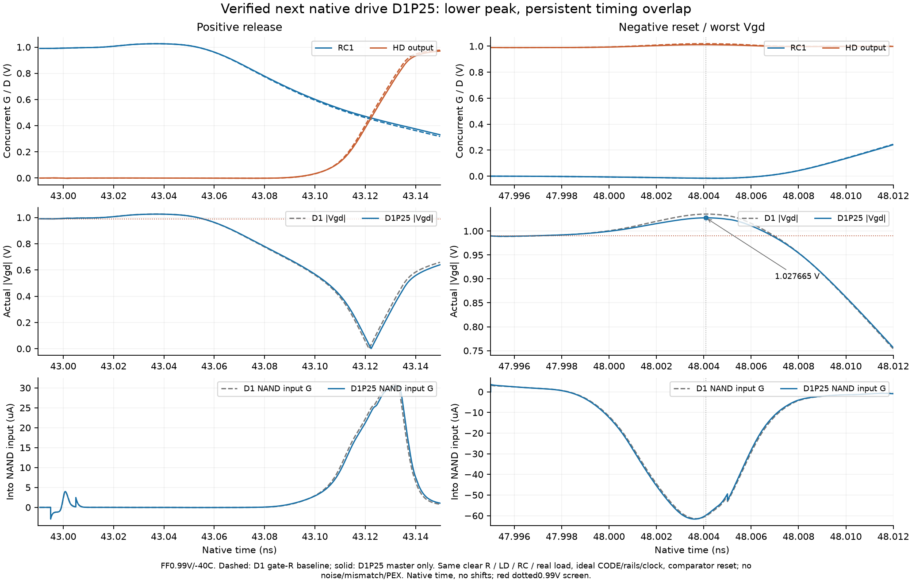

# HD X005：D1与D1P25配对

**更强原生档位降低峰值，但没有解除端压超限。** 最坏绝对Vgd从1.035538降至1.027665V；RC1正峰1.026241→1.025818V、负峰−16.508→−16.237mV。超限持续时间未改善，复位略慢，因此该版本不判通过。

仅HD.X005原生master改为已核验的INVD1P25；HD clear串阻、LD、其他193条叶记录和外部源/时序/采样窗口/关闭沿/负载不变。FF0.99V/−40°C，CODE/电源/时钟理想、比较器复位、其他位静态；无噪声、失配、PEX。

| 指标 | D1 | D1P25 |
| --- | --- | --- |
| RC1正峰 V | 1.026241 | 1.025818 |
| RC1负峰 mV | -16.508 | -16.237 |
| HD输出正峰 V | 1.019237 | 1.011691 |
| X005正向Vgd V | 1.026231 | 1.025809 |
| X005负向Vgd V | -1.035538 | -1.027665 |
| X005绝对Vgd超0.99V累计 ps | 68.257 | 68.752 |
| clear最大绝对Vds V | 1.006508 | 1.006237 |
| clear绝对Vds超0.99V累计 ps | 11.274 | 11.282 |

## 最坏时刻仍是负RC1与正HD重合

- D1：48.004116ns，RC1=-0.016367V、HD=1.019171V，Vgd=-1.035538V；NAND输入G总电流=-59.977µA，X005输出D总电流=59.977µA。
- D1P25：48.004088ns，RC1=-0.016062V、HD=1.011603V，Vgd=-1.027665V；NAND输入G总电流=-59.830µA，X005输出D总电流=59.830µA。

电流正方向为流入器件。负NAND门端电流仍在向HD回送电荷，较强反相器吸收回流，使HD正峰下降；但RC1负窗和HD反冲依然重合，不能把更小的单节点峰值理解为安全端压。这里只比较实际总端口流向，不分解成纯沟道或本征Cgd电流。

## 实际器件数与公平计数

| 检查口径 | D1 | D1P25 |
| --- | --- | --- |
| 实际端对／严格超限 | 738 / 215 | 750 / 225 |
| 738等价组／严格超限 | 738 / 215 | 738 / 215 |
| 实际端对超门限1mV项数 | 197 | 207 |
| 等价组超门限1mV项数 | 197 | 197 |

D1P25实际使用两N两P共四只MOS；并联成员共享经过核验的D/G/S/B节点、模型和门限，所以新增的并联筛查不是新增独立电压故障。750项物理端压/持续时间全部保留，738组只用于与基线对应比较。核心0.99V、IO1.98V门限未改。

等价组严格状态变化：新增0项、消失0项；详见status_changes.json。

## 时序、建立及方向判断

| 指标 | D1 | D1P25 |
| --- | --- | --- |
| HD整腿1%复位 ps | 31.734 | 31.879 |
| LD整腿1%复位 ps | 19.022 | 19.018 |
| select_high N实际栅间隔 ps | 23.498 | 24.168 |
| select_high P实际栅间隔 ps | 89.951 | 90.643 |
| select_low N实际栅间隔 ps | 171.555 | 171.556 |
| select_low P实际栅间隔 ps | 99.017 | 99.017 |
| select_high BN0/BP0进入1mV ns | 43.565824 / 43.375974 | 43.567808 / 43.377057 |
| select_low BN0/BP0进入1mV ns | 48.441042 / 48.575181 | 48.440429 / 48.573476 |

两腿复位和四个物理参考建立窗口均完成；半VDD间隔只是控制顺序诊断。完成建立不代表切换期间无过压。原生CMI及其他RC/clear/逻辑残余保留，不推断SS/整机合格。

**方向判断：不继续把“提高驱动档位”当作完整修复主线。** 1.25倍档已显示HD峰值略降，但RC1输入负窗与回流仍重合，输入负担和复位代价也增加。下一方向应回到RC1复位路径与下游回流的接口边界，寻找能同时处理正向注入、负向恢复和输出端轨外电压的结构；先做边界分析再选一个变量，不继续自动扫驱动强度。本轮不新增候选或远端任务。

## 证据

- sar8audit-ref-rc1-hd-cleargater-ff-v1：11420点、27685183B；result SHA256 16e73f42c5d1651712690981021288dc10e97a10e4c4d9e5c07bbd7c76479d9e；managed f99c95e1c92a40c8abbe26f5456f77c03793e496538994c5ef75a17660a21e2b。
- sar8audit-ref-rc1-hd-x005-d1p25-ff-v1：11422点、27718889B；result SHA256 a273e6730a84cd84aebe79a099b99605bdd8549c154d497bce0e44fa2faa1dbd；managed 24306072b56f9a60a0d2e73fa0619d797094ce81a7829cbb6c61b3d4c0e1a81d。

逐文件/输入/native流大小与SHA、PASS/END、654/662路电流初始化、全窗单调原生时间验证；solver和非save测试台一致。physical_terminal_pairs.csv保留1488条实际检查，comparison.json保留全部738组对应、四事件电荷/复位和同刻流向；状态变化不以缺失字段计零。输入和analyzer未修改。

