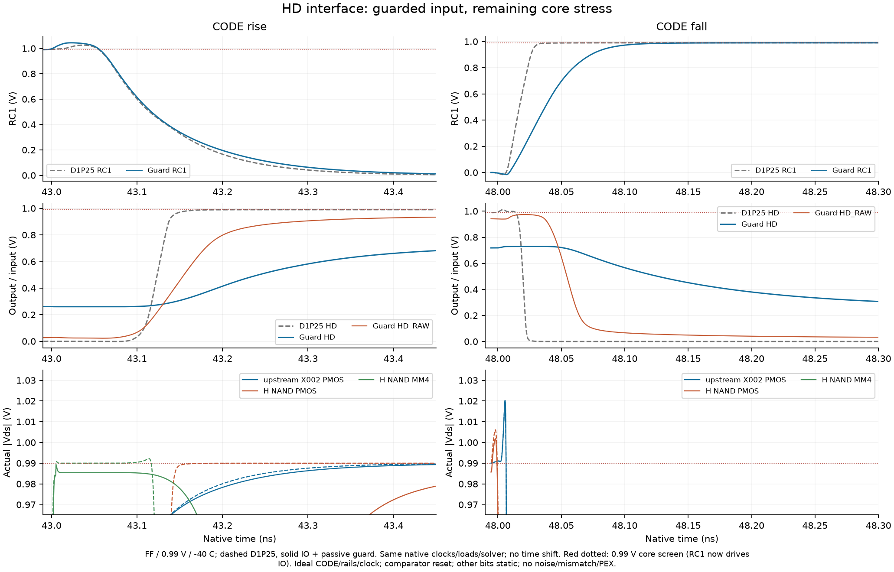
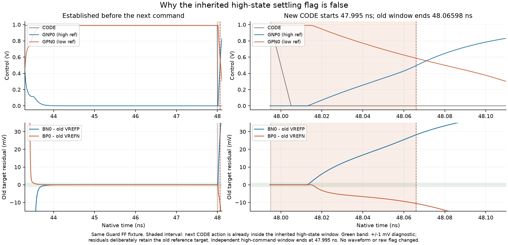

# HD IO＋guard：FF 实测对照

**接口保护有效，但整条链尚未修好，当前分压方案也不适合直接复制到整机。** IO 接收器和 clear 的全部端对低于 1.98V；HD 输入压缩到 0.260–0.731V，下游 H NAND 的部分应力消除。上游核心反相器和 NAND 输出端仍超 0.99V，同时付出了约36–37µW/腿的持续耗电。

条件：T28 FF、0.99V、−40°C、0–52ns；原 D1P25 对照与候选使用相同外部源、采样窗口/关闭沿、真实 CDAC/Bootstrap 负载和实际求解设置。CODE/电源/时钟理想，比较器复位、其他位静态，无噪声/失配/PEX；这是局部两次命令测试，不是 ADC 码字或整机 PVT 验收。

## 哪部分改善，哪部分仍失败

| 实际检查量 | D1P25 | IO＋guard | 本次判断 |
| --- | ---: | ---: | --- |
| RC1 正峰 / 负峰 | 1.025818V / −16.237mV | 1.044212V / −15.548mV | 正过冲增大；没有消除越轨 |
| X005 接收器最坏端压 | 1.027665V，20/24端对超0.99V | 1.044212V，0/12端对超1.98V | 实际换成 IO 后获得承受余量 |
| clear 最坏端压 | 1.006237V，3/6端对超0.99V | 1.005548V，0/6端对超1.98V | 本次 IO 筛查通过 |
| H NAND MM4 最大 Vds | 0.992231V | 0.988770V | 本项超限时长57.473→0ps；仅余1.23mV裕量 |
| 上游 HD.X002 PMOS 最大绝对 Vds | 1.020256V | 1.020313V | 仍超限30.31mV，约11.48ps |
| H NAND MM1/MM2 最大绝对 Vds | 1.006093V | 1.001841V | 仍超限11.84mV，约3.78ps |
| 未改 L NAND MM4 最大 Vgb | 1.039624V | 1.039621V | 原有另一腿故障基本保留 |

IO 的判定依据是**器件模型真实改变**，没有放宽任何核心管门限。全台实际计数为225/750→194/738；移除的并联 MOS 和模型改变使口径不同，不能把差值直接称为修复数量。严格匹配模型、节点和门限的720项中，202→194，8项消失、0项新增，均位于 H NAND；这些相关端对不代表8种独立机理。原来的“738等价组”也不是本候选的“738实际端对”。

图中虚线为 D1P25、实线为候选：第一行说明 RC1 仍越轨；第二行区分 IO 输出 HD_RAW 与被动网络后的核心输入 HD；第三行放大仍有问题的核心端压。红线是0.99V参考，RC1现在连接的接收器按实际 IO 门限检查。

**两处残余的位置和相位已明确：**

- **上游 B 节点：48.005686ns。** HD.X002 的输出 B 下冲到−30.313mV，源极仍为0.99V，PMOS 绝对 Vds 因而达到1.020313V；当时 RC0 正在下降、约0.643V，RC1约−14.572mV。由最后非负点到该峰，PMOS漏端总电荷约+0.02021fC、NMOS漏端−0.02128fC，R1仅+0.001075fC；峰值时 R1反而向B返回约1.608µA。这将定位指向 **RC0驱动的核心反相器换向**，不支持只把 B 下冲归因于 RC1 经 R1 拉低。该故障在原版已存在，本候选没有解除。
- **下游 NAND_N：47.998033ns。** CODE下降沿中，NAND输出下冲至−11.841mV；PMOS源极0.99V，因此 MM1/MM2 的绝对 Vds 达1.001841V。HD此时仍为0.718V，已经不再越轨。领先区 CODE侧 MM2 漏端总电荷约+0.01731fC，是该区间主要正向端口项；其余 NAND 漏端和后级输入门端共同平衡。这是 **CODE换向时 NAND输出/后级的动态电荷交换**，不是原 HD 高峰还未被隔离。

两处领先区的电荷 KCL 残差均约1.7e−24C。这里定位的是实际端口交换与时序；没有把总电流分解成未经测量的沟道、二极管或本征 Cgd 比例。

## 逻辑、建立和测量边界

加载后的 HD 静态低/高电平是 **0.261235/0.718386V**，不是理想分压的0.2475/0.7425V。高态 NAND_N 约4.260mV，后级 H0约0.989999V；低态 NAND_N约0.99V，H0约0.46µV，L0状态相反。本台 H0/L0各观察到一次上升和一次下降，没有额外半VDD翻转；原生采样中同时高于半VDD的时长为0。半VDD只作时序诊断，不能作为无瞬态直通或 VIH/VIL 已合格的证明；库输入条件仍为 unknown。

**原 HD满摆幅契约没有通过。** 三个静态窗口的原0/VDD目标均不满足；原HD→0V复位仍为false，终点约0.261235V。没有把目标改成偏置电平后宣布通过。独立 RC0/RC1复位仍完成，但RC1进入原1%目标的时间由31.879ps增至110.441ps。

| 时序／建立 | D1P25 | IO＋guard |
| --- | ---: | ---: |
| CODE→H0上升半电平延迟 | 133.942ps | 262.392ps |
| 高命令 BN0 持续进入±1mV | 43.567808ns | 43.697441ns |
| 高命令 BP0 持续进入±1mV | 43.377057ns | 43.507309ns |
| 低命令 BN0 / BP0 持续进入±1mV | 48.440429 / 48.573476ns | 48.441386 / 48.576142ns |

高态建立增加约130ps；低态只有数ps变化，不据此宣称可分辨的改善。独立命令窗 `[43.005,47.995)ns` 和 `[48.005,52]ns` 内四项均进入并保持在±1mV，实际N/P栅半电平间隔仍为正。

旧 `actual_correct_ON_settling.select_high=false` 的窗口延伸到 **48.065975ns**，下一CODE动作却已从 **47.995ns** 开始。图中阴影正是这段重叠：BN0/BP0在48.014183/48.016548ns首次偏离旧目标超过1mV；旧窗口最后原生样本48.065800ns已得到+28.135/−10.516mV。

这是下一次真实切换产生的电压变化，被继续拿来与上一次高态目标比较；**不能据此说高态一直未建立**。原波形、原false和原窗口都保留，独立命令窗通过与它不矛盾。末尾约10nV残差也不解释为电路物理精度。

## 功耗代价与路线判断

以下是相同固定命令平台窗口的实际端口积分，接口列仅含改动的clear/接收器及偏置电阻VDD端，不含未改的整条HD逻辑：

| 窗口 | 原接口 | 新接口 | 新H NAND |
| --- | ---: | ---: | ---: |
| 41.5–42.5ns低态 | 0.00147µW | 36.844µW／37.216µA | 0.000126µW |
| 45–46ns高态 | 0.00565µW | 36.319µW／36.686µA | 2.985µW／3.016µA |
| 50–51.5ns低态 | 0.00147µW | 36.844µW／37.216µA | 0.000073µW |

高态 NAND 的原功耗仅约0.00148µW。输入摆幅被压缩后，逻辑虽能恢复，却出现可测的持续供电电流。新接口52ns内直接VDD能量约1.922pJ；高态全局部测试台供电平均功率94.228→133.526µW，新增量与接口/NAND归属相符。这些内部归属不能与全台功耗重复相加，也不代表完整ADC功耗。

若相同结构未经优化地复制到16腿，**仅接口持续耗电约0.58–0.59mW**，还不含依状态出现的 NAND电流及其余ADC功耗。这会占用1mW目标的大部分预算，且当前只测一个FF点，不能据此铺开或进入整机PVT。

**结论：保留为“有余量接口能隔开一部分应力”的实测对照，不冻结这版分压结构。** 下一决策应聚焦仍超限的上游RC0接收反相器和NAND换向接口，并要求恢复电平与静态功耗一并满足；不继续自动扫drive或分压参数。本轮没有新增候选、远端任务、基线采用、提交或push。

## 证据

- 完成源：`sar8audit-ref-hd-io-guard-ff-v1`，11373原生点、11文件28479798B，零跳过；managed `f4e063a683dcc65de7630b8f139f1a1c9d61a1c32e0fc10543924de7f1ce52d0`。
- [comparison.json](comparison.json)：源SHA、实际同刻节点/电流、领先区电荷、功耗、原契约与窗口；[全部1488项实际端压](actual_terminal_pairs.csv)；[720项同口径状态对照](unchanged_pair_status_changes.json)。
- 两源全部冻结输入/回收文件/原生流SHA、PASS/END、662/666路实际电流初始化和求解设置核对；原生波形独立重算全部极值和平台功率。原CMI-2751…2756及SFE/VACOMP告警保留。数据与冻结分析器未修改。
