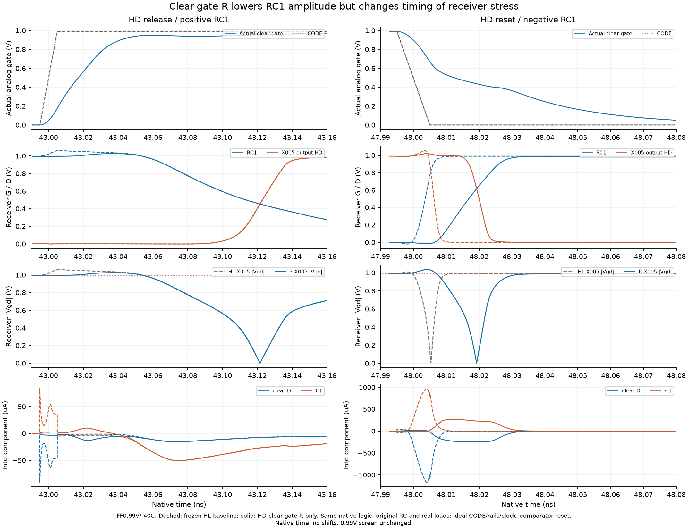
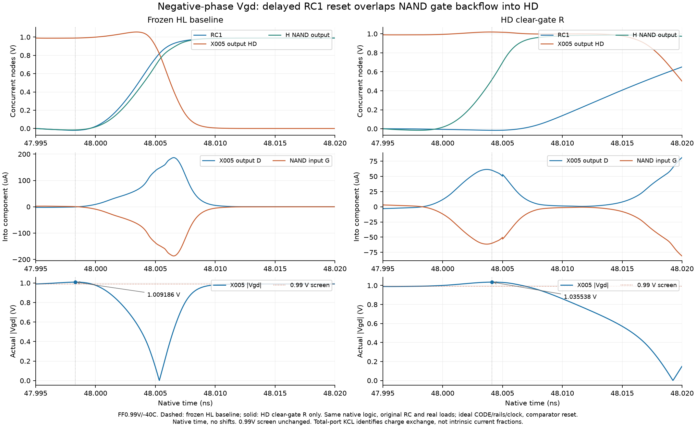

# HD clear栅串阻：幅度改善与时间代价

**正峰和下冲幅度均改善，但没有通过端压验证。** HD RC1正峰1.061723→1.026241 V，下冲−19.953→−16.508 mV；接收X005的全窗最坏|Vgd|仍1.035538 V。该最坏值已从正相位转到负相位。clear的超限幅度减小，但超限时间变长，不能只看峰值。

FF0.99V/−40°C，只有HD.MP_CLEAR栅串入同R0几何电阻；LD及其他原电路、普通原生逻辑、电源、采样窗口/关闭沿和外部刺激不变。CODE/电源/时钟理想、比较器复位，其他位静态；未含噪声/失配/PEX。

| 指标 | HL基线 | HD串阻 |
| --- | --- | --- |
| HD RC1正峰 V | 1.061723 | 1.026241 |
| HD RC1负峰 mV | -19.953 | -16.508 |
| HD X005正向Vgd峰值 V | 1.061623 | 1.026231 |
| HD X005负向Vgd峰值 V | -1.009186 | -1.035538 |
| HD X005绝对Vgd超0.99V累计 ps | 65.396 | 68.257 |
| HD clear最大绝对Vds V | 1.009953 | 1.006508 |
| HD clear绝对Vds超0.99V时长 ps | 4.497 | 11.274 |

## 为什么负相位的接收Vgd仍高

- HL负向Vgd最坏：47.998319ns，同刻G=RC1=-0.019784 V，D=HD=0.989402 V，Vgd=-1.009186 V。
- R负向Vgd最坏：48.004116ns，同刻G=RC1=-0.016367 V，D=HD=1.019171 V，Vgd=-1.035538 V。

串阻延后了clear开启/RC1复位。HD各自输出峰值时，基线RC1已回升到0.471209V，新版本RC1却仍为−0.016214V。新版本最坏Vgd时，RC1约−16.37mV、HD约1.01917V，同刻形成−1.035538V。虽然RC1负峰和HD输出正峰都比各自基线小，**二者的时间重合更不利**。因此正向接收峰从1.061623降到1.026231V，负向接收峰却从−1.009186恶化到−1.035538V。

HD输出并非理想VDD钳位：CODE下降使H NAND输出上升，其HD输入总G端向HD节点回送电荷。HD的完整入射集合只有接收反相器两个D端与NAND两个G端；预算闭合，方向显示反相器正在吸收下游回流。

| HD上冲前沿 | X005两D端电荷 fC | H NAND两G端电荷 fC | 最大KCL残差 pA |
| --- | --- | --- | --- |
| HL | 0.123016 | -0.123016 | 1.104 |
| R | 0.174058 | -0.174058 | 0.956 |

新版本最坏负Vgd时刻，NAND输入G总电流=-59.977µA，X005输出D总电流=59.977µA；电流正方向为流入器件。它定位到下游门端回流与有限输出钳位能力，不把总端口电流拆成纯本征Cgd或沟道份额。

## 电荷、复位与真实接口

| 事件 | clear D到峰值电荷fC：HL→串阻 | clear D越轨至首次回轨净电荷fC：HL→串阻 | C1 / R1 / 接收G到峰值电荷fC：HL→串阻 |
| --- | --- | --- | --- |
| HD_positive | -0.427214 → -0.267691 | -0.549139 → -0.377333 | 0.355063/0.033088/0.039063 → 0.179489/0.068329/0.019873 |
| HD_negative | 0.113984 → 0.104552 | 0.001830 → 0.005393 | -0.098982/-0.003335/-0.011668 → -0.081764/-0.004596/-0.018192 |
| LD_positive | -0.397012 → -0.397045 | -0.528111 → -0.529987 | 0.310494/0.052126/0.034392 → 0.310510/0.052141/0.034394 |
| LD_negative | 0.116749 → 0.116899 | 0.003101 → 0.006708 | -0.101139/-0.003687/-0.011924 → -0.101225/-0.003728/-0.011945 |

积分窗口按各自原生跨轨、峰值及首次回轨定义，未平移；区间时刻及KCL在JSON。到峰值前的正向送入电荷减少且R1分流增加，支持边沿缓和；不同长度的峰前积分不等于整个CODE相位总注入。回轨净值含流入/流出抵消。负向抽走电荷减少较小，不能推出持续时间缩短。

| 指标 | HL | 串阻 |
| --- | --- | --- |
| HD整腿进入1%复位 ps | 11.507 | 31.734 |
| LD整腿进入1%复位 ps | 18.985 | 19.022 |
| select_high N实际栅间隔 ps | 23.524 | 23.498 |
| select_high P实际栅间隔 ps | 89.978 | 89.951 |
| select_low N实际栅间隔 ps | 171.487 | 171.555 |
| select_low P实际栅间隔 ps | 98.949 | 99.017 |
| high BN0/BP0进入1mV ns | 43.567572 / 43.376517 | 43.565824 / 43.375974 |
| low BN0/BP0进入1mV ns | 48.441501 / 48.576463 | 48.441042 / 48.575181 |

两腿复位和四个物理参考建立判据均true，但HD复位明显变慢。半VDD间隔只是顺序诊断，1mV/1%是既有测量值。新CLEAR_G在0..VDD范围内，不能据此判全部器件端压通过。

## 全窗738项与下一必要变量

严格超限214→215；超出各自门限1mV的项数197→197。

- 新增 XDUT.XBBM0.XD_HD.MP_CLEAR:gd：峰值-0.990000431031V，42.995021286ns；门限0.99V，超限时长0.000000→0.025057ps。

新增clear gd属于亚微伏边界，必须保留严格计数，但不能与几十mV过轨等量解读。RC1/接收/clear的其他严格超限、原生CMI和既有NAND残余全部保留；本对照未采用为合格基线。

**建议仅考察一个后续变量：HD X005的原生库驱动档位。** 先核验库中存在的更强反相单元，保持本次串阻、其余电路和外部时序/负载不变，只换该标准单元master，检验其吸收NAND门端回流的能力。更强单元也会增加RC1输入负担，必须同时复核正负端压、建立/复位和实际栅顺序；并不保证0.99V无余量条件下通过。不继续只加大clear串阻，因为本轮已显示负相位重合与复位代价。这里只给建议，不假定具体库型号存在，不准备或启动新实验。

## 来源与限制

- sar8audit-ref-bbm-stdcell-hlswap-ff-v1：11298点、26389195B；result SHA256 b1e3c3e50d73e6e2aebd478e3426fe1a8686131054527a645ee9d71eba365a5c；managed d0020c7f2887144d28c373ad052a6f24e81d0d4af120993e2c1066b7c8f186f7。
- sar8audit-ref-rc1-hd-cleargater-ff-v1：11420点、27685183B；result SHA256 16e73f42c5d1651712690981021288dc10e97a10e4c4d9e5c07bbd7c76479d9e；managed f99c95e1c92a40c8abbe26f5456f77c03793e496538994c5ef75a17660a21e2b。

回执无跳过；文件/冻结输入/原生流SHA、大小、PASS/END、652/654路电流初始化核验。全738项真实端点/门限及full/rise/fall持续时间保留，445列新增测量与原441列无时间平移；刺激及模型/solver相同，仅新增必要save。数值见comparison.json，逐端压1476行见terminal_pairs.csv，状态变更见status_changes.json。

