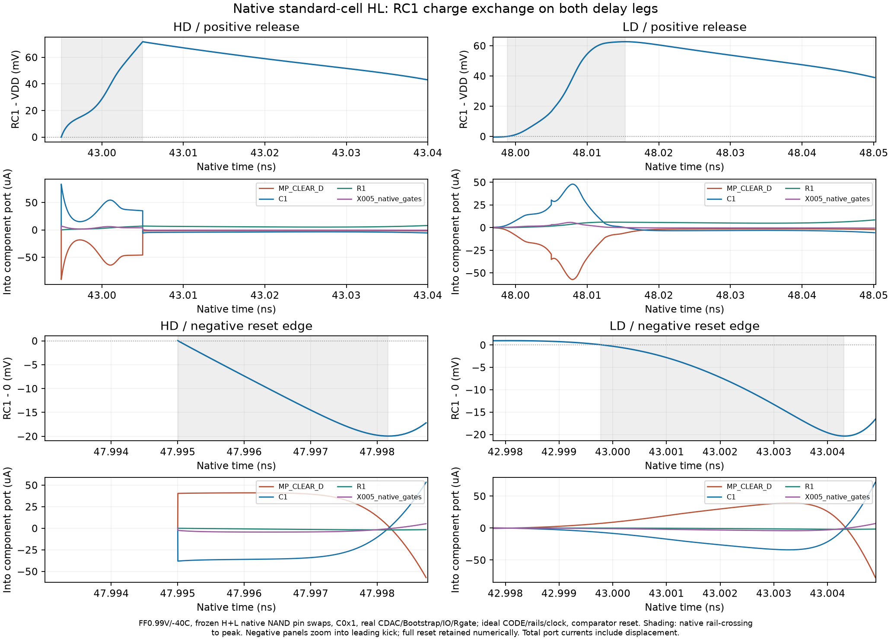

# 标准单元版RC1支路诊断

使用已回收HL-swap FF0.99V/−40°C的原生数据，无新仿真。接收器是原生 INVD1 的 MM1/MM0；下表不借用历史自建INV的电流。完整652路端电流已由原生分析确认初始化；RC1实际五端口归并为四组，逐节点核对完整入射集合。

| 事件 | RC1峰值V／时刻ns | 到峰值MP_CLEAR D电荷fC | C1 / R1 / 原生X005栅电荷fC | 最大KCL残差pA |
| --- | --- | --- | --- | --- |
| HD_positive | 1.061723 / 43.005000 | -0.427214 | 0.355063 / 0.033088 / 0.039063 | 0.066 |
| LD_negative | -0.020355 / 43.004302 | 0.116749 | -0.101139 / -0.003687 / -0.011924 | 1.082 |
| LD_positive | 1.052682 / 48.015312 | -0.397012 | 0.310494 / 0.052126 / 0.034392 | 2.516 |
| HD_negative | -0.019953 / 47.998160 | 0.113984 | -0.098982 / -0.003335 / -0.011668 | 1.030 |

电流/电荷正方向均为流入器件端口。正峰时MP_CLEAR D为负，表示它向RC1送电荷，由C1、R1与接收栅吸收；负峰时MP_CLEAR D为正，从RC1抽走电荷，其他支路给出反向平衡。这证明主交换支路是MP_CLEAR的实际总D端口，不把它进一步武断分成纯Cgd、沟道或二极管电流。阴影/积分起点是同一原生轨线最后一次跨过VDD/0到峰值，完整回轨积分另存JSON。

| 事件 | 同刻MP_CLEAR D/G/S/B V | 同刻Vds/Vgd V | 接收NMOS Vgs/Vgd V |
| --- | --- | --- | --- |
| HD_positive | 1.061723/0.990000/0.990000/0.990000 | 0.071723/-0.071723 | 1.061723/1.060803 |
| LD_negative | -0.020355/0.669763/0.990000/0.990000 | -1.010355/0.690119 | -0.020355/-1.009126 |
| LD_positive | 1.052682/0.922768/0.990000/0.990000 | 0.062682/-0.129914 | 1.052682/1.052708 |
| HD_negative | -0.019953/0.677128/0.990000/0.990000 | -1.009953/0.697080 | -0.019953/-1.009024 |

同刻端压不混用不同时间极值；全窗最坏端压仍以已回收的738项及其持续时间为准。MP_CLEAR源/体为VDD，RC1被拉负会使其绝对Vds/Vbd超过0.99V；RC1正峰直接加到核心接收栅。

## 选择一个最小变量

**仅在HD腿MP_CLEAR栅极串入一只与现有R0完全相同的PDK rupolym电阻，LD腿保留作未改对照。** 不改clear尺寸/直流强度，不改普通标准逻辑或原RC0/RC1电容。新增电阻与新增门节点的保存/入射电流会显式纳入测量。

理由是两种极性都由clear漏端电荷交换主导，且与其栅边沿一致。现有R1实测约9.7907kΩ（R0同几何）；HD门端在所声明的上升窗口交换约1.9677fC，除以0.99V得到约1.9876fF的本次事件等效负担，R×Qg/ΔV约19.46ps。该量只是选首个边沿缓和实验的估计，不是固定本征电容。使用已原生通过的同几何电阻避免臆造PDK尺寸或理想边沿源。

预期检验：较缓clear栅边沿能否让R1/接收通路在注入期间分流，从而降低正峰和负峰。风险同样明确：MP_CLEAR关断/开启会延后，可能与R1驱动竞争、拖慢assert及复位，或在新门节点产生过轨。必须同时比较两极性、clear/接收全端压、RC复位/延迟、实际门极间隔和参考建立。既有H/L约2.3mV残余和其他核心过轨不据此宣称修复。

完整事件积分、四端电流/端压、回轨状态及来源哈希见events.json。仅准备一个HD门串阻候选，由父任务核对后managed提交；本轮未运行。

