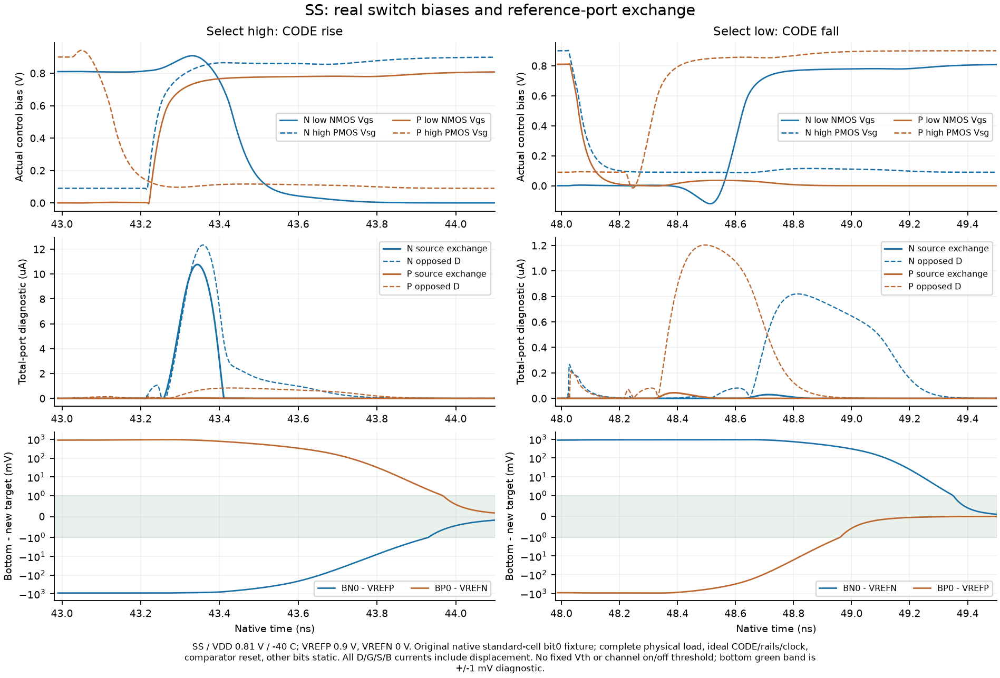

# SS：真实参考开关的非交叠证据

**高选择时，N侧存在实测双参考端口回流，不能判为安全非交叠；其余方向的反向漏端电流峰值，也不能直接当作同时导通。** 本次补齐了实际源极参考的控制电压和四端电流，未使用固定Vth。严格的沟道重叠/死区时长仍未知。

来源：`sar8audit-ref-bbm-stdcell-sscold-v1`，原生标准参考初版 `standard_cell_bbm_v1`；SS、VDD=0.81V、−40°C，VREFP=0.9V、VREFN=0V。10956个原生点，0–52ns。四只活动bit0开关使用真实驱动和完整CDAC/Bootstrap负载；其他28只参考开关保持静态，比较器复位；CODE/电源/时钟理想，无噪声/失配/PEX，不是完整ADC或后续候选的SS结果。

已有[原生标准单元对照](../standard_cell_bbm_v1/comparison/report.md)记录了H/L半轨间隔、高选择N侧−209.799ps的栅半轨次序、参考建立和总D电流。本次只补这些读数尚不能回答的“实际开关端口发生了什么”。

## 按真实连接计算，不用栅压本身代替控制电压

图中N/P表示差分的BN0/BP0两侧；每侧各有一只低参考NMOS、一只高参考PMOS。

| 实际实例 | G / S / B | 本次控制电压 |
| --- | --- | --- |
| XCDAC.XSN0.MN_LOW | GNN0 / VREFN / 0 | Vgs=GNN0−实际VREFN |
| XCDAC.XSN0.MP_HIGH | GNP0 / VREFP / VDD | Vsg=实际VREFP−GNP0 |
| XCDAC.XSP0.MN_LOW | GPN0 / VREFN / 0 | Vgs=GPN0−实际VREFN |
| XCDAC.XSP0.MP_HIGH | GPP0 / VREFP / VDD | Vsg=实际VREFP−GPP0 |

模型分别为 `nch_18_mac/pch_18_mac`，漏极接各自底板。由于VREFP=0.9V而VDD=0.81V，PMOS栅拉到VDD时，其Vsg仍约0.09V；不能把这个状态写成Vsg=0，也不能忽略实际Vds/Vbs。结构化证据同时保留Vgd、Vds、Vbs，以免底板越轨时误用固定源漏方向或固定阈值。

第一行是四只开关的实际Vgs/Vsg；第二行实线为两参考**声明源端**的同时交换指标，虚线为旧的相反方向D端电流指标；第三行是底板相对本轮实际参考的残差，采用对称对数轴，绿色为±1mV诊断带。图无时间平移。

## 关键补充：漏端电流与参考源端电流并不等价

下表在原报告的两个D电流峰值**同一原生时刻**取数。电流正方向为流入器件；“流出低参考源端”为−I(S)，栅/体流出为−I(G)−I(B)。这些都是总端口电流，不是沟道电流分量。

| 时刻／位置 | 低开关Vgs / 高开关Vsg | 低开关D流入 | 流出低参考S | 流出低开关G＋B | CDAC电容底板端电流 |
| --- | ---: | ---: | ---: | ---: | ---: |
| 43.358315ns，N侧选高 | 0.882535 / 0.847107V | 12.333µA | **10.300µA** | 2.033µA | 2.380µA |
| 48.495550ns，P侧选低 | 0.034142 / 0.845367V | 1.203µA | **0.00918µA** | 1.194µA | 11.629µA |

**N侧：风险有实际端口证据。** 同刻高参考PMOS从VREFP源端吸入15.349µA、向底板送出14.713µA；低参考NMOS从底板吸入12.333µA，其中10.300µA从其VREFN源端流出。底板电容承担其余2.380µA，三支路KCL闭合。它不是仅由“栅半轨顺序为负”推出来的风险，也不能解释成所有高参考电流都只在给CDAC充电。

该方向声明源端交换指标峰值为 **10.764µA@43.344090ns**；此时低/高开关控制电压为0.902065/0.835816V。指标定义为 `min(max(I_SP,0), max(−I_SN,0))`，整个高命令窗积分约0.998fC。它量化实测端口交换，不将其中任一比例命名为纯沟道直通。

这与已有慢GNN关断路径一致：实际半轨传播的L→GNN约419.367ps，H→GNP约36.571ps，路径差约382.796ps，超过H/L间隔172.997ps。**这些仍是传播次序诊断，不是MOS精确开关时刻或新的冻结互斥指标。**

**P侧：1.203µA不能直接写成低参考通路仍导通。** 在对应峰值，低NMOS总D电流中约1.194µA从G/B端流出，声明源端仅流出约9.18nA；高参考PMOS从源端吸入13.995µA，底板电容端约11.629µA。端口分配显示多数D电流并未流入低参考源。这支持保留动态电荷交换解释，而不能单凭D电流就判低开关已导通或精确关断。

| 声明参考源端交换指标峰值 | N侧 | P侧 |
| --- | ---: | ---: |
| 选高命令窗 | 10.764µA | 0.0254µA |
| 选低命令窗 | 0.0297µA | 0.0442µA |

后面三个小读数不等于零电流或已证明安全死区。两底板全程最大KCL残差均约1.905pA；所有峰值同刻D/G/S/B和电容支路明细见[evidence.json](evidence.json)。

## 已证实的建立，与仍缺少的导通证据

沿用独立命令窗的既有结果：选高BN0/BP0在43.934221/43.969422ns后持续进入±1mV；选低为49.352182/48.962197ns。高态截止47.995ns、低态评价到52ns。**最终能建立不消除前面的切换回流；本点端压0/738超限也不能证明非交叠合格。**

四只开关的D/G/S/B外部电压和电流均已保存，**没有缺失某个栅端或源端**。缺的是能把总端口电流与器件电荷位移分开的内部沟道导电量，以及实际SS偏置下的动态工作状态。因此本次不报伪精确的“同时导通持续多少ps”或“死区多少ps”，也不把0.405V或某个猜测Vth当边界。

最小后续测量建议只针对上述四只macro：先核实PDK宏内实际primitive及Spectre支持的字段，再增加各自的**内部沟道导电电流**，必要时配套动态工作区/小信号状态；沿用本次已存的四端偏置和两个交接相位，不扩展矩阵、不自行设电流门限。如果宏不提供可分离的量，再用对应峰值实际Vgs/Vds/Vbs做有界DC对照；不能凭空猜内部实例或把总D电流重命名为沟道电流。本轮未准备或启动此测量。

**当前可推进的判断：高选择N侧的慢关断接口仍是明确风险点，需要在真实开关端继续解决；P侧等其余方向暂不能仅靠D电流判失败，也尚不足以作安全非交叠签核。** 不追加候选或试参。

来源身份：managed `24f9e00fd4bd98704a43a6e3f5f367e7ea44810209313d366a8bae9417b9b770`；result SHA256 `c61c9a71f01e9485c455ec26e0424cfbd2847fae9e10d2d1618cdebb9be8615e`。11文件22126021B零跳过，9个冻结输入及完整原生流SHA/PASS/END/652路电流初始化均核对。告警SFE-1131/VACOMP-2435保留。全部10956原生时刻只读复用；[四开关×两命令窗摘要](actual_switch_bias_summary.csv)。未改电路、PDK、OA、原始结果或共享计划，未远端运行、提交或push。
